# TikTok Shrine Live 🙏 — ไหว้พระขอเลข / เสี่ยงเซียมซี บนไลฟ์ TikTok

โปรแกรมเอฟเฟกต์ (เขียนด้วย **Rust**) สำหรับวางทับ **ครึ่งบนของจอไลฟ์แนวตั้ง** — ผู้ชมส่งของขวัญ แล้วตัวละครชื่อผู้ชมจะเดินไปไหว้พระ ขึ้น **เลขมงคล** (2 ตัว/3 ตัว) หรือ **เขย่าเซียมซี** ไม้ตกแล้วขึ้น **ใบที่ + คำทำนาย** ยิ่งของขวัญแพง (เพชร × จำนวน) ตัวละครยิ่งหรู พลุยิ่งใหญ่ — 5 ระดับ

เลือกโหมดได้ในหน้าตั้งค่า: **ไหว้พระ / เสี่ยงเซียมซี**, **ลอยกระทง**, หรือ **ให้อาหารแมว** (แมวน่ารักเดินเข้าคิว กินตามยอดของขวัญ แล้วขึ้นการ์ดขอบคุณมีชื่อคนส่ง — ไม่มีเลขมงคล ชื่อคนส่งลอยบนหัวทุกตัว)

📖 **คู่มือติดตั้ง-ใช้งานแบบละเอียดทีละขั้น: [docs/คู่มือ.md](docs/คู่มือ.md)**

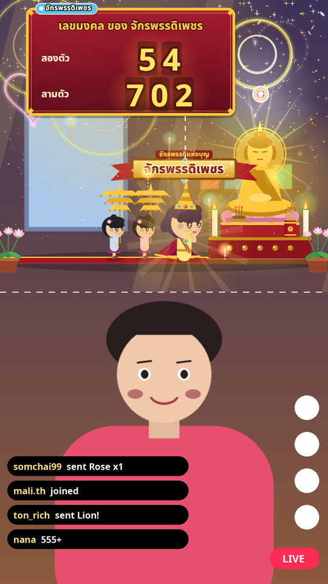  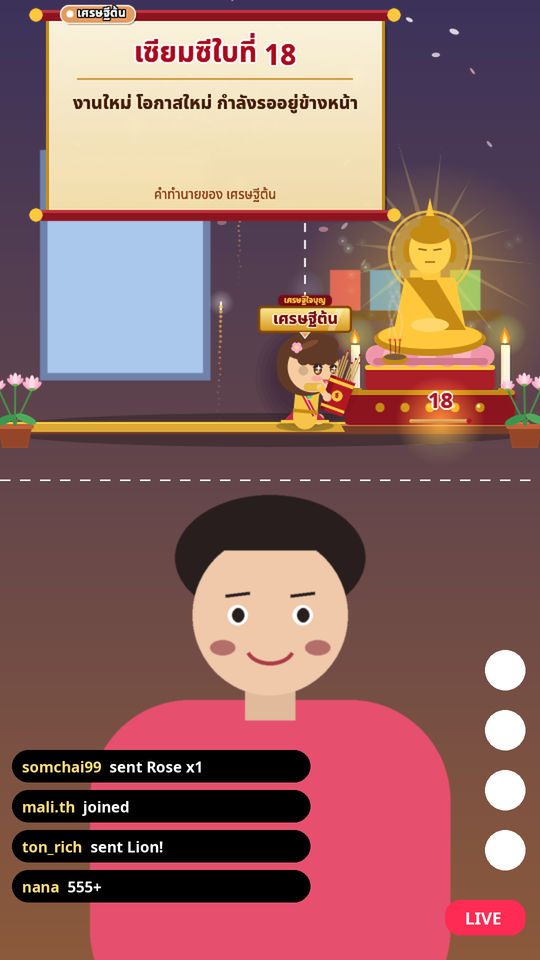 

**ตัวอย่างแบบเคลื่อนไหว:** [ไหว้พระ ระดับ 5](previews/pray_t5.gif) · [เซียมซี ระดับ 5](previews/siamsi_t5.gif) · [ลอยกระทง ระดับ 5](previews/krathong_t5.gif) · [หลายคนต่อแถว](previews/multi_queue_4senders.gif) · [หลายคนต่อแถว บนไลฟ์](previews/live_multi_3senders.gif) (มี .mp4 ด้วยในโฟลเดอร์ [`previews/`](previews/))

## มีอะไรใหม่ใน v0.2.1
- **โหมดให้อาหารแมว** 🐱 — แมวของผู้ส่งเดินมาที่ชาม กินตามยอดของขวัญ แล้วขึ้น **การ์ดขอบคุณ** มีชื่อคนส่ง (ไม่มีเลขมงคล) · หลายคนส่งพร้อมกันแมวนั่งต่อแถว · `F2` สลับ 3 โหมด
- **อัปเดตปลอดภัยขึ้น**: หลังสลับไฟล์ โปรแกรมจะทดลองเปิดไฟล์ใหม่ (`--selftest`) ก่อน ถ้าเปิดไม่ได้จะ **ย้อนกลับเป็นเวอร์ชันเดิมเองและทำงานต่อ**
- **ตั้งค่า "พื้นหลัง" ใช้ได้ทั้ง 3 โหมด** (แท็บหน้าจอ / `F9`): **ฉากเต็ม** (วัด / แม่น้ำยามค่ำ / มุมแมว) หรือ **โปร่งใส** — เห็นกล้องของสตรีมเมอร์ เหลือแค่ตัวละคร ป้ายชื่อ การ์ด พลุ + ของประกอบเล็ก ๆ (ศาล / เส้นน้ำ+ท่าน้ำ / ชามข้าวแมว ปิดได้) ตัวละครมีเงานุ่ม ๆ ด้านหลังให้อ่านออกบนกล้องทุกแบบ · ตอนว่างในโหมดโปร่งใส = ไม่มีอะไรทับกล้องเลย (เหลือแค่ข้อความแนะนำเล็ก ๆ)
- ป้ายชื่อไม่ถูกการ์ดผลบัง (ป้ายชื่ออยู่ชั้นบนสุด, การ์ดลอยกระทงชิดขวา) · ป้ายชื่อไม่ล้นขอบจอ · ป้ายที่ซ้อนกันจะขยับหลบให้เอง
- ไฟล์ Linux build บน Ubuntu 22.04 (ใช้ได้กับ Linux รุ่นเก่ากว่า) · เพิ่ม `--version`


| ฉากเต็ม vs โปร่งใส — ไหว้พระ | ลอยกระทง | แมว | ตอนว่าง |
|---|---|---|---|
|  | 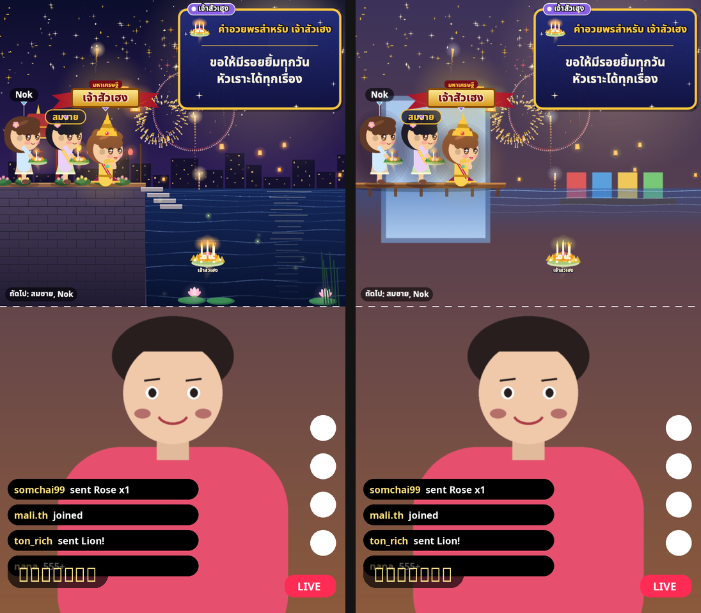 | 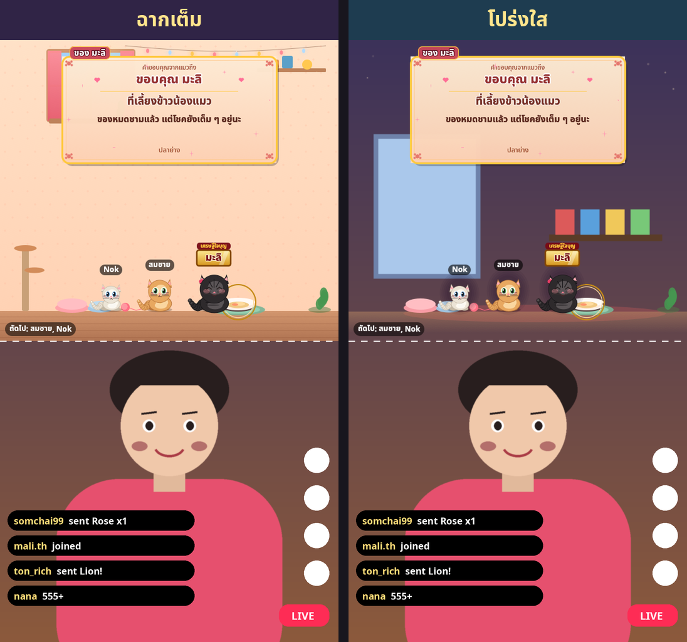 | 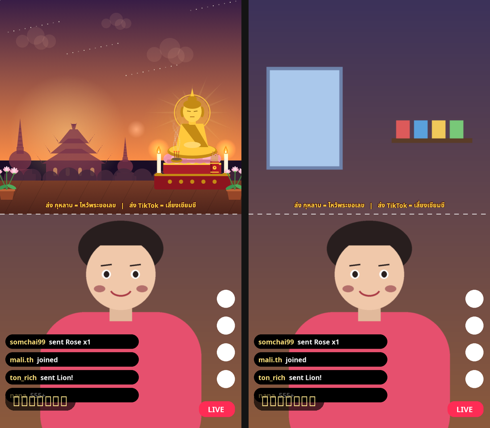 |

## มีอะไรใหม่ใน v0.2
- **ตัวละครน่ารักแบบ chibi** หน้าตา/ทรงผม/สีเสื้อต่างกันตามชื่อผู้ชม · เดินแบบมีจังหวะ กระพริบตา หายใจ ผ้าคลุมพลิ้ว · ไหว้แบบ 3 จังหวะ (ยกมือ → ก้มกราบ → เงย)
- **ต่อแถวให้เห็น**: ส่งของขวัญพร้อมกันหลายคน → ตัวละครเดินออกมายืน **ต่อแถวทีละคน** (เห็นพร้อมกันสูงสุด `max_visible` = 5 คน ที่เหลือรอนอกจอ) **ทุกคนมีป้ายชื่อเหนือหัว** คนหน้าสุดทำพิธี → เดินออก → แถวขยับ
- **การ์ดผลบอกชัดว่าเป็นของใคร**: ป้ายชื่อสีเดียวกับเจ้าของ + เส้นประชี้ลงไปที่ตัวละคร · ชื่อที่มีอีโมจิถูกตัดอีโมจิออก (ไม่ขึ้นเป็นกล่องสี่เหลี่ยม)
- เลขมงคลหมุนแบบ **สล็อตแมชชีน** · เซียมซีเขย่า ไม้กระเด็นตกพื้นจริง กล้องซูม · คำทำนายเป็น **ม้วนกระดาษคลี่ออก** · พลุหลายรูปทรง (วงกลม หัวใจ ดาว วงแหวน) + จอสั่นระดับสูง
- **โหมดลอยกระทง** 🌕 (เลือกในหน้าตั้งค่า / กด `F2` สลับระหว่างไลฟ์) — ไหว้ขอเลขริมน้ำ หรือ อธิษฐานรับคำอวยพร กระทงลอยค้างในแม่น้ำพร้อมชื่อ
- **ตอนไม่มีของขวัญ**: `idle = "still"` ภาพนิ่งไม่มีตัวละคร (ค่าเริ่มต้น) · `"ambient"` ขยับเบาๆ · `"hidden"` โปร่งใสทั้งหมด
- **ปุ่มอัปเดตในโปรแกรม** (แท็บ "อัปเดต"): ตรวจ GitHub Releases ตอนเปิด/กดปุ่ม → แถบแจ้ง + ปุ่ม **อัปเดตเลย** (ดาวน์โหลด สลับไฟล์ แล้วเปิดใหม่เอง) และปุ่มแยก **อัปเดตตัวเชื่อม TikTok** (อัปเดตเฉพาะ `bridge.cjs`)
- License เปลี่ยนเป็น **AGPL-3.0** (ใช้ `tiktok-live-connector`)

| ก่อน (v0.1) / หลัง (v0.2) |
|---|
| 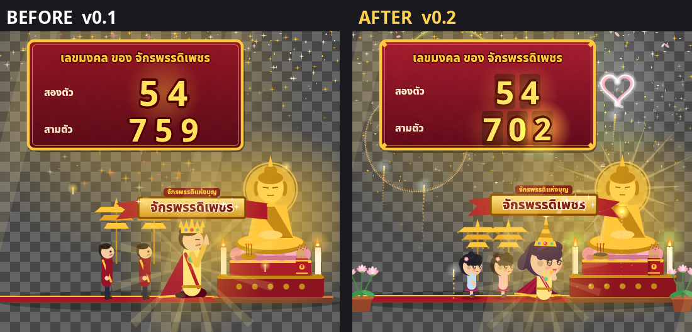 |
| 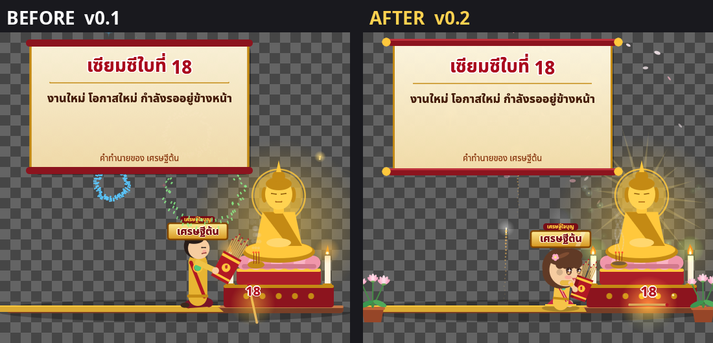 |

## ความสามารถ
- หน้าต่าง **โปร่งใสจริง (per-pixel alpha) ไม่มีขอบ ลอยบนสุด** ลากย้ายได้ เปิด **คลิกทะลุ** ได้ + โหมด **จอเขียว** สำหรับ Chroma Key + โหมด **ฉากเต็ม** (วัด / แม่น้ำ / มุมแมว)
- เลย์เอาต์ **ส่วนบนของจอ** (ปรับ % ความสูงได้) หรือ **เต็มจอ 9:16**
- **หน้าตั้งค่าภาษาไทย** เป็นหน้าต่างแยก (ไม่ติดเข้าไลฟ์) — ชื่อ TikTok + ปุ่มเชื่อมต่อ, ปุ่ม **เริ่ม/หยุด** ใหญ่, ของขวัญ→การกระทำ, เพชรขั้นต่ำแต่ละระดับ, รูปแบบเลข, คำทำนาย, ความเร็ว, ปุ่มทดสอบ → บันทึกลง `config.toml`
- **คิวที่มองเห็นได้**: ส่งพร้อมกันหลายคน ตัวละครยืนต่อแถว เล่นทีละคนตามลำดับ (ตั้งจำนวนบนจอได้ `window.max_visible`)
- ของขวัญแบบคอมโบ (streak) นับตอนจบคอมโบครั้งเดียว ไม่นับซ้ำ
- ฟอนต์ไทย **Noto Sans Thai** + ตัวเชื่อม TikTok **ฝังอยู่ในไฟล์โปรแกรม** — Windows ใช้แค่ไฟล์ .exe ไฟล์เดียว (config สร้างให้อัตโนมัติ)
- ภาพทั้งหมดวาดด้วยโค้ด ใส่ PNG ของตัวเองแทนได้ที่ `assets/sprites/` (`buddha.png`, `character.png`, `background.png`)
- รับเหตุการณ์ได้ 3 ทาง: **TikTok โดยตรง** (Node bridge), **HTTP/Webhook** (TikFinity, Streamer.bot, curl), **คีย์บอร์ด** ทดสอบ

## ดาวน์โหลด / ติดตั้ง (สรุป)
| ระบบ | วิธี |
|---|---|
| **Windows** | แตก `TikTokShrineLive-Windows-x64.zip` → ดับเบิลคลิก `TikTokShrineLive.exe` (ถ้า SmartScreen เตือน: More info → Run anyway) |
| **macOS** | เปิด `.dmg` → ลากเข้า Applications → **ครั้งแรกให้คลิกขวา → Open → Open** (หรือ System Settings → Privacy & Security → Open Anyway) |
| ทั้งสองระบบ | ติดตั้ง **Node.js LTS** (https://nodejs.org) สำหรับเชื่อม TikTok โดยตรง |

รายละเอียด, การใส่ใน **TikTok LIVE Studio / OBS**, เช็กลิสต์ก่อนไลฟ์, แก้ปัญหา → [docs/คู่มือ.md](docs/คู่มือ.md)

## ปุ่มลัด (คลิกหน้าต่างเอฟเฟกต์ก่อน)
| ปุ่ม | ผล |
|---|---|
| `1` / `2` | ไหว้พระขอเลข / เซียมซี (ระดับที่เลือก) |
| `Shift+1..5` | เลือกระดับทดสอบ |
| `Q W E R T` / `A S D F G` | ไหว้พระ / เซียมซี ระดับ 1–5 |
| `F1`, คลิกขวา, ดับเบิลคลิก | เปิด/ปิดหน้าตั้งค่า |
| `F2` | สลับโหมด ไหว้พระ → ลอยกระทง → ให้อาหารแมว |
| `F8` / `F9` | คลิกทะลุ / สลับพื้นหลัง |
| `Delete` | ล้างคิว |
| `Ctrl+Q` (Mac `Cmd+Q`) | ปิดโปรแกรม |
| ลากเมาส์ซ้าย | ย้ายหน้าต่าง |

## ระดับความหรูหรา (ตั้งเพชรขั้นต่ำได้)
| ระดับ | เพชร (ค่าเริ่มต้น) | ไหว้พระ+เลข | เซียมซี |
|---|---|---|---|
| 1 สายบุญ | 0+ | 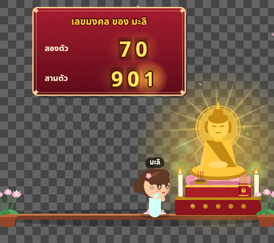 |  |
| 2 ผู้มีบุญ | 10+ | 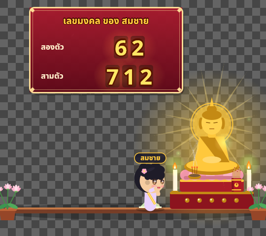 |  |
| 3 เศรษฐีใจบุญ | 100+ | 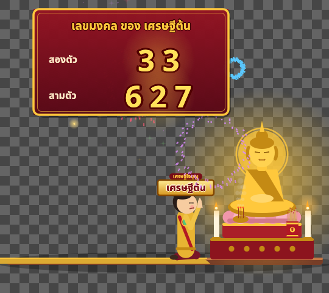 |  |
| 4 มหาเศรษฐี | 1,000+ |  | 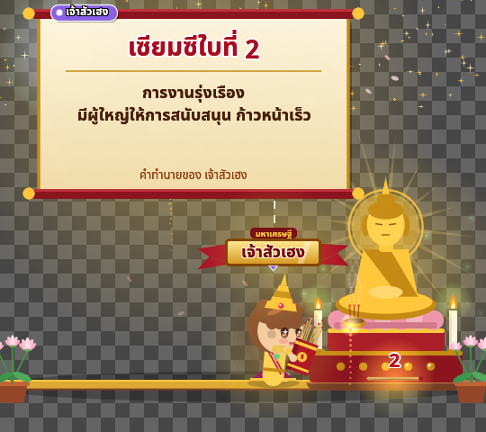 |
| 5 จักรพรรดิแห่งบุญ | 10,000+ |  |  |

(ลายตารางหมากรุก = ส่วนที่โปร่งใส)

### ลำดับภาพ (ระดับ 5)
| เดินเข้า | ไหว้ | ขึ้นเลข | พลุ |
|---|---|---|---|
| 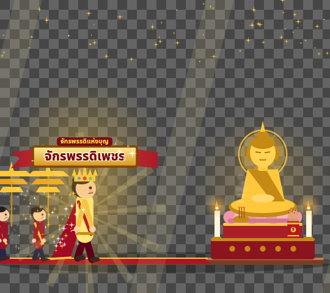 | 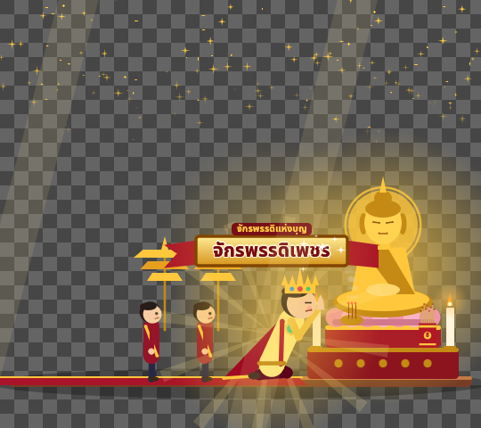 | 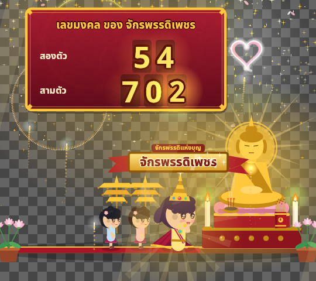 |  |

| เขย่าเซียมซี | ไม้ตก | คำทำนาย |
|---|---|---|
| 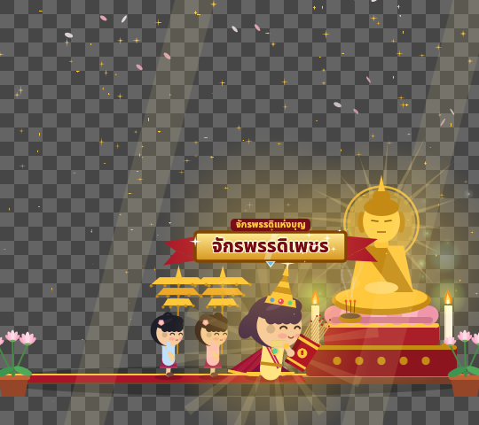 |  |  |

| หลายคนต่อแถว — คนหน้าสุดไหว้ | การ์ดเลขของคนหน้าสุด (ชี้ไปที่เจ้าของ) |
|---|---|
|  |  |

### โหมดลอยกระทง
| เดินถือกระทง | อธิษฐาน | ลอยกระทง | ขึ้นเลข | คำอวยพร |
|---|---|---|---|---|
| 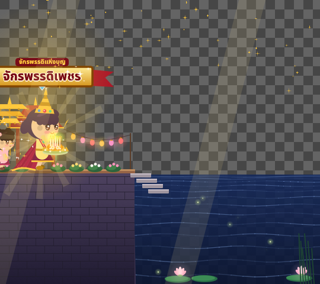 |  |  | 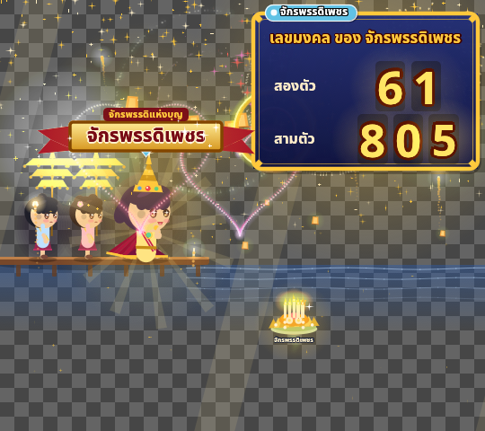 |  |

### ตอนไม่มีของขวัญ (idle)
| ไหว้พระ (ภาพนิ่ง) | ลอยกระทง (ภาพนิ่ง) | บนไลฟ์ (พื้นหลังโปร่งใส = ไม่ทับกล้อง) |
|---|---|---|
|  |  | 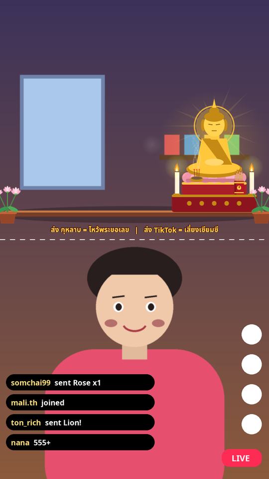 |

ทุกระดับ ทุกเฟรม อยู่ในโฟลเดอร์ [`screenshots/`](screenshots/)

### โหมดให้อาหารแมว
เลือกได้ในแท็บเริ่ม/หยุด ของหน้าตั้งค่า คิวหลายคนเดินต่อกันเป็นแถว แต่ละตัวมีชื่อคนส่งบนหัว ยิ่งยอดสูงแมวและอาหารยิ่งน่ารัก (ลูกแมว+อาหารเม็ด ถึงแมวหลวงมีมงกุฎ+สำรับปลา)

| ภาพนิ่งตอนว่าง | คิว 3 คน | กินระดับ 5 | การ์ดขอบคุณของคนส่ง |
|---|---|---|---|
| 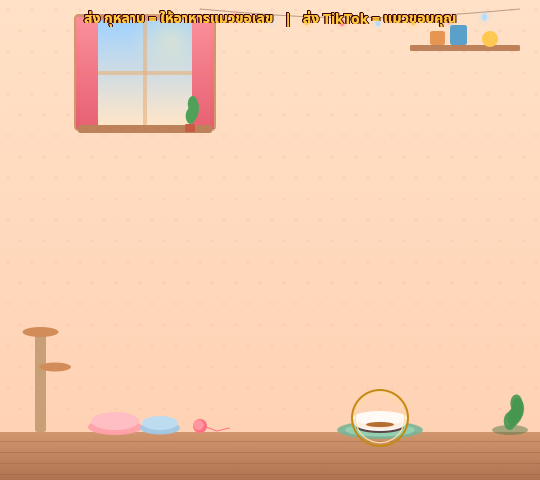 |  |  |  |

พรีวิวแอนิเมชัน: [`previews/cat_t1.gif`](previews/cat_t1.gif) · [`previews/cat_t5.gif`](previews/cat_t5.gif) · [`previews/cat_queue.gif`](previews/cat_queue.gif)


### โหมดพื้นหลัง / เลย์เอาต์
| โปร่งใส | จอเขียว | หลัง Chroma Key | ฉากวัด | เต็มจอ 9:16 |
|---|---|---|---|---|
| 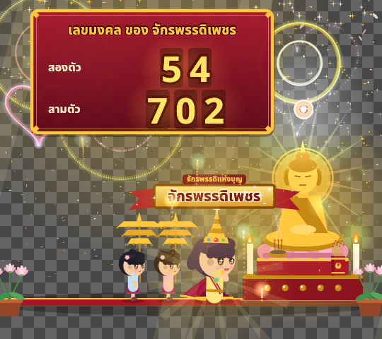 |  |  |  | 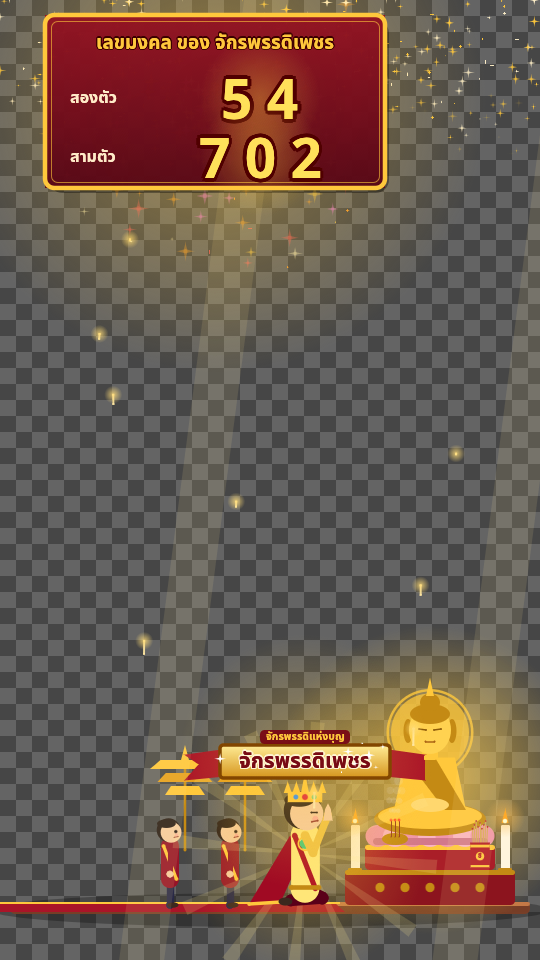 |

### หน้าตั้งค่า
| เริ่ม/หยุด | หยุดอยู่ | TikTok | หน้าจอ |
|---|---|---|---|
|  | 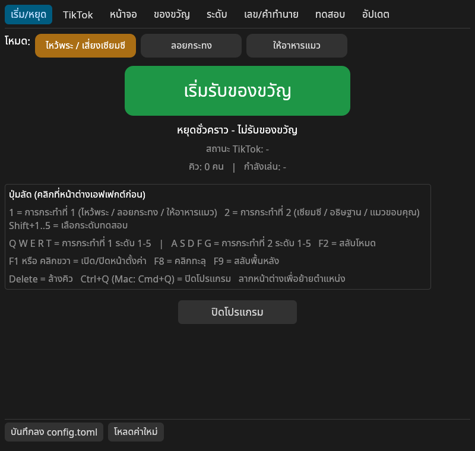 |  | 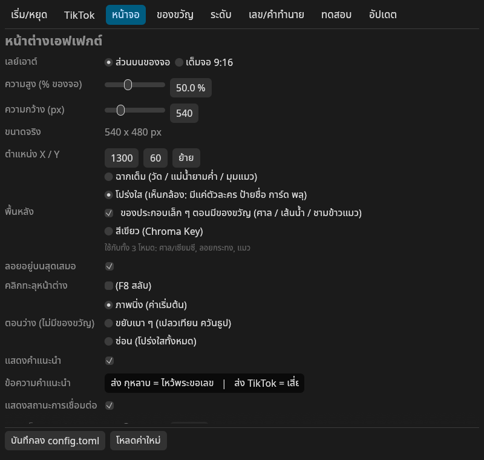 |

| ของขวัญ | ระดับ | เลข/เซียมซี | ทดสอบ |
|---|---|---|---|
|  |  | 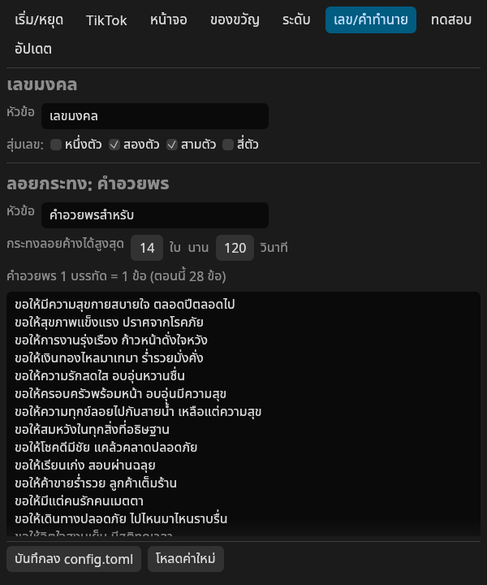 | 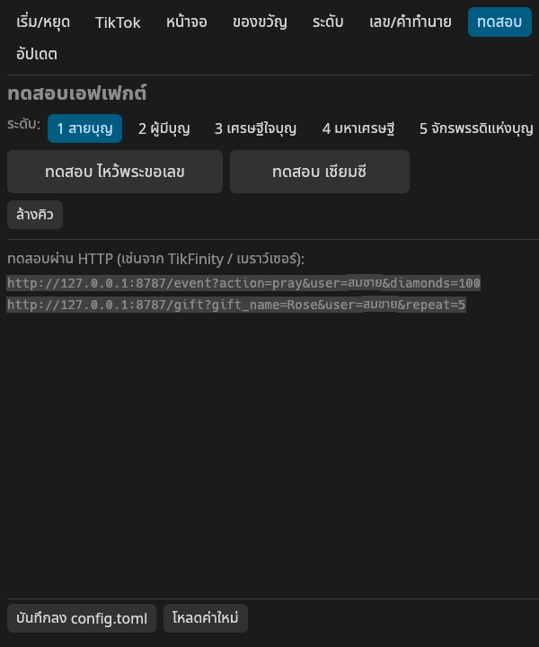 |

| อัปเดต | เริ่ม/หยุด (โหมดลอยกระทง) |
|---|---|
|  | 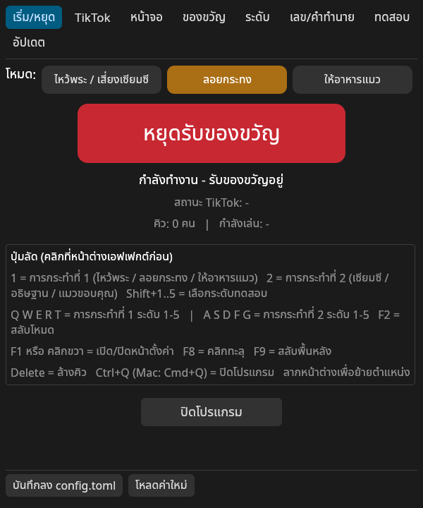 |

---

## การเชื่อมต่อ TikTok — เลือกวิธีไหน และทำไม
TikTok **ไม่มี API ทางการ** สำหรับอ่านของขวัญในไลฟ์ ทางเลือกที่มี:

| วิธี | สถานะ (พ.ย. 2026) | ใช้ในโปรเจกต์นี้ |
|---|---|---|
| Rust crate `tiktoklive` (TikTokLiveRust) | อัปเดตล่าสุด ส.ค. 2024 — ค้างนาน เสี่ยงพังกับ TikTok ปัจจุบัน | ❌ |
| Node `tiktok-live-connector` (zerodytrash) | ดูแลต่อเนื่อง v2.5.0 (ก.ย. 2026), ใช้ sign server ของ EulerStream | ✅ **หลัก** (bridge ฝังในโปรแกรม) |
| TikFinity / Streamer.bot → Webhook | แอปสำเร็จรูป ไม่ต้องลง Node | ✅ **สำรอง** ผ่าน HTTP |

โปรแกรม Rust จะรัน `node bridge.cjs <username>` (สคริปต์ bundle รวม dependency แล้ว ฝังใน exe แตกไฟล์ออกมาเองข้าง config) อ่าน JSON ทีละบรรทัดจาก stdout และ **ต่อใหม่อัตโนมัติ** เมื่อหลุด ทุกแหล่งทำงานผ่าน trait `EventSource` เปลี่ยน/เพิ่มตัวเชื่อมได้โดยไม่แตะส่วนภาพ

⚠️ **ความเสี่ยง**: ตัวเชื่อมแบบไม่เป็นทางการอาจหยุดทำงานเมื่อ TikTok เปลี่ยนระบบ — ถ้าพัง ให้อัปเดต `tiktok-live-connector` แล้ว build bridge ใหม่ หรือใช้ TikFinity ชั่วคราว

### HTTP API (`127.0.0.1:8787`)
| Endpoint | ตัวอย่าง |
|---|---|
| `GET/POST /event` | `/event?action=pray&user=สมชาย&diamonds=100` · `action=siamsi` |
| `GET/POST /gift` | `/gift?gift_name=Rose&gift_id=5655&user=สมชาย&diamonds=1&repeat=5` (จับคู่ตามตารางของขวัญ) |
| `POST` JSON | `{"gift_name":"Rose","user":"สมชาย","diamonds":1,"repeat":5}` · รองรับชื่อฟิลด์แบบ `nickname`, `giftName`, `diamondCount`, `repeatCount` |
| `GET /control` | `?click_through=toggle\|1\|0` · `?background=green\|transparent\|scene` · `?clear=1` · `?mode=shrine\|krathong` · `?idle=still\|ambient\|hidden` · `?layout=top\|full` · `?running=0\|1` · `?save=1` · `?reload=1` · `?update=check\|apply\|bridge` |
| `GET /state` | สถานะ JSON (คิว, แถว, คนที่กำลังเล่น, โหมด) — ใช้ในชุดทดสอบ |
| `GET /health` | `ok` |

## สำหรับนักพัฒนา
```
src/main.rs     เปิดหน้าต่าง (eframe/egui + glow, transparent, always-on-top), ฟอนต์, หา config
src/app.rs      คิว, ไทม์ไลน์แอนิเมชัน, พลุ/particles, หน้าตั้งค่า (viewport แยก), ปุ่มลัด
src/scene.rs    ภาพวาดทั้งหมด (องค์พระ, ตัวละคร 5 ระดับ, เซียมซี, ป้ายชื่อ, การ์ด) + sprite override
src/events.rs   trait EventSource, HttpSource, TikTokBridgeSource (Node bridge), แปลง JSON
src/config.rs   config.toml (serde) + ค่าเริ่มต้นฝังในโปรแกรม
src/krathong.rs ฉากลอยกระทง (แม่น้ำ, ศาลา, กระทง)
src/updater.rs  อัปเดตตัวเอง (GitHub Releases) + อัปเดตตัวเชื่อม TikTok
scripts/e2e_test.py  ชุดทดสอบ end-to-end (คีย์, HTTP, ระดับ, คิว, แถวหลายคน, โหมด, save/reload) → tests/e2e_results.md
bridge/         bridge.js (tiktok-live-connector) → bundle เป็น dist/bridge.cjs ด้วย esbuild
```
**ทำไม eframe/egui** (แทน macroquad): ต้องการหน้าต่างโปร่งใส per-pixel + always-on-top + click-through + หลายหน้าต่าง (ตั้งค่าแยก) บน Windows/macOS ซึ่ง eframe รองรับครบผ่าน winit/glutin และ text shaping (harfrust) ทำให้สระ/วรรณยุกต์ไทยวางถูกตำแหน่ง

```bash
cargo build --release                       # Linux/Windows/macOS
# Windows .exe จาก Linux (ไม่มี icon ในไฟล์ exe แต่หน้าต่างมี icon):
pip install ziglang && cargo install cargo-zigbuild
rustup target add x86_64-pc-windows-gnu
cargo zigbuild --release --target x86_64-pc-windows-gnu
packaging/make_windows_zip.sh
# macOS .app + .dmg (universal) — รันบน Mac:
packaging/macos/make_app.sh
# build bridge ใหม่ (หลังอัปเดต tiktok-live-connector):
cd bridge && npm install && npx esbuild bridge.js --bundle --platform=node --target=node18 --format=cjs --minify --outfile=dist/bridge.cjs
# ภาพตัวอย่างทั้งหมด (Linux + Xvfb):
scripts/make_screenshots.sh && python3 scripts/make_composites.py
# ถ่ายภาพเฟรมเดียว:
./target/release/tiktok-shrine-live --demo pray:5:ชื่อ --shot-at 8 --out shot.png --bg transparent --layout top
```
**CI**: `.github/workflows/release.yml` — build Windows (.exe มี icon, zip), macOS (universal .app + .dmg + .zip), Linux (tar.gz) และตัวเชื่อม (`bridge.cjs` + `bridge-version.json`) บน runner จริง; push tag `v*` แล้วจะแนบไฟล์ใน GitHub Release · `bridge.yml` สร้างตัวเชื่อมล่าสุดลง release `bridge-latest` ทุกสัปดาห์

## License
โค้ดทั้งหมด: **AGPL-3.0-only** (`LICENSE`) เพราะฝัง [`tiktok-live-connector`](https://github.com/zerodytrash/TikTok-Live-Connector) (AGPL-3.0) ไว้ในตัวโปรแกรม · ฟอนต์ Noto Sans / Noto Sans Thai: SIL OFL 1.1 (`assets/fonts/OFL.txt`) · รายละเอียดผู้มีส่วนร่วมดู `NOTICE.md`
