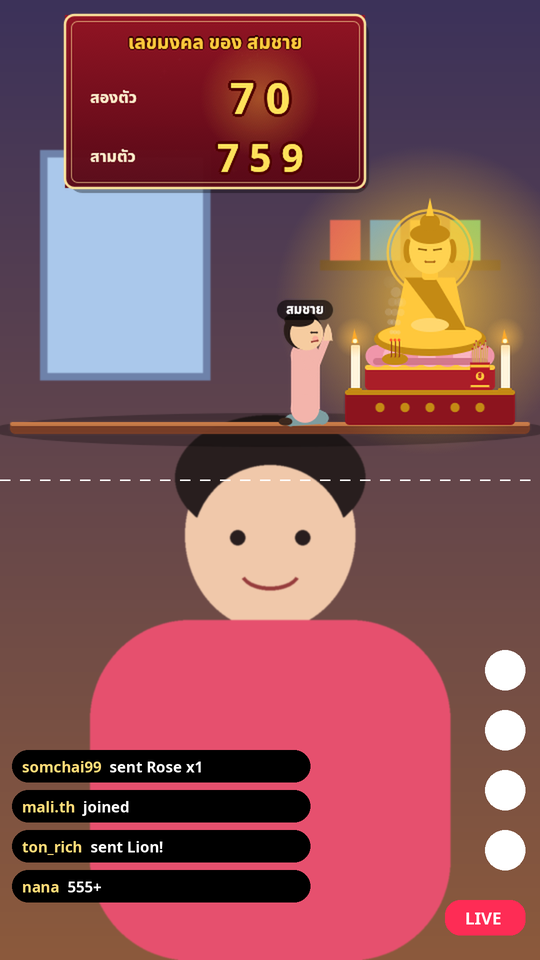
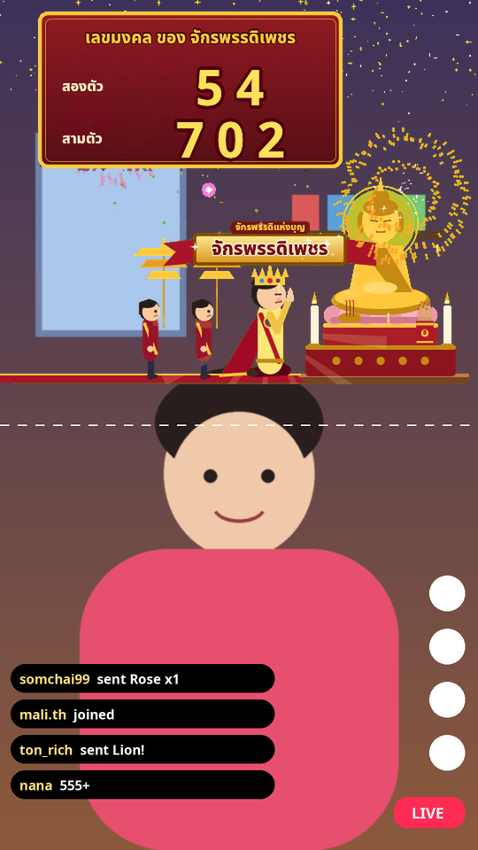
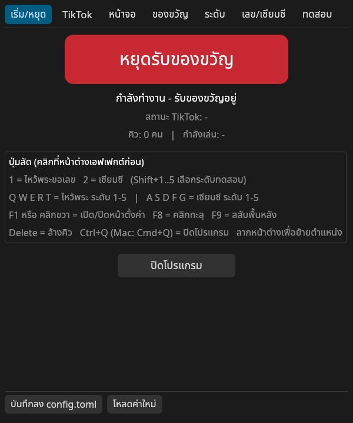
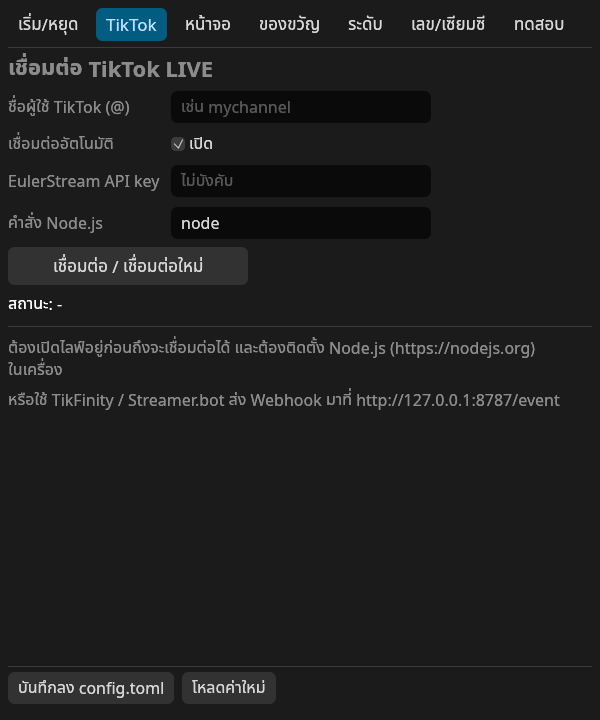
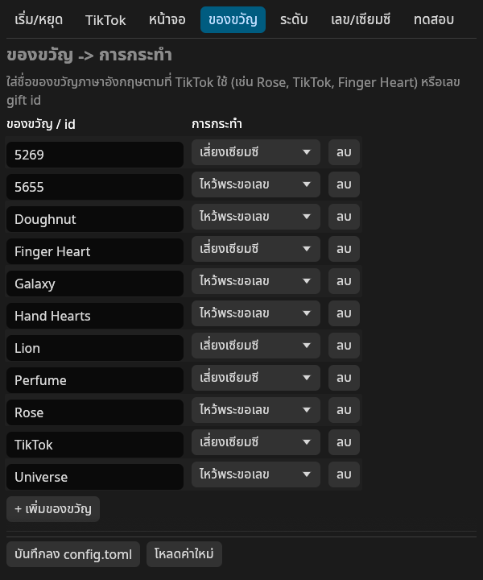
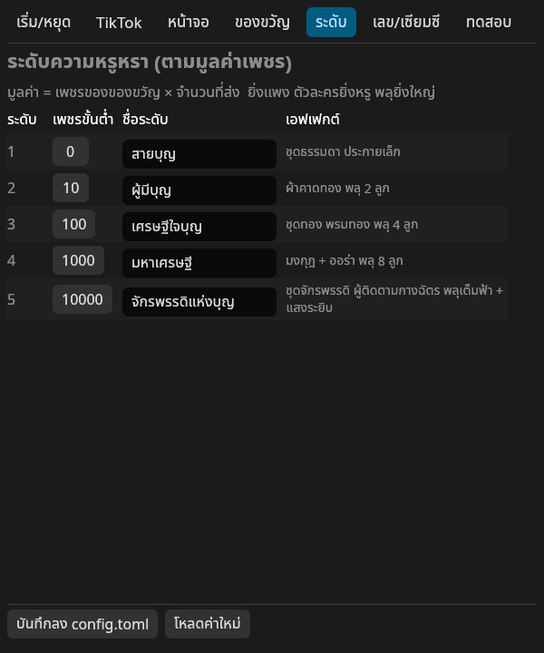

# TikTok Shrine Live 🙏 — ไหว้พระขอเลข / เสี่ยงเซียมซี บนไลฟ์ TikTok

โปรแกรมเอฟเฟกต์ (เขียนด้วย **Rust**) สำหรับวางทับ **ครึ่งบนของจอไลฟ์แนวตั้ง** — ผู้ชมส่งของขวัญ แล้วตัวละครชื่อผู้ชมจะเดินไปไหว้พระ ขึ้น **เลขมงคล** (2 ตัว/3 ตัว) หรือ **เขย่าเซียมซี** ไม้ตกแล้วขึ้น **ใบที่ + คำทำนาย** ยิ่งของขวัญแพง (เพชร × จำนวน) ตัวละครยิ่งหรู พลุยิ่งใหญ่ — 5 ระดับ

📖 **คู่มือติดตั้ง-ใช้งานแบบละเอียดทีละขั้น: [docs/คู่มือ.md](docs/คู่มือ.md)**

  

## ความสามารถ
- หน้าต่าง **โปร่งใสจริง (per-pixel alpha) ไม่มีขอบ ลอยบนสุด** ลากย้ายได้ เปิด **คลิกทะลุ** ได้ + โหมด **จอเขียว** สำหรับ Chroma Key + โหมด **ฉากวัด** เต็มพื้นหลัง
- เลย์เอาต์ **ส่วนบนของจอ** (ปรับ % ความสูงได้) หรือ **เต็มจอ 9:16**
- **หน้าตั้งค่าภาษาไทย** เป็นหน้าต่างแยก (ไม่ติดเข้าไลฟ์) — ชื่อ TikTok + ปุ่มเชื่อมต่อ, ปุ่ม **เริ่ม/หยุด** ใหญ่, ของขวัญ→การกระทำ, เพชรขั้นต่ำแต่ละระดับ, รูปแบบเลข, คำทำนาย, ความเร็ว, ปุ่มทดสอบ → บันทึกลง `config.toml`
- **คิว**: ส่งพร้อมกันหลายคน เล่นทีละคน
- ของขวัญแบบคอมโบ (streak) นับตอนจบคอมโบครั้งเดียว ไม่นับซ้ำ
- ฟอนต์ไทย **Noto Sans Thai** + ตัวเชื่อม TikTok **ฝังอยู่ในไฟล์โปรแกรม** — Windows ใช้แค่ไฟล์ .exe ไฟล์เดียว (config สร้างให้อัตโนมัติ)
- ภาพทั้งหมดวาดด้วยโค้ด ใส่ PNG ของตัวเองแทนได้ที่ `assets/sprites/` (`buddha.png`, `character.png`, `background.png`)
- รับเหตุการณ์ได้ 3 ทาง: **TikTok โดยตรง** (Node bridge), **HTTP/Webhook** (TikFinity, Streamer.bot, curl), **คีย์บอร์ด** ทดสอบ

## ดาวน์โหลด / ติดตั้ง (สรุป)
| ระบบ | วิธี |
|---|---|
| **Windows** | แตก `TikTokShrineLive-Windows-x64.zip` → ดับเบิลคลิก `TikTokShrineLive.exe` (ถ้า SmartScreen เตือน: More info → Run anyway) |
| **macOS** | เปิด `.dmg` → ลากเข้า Applications → **ครั้งแรกให้คลิกขวา → Open → Open** (หรือ System Settings → Privacy & Security → Open Anyway) |
| ทั้งสองระบบ | ติดตั้ง **Node.js LTS** (https://nodejs.org) สำหรับเชื่อม TikTok โดยตรง |

รายละเอียด, การใส่ใน **TikTok LIVE Studio / OBS**, เช็กลิสต์ก่อนไลฟ์, แก้ปัญหา → [docs/คู่มือ.md](docs/คู่มือ.md)

## ปุ่มลัด (คลิกหน้าต่างเอฟเฟกต์ก่อน)
| ปุ่ม | ผล |
|---|---|
| `1` / `2` | ไหว้พระขอเลข / เซียมซี (ระดับที่เลือก) |
| `Shift+1..5` | เลือกระดับทดสอบ |
| `Q W E R T` / `A S D F G` | ไหว้พระ / เซียมซี ระดับ 1–5 |
| `F1`, คลิกขวา, ดับเบิลคลิก | เปิด/ปิดหน้าตั้งค่า |
| `F8` / `F9` | คลิกทะลุ / สลับพื้นหลัง |
| `Delete` | ล้างคิว |
| `Ctrl+Q` (Mac `Cmd+Q`) | ปิดโปรแกรม |
| ลากเมาส์ซ้าย | ย้ายหน้าต่าง |

## ระดับความหรูหรา (ตั้งเพชรขั้นต่ำได้)
| ระดับ | เพชร (ค่าเริ่มต้น) | ไหว้พระ+เลข | เซียมซี |
|---|---|---|---|
| 1 สายบุญ | 0+ |  |  |
| 2 ผู้มีบุญ | 10+ |  |  |
| 3 เศรษฐีใจบุญ | 100+ |  |  |
| 4 มหาเศรษฐี | 1,000+ |  |  |
| 5 จักรพรรดิแห่งบุญ | 10,000+ |  |  |

(ลายตารางหมากรุก = ส่วนที่โปร่งใส)

### ลำดับภาพ (ระดับ 5)
| เดินเข้า | ไหว้ | ขึ้นเลข | พลุ |
|---|---|---|---|
|  |  |  |  |

| เขย่าเซียมซี | ไม้ตก | คำทำนาย |
|---|---|---|
|  |  |  |

ทุกระดับ ทุกเฟรม อยู่ในโฟลเดอร์ [`screenshots/`](screenshots/)

### โหมดพื้นหลัง / เลย์เอาต์
| โปร่งใส | จอเขียว | หลัง Chroma Key | ฉากวัด | เต็มจอ 9:16 |
|---|---|---|---|---|
|  |  |  |  |  |

### หน้าตั้งค่า
| เริ่ม/หยุด | หยุดอยู่ | TikTok | หน้าจอ |
|---|---|---|---|
|  |  |  |  |

| ของขวัญ | ระดับ | เลข/เซียมซี | ทดสอบ |
|---|---|---|---|
|  |  |  |  |

---

## การเชื่อมต่อ TikTok — เลือกวิธีไหน และทำไม
TikTok **ไม่มี API ทางการ** สำหรับอ่านของขวัญในไลฟ์ ทางเลือกที่มี:

| วิธี | สถานะ (พ.ย. 2026) | ใช้ในโปรเจกต์นี้ |
|---|---|---|
| Rust crate `tiktoklive` (TikTokLiveRust) | อัปเดตล่าสุด ส.ค. 2024 — ค้างนาน เสี่ยงพังกับ TikTok ปัจจุบัน | ❌ |
| Node `tiktok-live-connector` (zerodytrash) | ดูแลต่อเนื่อง v2.5.0 (ก.ย. 2026), ใช้ sign server ของ EulerStream | ✅ **หลัก** (bridge ฝังในโปรแกรม) |
| TikFinity / Streamer.bot → Webhook | แอปสำเร็จรูป ไม่ต้องลง Node | ✅ **สำรอง** ผ่าน HTTP |

โปรแกรม Rust จะรัน `node bridge.cjs <username>` (สคริปต์ bundle รวม dependency แล้ว ฝังใน exe แตกไฟล์ออกมาเองข้าง config) อ่าน JSON ทีละบรรทัดจาก stdout และ **ต่อใหม่อัตโนมัติ** เมื่อหลุด ทุกแหล่งทำงานผ่าน trait `EventSource` เปลี่ยน/เพิ่มตัวเชื่อมได้โดยไม่แตะส่วนภาพ

⚠️ **ความเสี่ยง**: ตัวเชื่อมแบบไม่เป็นทางการอาจหยุดทำงานเมื่อ TikTok เปลี่ยนระบบ — ถ้าพัง ให้อัปเดต `tiktok-live-connector` แล้ว build bridge ใหม่ หรือใช้ TikFinity ชั่วคราว

### HTTP API (`127.0.0.1:8787`)
| Endpoint | ตัวอย่าง |
|---|---|
| `GET/POST /event` | `/event?action=pray&user=สมชาย&diamonds=100` · `action=siamsi` |
| `GET/POST /gift` | `/gift?gift_name=Rose&gift_id=5655&user=สมชาย&diamonds=1&repeat=5` (จับคู่ตามตารางของขวัญ) |
| `POST` JSON | `{"gift_name":"Rose","user":"สมชาย","diamonds":1,"repeat":5}` · รองรับชื่อฟิลด์แบบ `nickname`, `giftName`, `diamondCount`, `repeatCount` |
| `GET /control` | `?click_through=toggle\|1\|0` · `?background=green\|transparent\|scene` · `?clear=1` |
| `GET /health` | `ok` |

## สำหรับนักพัฒนา
```
src/main.rs     เปิดหน้าต่าง (eframe/egui + glow, transparent, always-on-top), ฟอนต์, หา config
src/app.rs      คิว, ไทม์ไลน์แอนิเมชัน, พลุ/particles, หน้าตั้งค่า (viewport แยก), ปุ่มลัด
src/scene.rs    ภาพวาดทั้งหมด (องค์พระ, ตัวละคร 5 ระดับ, เซียมซี, ป้ายชื่อ, การ์ด) + sprite override
src/events.rs   trait EventSource, HttpSource, TikTokBridgeSource (Node bridge), แปลง JSON
src/config.rs   config.toml (serde) + ค่าเริ่มต้นฝังในโปรแกรม
bridge/         bridge.js (tiktok-live-connector) → bundle เป็น dist/bridge.cjs ด้วย esbuild
```
**ทำไม eframe/egui** (แทน macroquad): ต้องการหน้าต่างโปร่งใส per-pixel + always-on-top + click-through + หลายหน้าต่าง (ตั้งค่าแยก) บน Windows/macOS ซึ่ง eframe รองรับครบผ่าน winit/glutin และ text shaping (harfrust) ทำให้สระ/วรรณยุกต์ไทยวางถูกตำแหน่ง

```bash
cargo build --release                       # Linux/Windows/macOS
# Windows .exe จาก Linux (ไม่มี icon ในไฟล์ exe แต่หน้าต่างมี icon):
pip install ziglang && cargo install cargo-zigbuild
rustup target add x86_64-pc-windows-gnu
cargo zigbuild --release --target x86_64-pc-windows-gnu
packaging/make_windows_zip.sh
# macOS .app + .dmg (universal) — รันบน Mac:
packaging/macos/make_app.sh
# build bridge ใหม่ (หลังอัปเดต tiktok-live-connector):
cd bridge && npm install && npx esbuild bridge.js --bundle --platform=node --target=node18 --format=cjs --minify --outfile=dist/bridge.cjs
# ภาพตัวอย่างทั้งหมด (Linux + Xvfb):
scripts/make_screenshots.sh && python3 scripts/make_composites.py
# ถ่ายภาพเฟรมเดียว:
./target/release/tiktok-shrine-live --demo pray:5:ชื่อ --shot-at 8 --out shot.png --bg transparent --layout top
```
**CI**: `.github/workflows/release.yml` — build Windows (.exe มี icon, zip) และ macOS (universal .app + .dmg) บน runner จริง; push tag `v*` แล้วจะแนบไฟล์ใน GitHub Release

## License
โค้ด: MIT · ฟอนต์ Noto Sans / Noto Sans Thai: SIL OFL 1.1 (`assets/fonts/OFL.txt`) · bridge ใช้ `tiktok-live-connector` (AGPL-3.0) — ถ้าเผยแพร่ไฟล์ bridge.cjs ต่อ ต้องเปิดซอร์สตามเงื่อนไข AGPL
