# TikTok Shrine Live 🙏 — ไหว้พระขอเลข / เสี่ยงเซียมซี บนไลฟ์ TikTok

โปรแกรมเอฟเฟกต์ (เขียนด้วย **Rust**) สำหรับวางทับ **ครึ่งบนของจอไลฟ์แนวตั้ง** — ผู้ชมส่งของขวัญ แล้วตัวละครชื่อผู้ชมจะเดินไปไหว้พระ ขึ้น **เลขมงคล** (2 ตัว/3 ตัว) หรือ **เขย่าเซียมซี** ไม้ตกแล้วขึ้น **ใบที่ + คำทำนาย** ยิ่งของขวัญแพง (เพชร × จำนวน) ตัวละครยิ่งหรู พลุยิ่งใหญ่ — 5 ระดับ

เลือกโหมดได้ในหน้าตั้งค่า: **ไหว้พระ / เสี่ยงเซียมซี**, **ลอยกระทง**, **ให้อาหารแมว**, **โหมดเต้น** (ท่าตามสติกเกอร์ + ฉากฟลอร์และเวที), **ปาตกน้ำ** (ปาลูกเติมเกจ ดังก์แล้วขึ้นป้ายให้ผู้ไลฟ์กดเครื่องจริง) หรือ **เลี้ยงแมว** (ผู้ชมช่วยกันเลี้ยงแมวหนึ่งตัว: ลูบหัว ไล่ไม้ขนกล่อ ให้อาหาร พร้อมแถบความเหงา/ความอิ่ม/ความผูกพัน) — โหมดแมว/เต้น/ปาตกน้ำ/เลี้ยงแมวไม่มีเลขมงคล ชื่อคนส่งลอยบนหัวทุกตัว

## 📥 เริ่มที่นี่ — คู่มือติดตั้งแยกตามเครื่อง (ทีละขั้น จนเริ่มไลฟ์ได้)
| 🪟 **[ติดตั้งบน Windows](docs/ติดตั้ง-Windows.md)** | 🍎 **[ติดตั้งบน Mac](docs/ติดตั้ง-Mac.md)** |
|---|---|
| ดาวน์โหลด `TikTokShrineLive-Windows-x64.zip` → แตกไฟล์ → เปิด | ดาวน์โหลด `TikTokShrineLive-macOS-universal.dmg` → ลากเข้า Applications → เปิด |

โปรแกรมนี้ติดตั้งบนมือถือไม่ได้ (รันได้เฉพาะ Windows / Mac) — ถ้าใช้มือถือคู่กับคอม ดู **[Android](docs/ติดตั้ง-Android.md)** · **[iPhone](docs/ติดตั้ง-iPhone.md)** (มือถือเป็นกล้องแล้วไลฟ์จากคอม / หรือไลฟ์จากแอปมือถือโดยคอมยังรับของขวัญ — ผู้ชมไลฟ์มือถืออย่างเดียวจะไม่เห็นเอฟเฟกต์)

**ไม่ต้องติดตั้ง Node.js หรือโปรแกรมอื่น** — ตัวเชื่อม TikTok มากับโปรแกรมแล้ว · การตั้งค่าที่ใช้เหมือนกันทั้งสองระบบ: [docs/คู่มือ.md](docs/คู่มือ.md)

   

**ตัวอย่างแบบเคลื่อนไหว:** [ไหว้พระ ระดับ 5](previews/pray_t5.gif) · [เซียมซี ระดับ 5](previews/siamsi_t5.gif) · [ลอยกระทง ระดับ 5](previews/krathong_t5.gif) · [หลายคนต่อแถว](previews/multi_queue_4senders.gif) · [หลายคนต่อแถว บนไลฟ์](previews/live_multi_3senders.gif) (มี .mp4 ด้วยในโฟลเดอร์ [`previews/`](previews/))

## มีอะไรใหม่ใน v0.2.5
- **โหมดเลี้ยงแมว** 🐱 — แมวหนึ่งตัวที่ผู้ชมทั้งไลฟ์ช่วยกันเลี้ยง ของขวัญ = กิมมิกเล่นกับแมว **10 อย่างไล่ตามราคาจริง** (ลูบหัว 1 เพชร → ลูกแมวทองคำ 4888 เพชร) · ไม่มีเลขมงคล การ์ดบอกกิมมิก + ชื่อคนส่ง
  - **3 แถบสถานะ:** ความเหงา (เพิ่มเมื่อไม่มีคนเล่นเกิน `lonely_after`), ความอิ่ม (ลดเองตลอด ส่งของกินเพื่อเติม), ความผูกพัน (สะสมแล้วเลื่อนเลเวล 1–5 แมวโตขึ้น ได้ปลอกคอ → โบว์ → มงกุฎ และขนทองตอนเลเวล 5)
  - ของขวัญนอกตารางเลือกกิมมิกที่แพงที่สุดที่ราคาไม่เกินเพชรที่ส่ง · ของขวัญซ้ำจากคนเดียวกันในช่วง `merge_window` รวมเป็นครั้งเดียว (ป้าย ×N) · คิวล้นขึ้นป้าย +N ไม่ทิ้งของขวัญ
  - ตั้งชื่อแมวและปรับการลดของแถบได้ใน `[pet]` · จับคู่ของขวัญ→กิมมิกเองได้ในแท็บของขวัญช่อง **กิมมิก** หรือ `[pet.tricks]` (ตารางนี้ไม่ร่วมคำนวณเกณฑ์สตาร์ของโหมดอื่น)
- กด `F2` สลับ 6 โหมด (ไหว้พระ → ลอยกระทง → ให้อาหารแมว → เต้น → ปาตกน้ำ → เลี้ยงแมว)

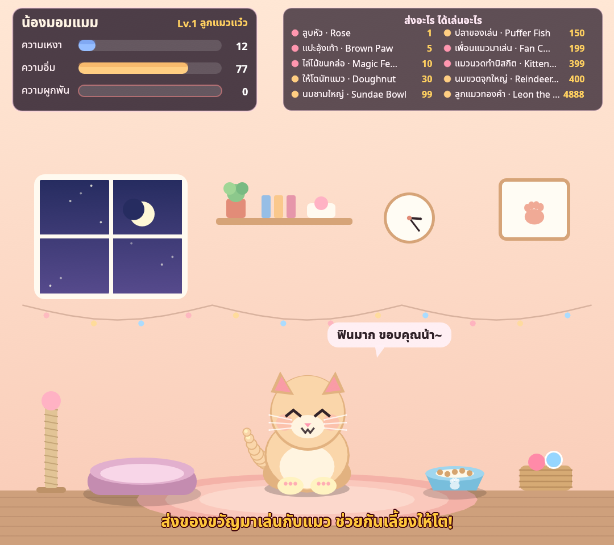
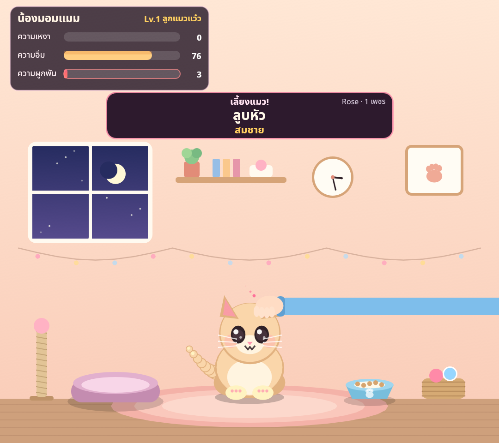
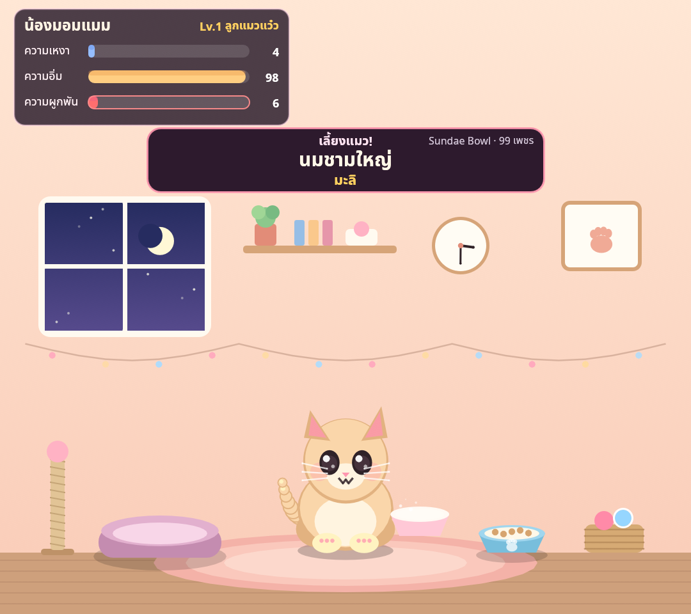
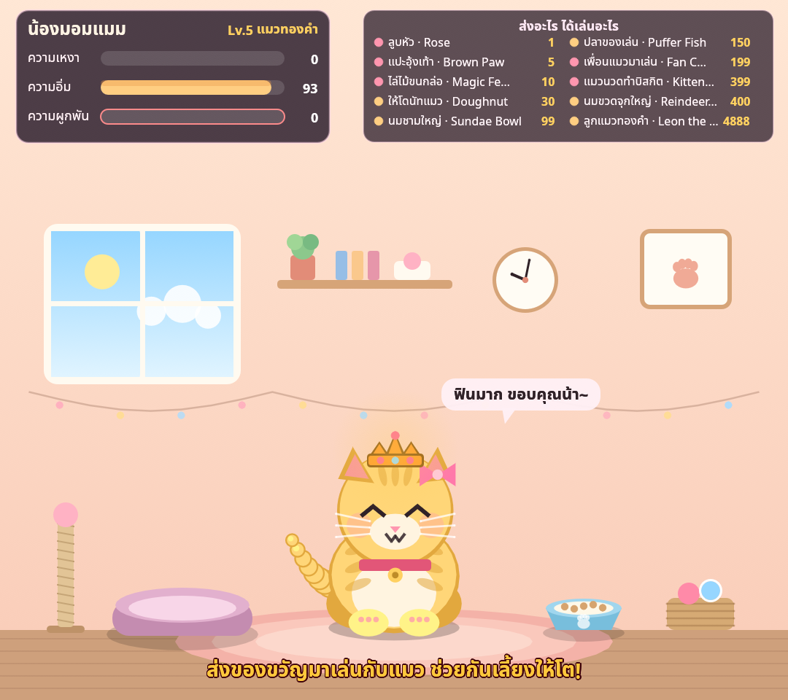

## มีอะไรใหม่ใน v0.2.4
- **ท่าเต้นตามสติกเกอร์** — ของขวัญแต่ละชิ้นได้ท่าที่ตั้งไว้ (ไม่สุ่ม) ตั้งในแท็บของขวัญช่อง **ท่าเต้น** หรือ `[dance.moves]` · ของที่ไม่ได้ตั้งใช้ท่าตามขั้นคงที่ · การ์ดโชว์ไอคอนสติกเกอร์คู่ชื่อท่า · คอมโบ ×N ใช้ท่าเดิม · **ไม่แสดงตัวเลขนับถอยหลัง** บนการ์ด (เวลายังนับภายใน)
- **ป้ายเมนูบนจอ** «ส่งอะไร ได้ท่าไหน» / ในโหมดลอยกระทง «ส่งอะไร ได้กระทงแบบไหน» — ไอคอน + ชื่อ + ท่าหรือแบบกระทง + เพชร แสดงตอนว่างและตอนมีคนส่ง (ตั้ง always / idle / off, ซ้าย/ขวา, จำนวนแถว)
- **ฉากเริ่มต้น «ฟลอร์ + เวที»** เต็มจอ 9:16: ฟลอร์ล่างให้คนส่งเต้นด้วยกันนาน เวทีบนสำหรับของขวัญถึงเกณฑ์ขึ้นเวที (ค่าเริ่มต้น 30 เพชร = Doughnut) และ **สตาร์** กลางเวทีเมื่อส่งของขวัญที่แพงสุดในตารางจับคู่หรือแพงกว่า — มีสปอตไลต์ พลุ เลเซอร์ ป้ายชื่อ «สตาร์» ใบหน้ายังอ่านออก
- **เรทราคาใช้ทุกโหมด** ในแท็บ **เรทราคา** (ไหว้พระ เซียมซี กระทง แมว เต้น ปาตกน้ำ): ตารางขั้นเดียวกัน + เกณฑ์ขึ้นเวที + กฎสตาร์ พร้อมราคาโดยประมาณเป็นบาท · ค่าเริ่มต้นของไม่แพงเท่านั้น (ทุกชิ้นไม่เกิน 100 เพชร: Rose / TikTok 1, Finger Heart 5, Perfume 20, Doughnut 30, Hand Heart 100) ขั้น 5 / สตาร์ = Hand Heart 100 หรือแพงกว่า — ของแพงกว่าเพิ่มได้ในแท็บของขวัญ · ไฟล์เก่าที่ยังไม่มี `[rates]` โหลดได้โดยเก็บตารางขั้นที่ผู้ใช้ตั้งไว้
- **ลอยกระทง:** ความหรูของกระทงยังตามสติกเกอร์/ขั้นจากตารางเรทร่วม และถ้าเป็นสตาร์จะมีเอฟเฟกต์ใหญ่ (พลุ โคมลอย แม่น้ำเรืองแสง ลำแสง ป้ายชื่อ) โดยไม่บังหน้า/ชื่อ
- **แท็บทดสอบ** ในหน้าตั้งค่า: คลิกสติกเกอร์ในตารางเรทเพื่อจำลองของขวัญจริง (ท่า/เวที/สตาร์ตามสติกเกอร์) พร้อมปุ่ม **จำลองคนเยอะ** — ใช้ได้ตอนหยุดหรือยังไม่เชื่อม และไม่ส่งอะไรไปที่ TikTok
- **คู่มือมือถือ** [Android](docs/ติดตั้ง-Android.md) · [iPhone](docs/ติดตั้ง-iPhone.md) — โปรแกรมติดตั้งบนมือถือไม่ได้ อธิบายทางใช้มือถือเป็นกล้องแล้วไลฟ์จากคอม และทางไลฟ์จากแอปมือถือ (ผู้ชมจะไม่เห็นโอเวอร์เลย์)

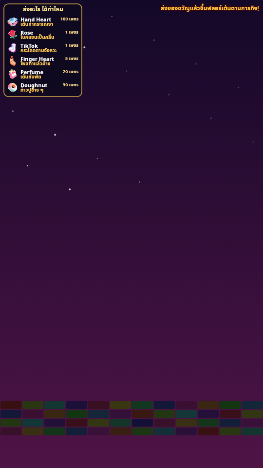
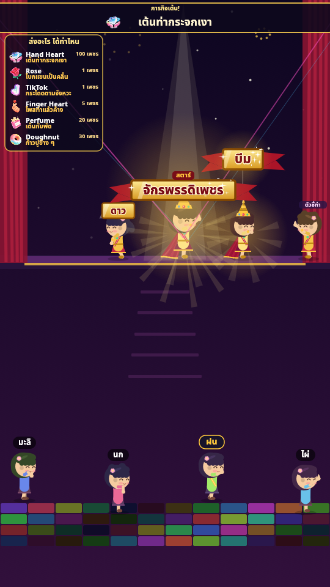
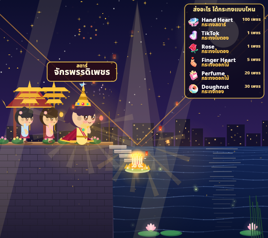
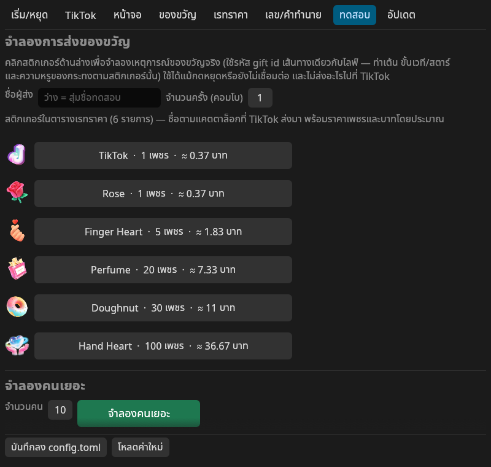

**ตัวอย่างแบบเคลื่อนไหว (สตาร์):** [ทางเข้าสตาร์บนเวที](previews/dance_star.gif)

## มีอะไรใหม่ใน v0.2.3
- **โหมดเต้น** — ของขวัญ = ภารกิจเต้น (กิมมิกสุภาพ + นับถอยหลัง + ตัวชี้ท่า) ฉากเวที 9 แบบปลดล็อกตามขั้น (ฟลอร์รวม, ลานวัด, บนโต๊ะ, บนลำโพง, บนเวที, รถแห่, ดาดฟ้า, ฝนโฟม, บนเมฆ) หรือล็อก/สุ่มในตั้งค่า · ฟลอร์รวมให้ทั้งคิวขึ้นเต้นด้วยกัน · ไม่มีเลขมงคล
  - ขั้น 1–5: นับถอยหลัง 8 / 10 / 14 / 18 / 24 วินาที, เวทีใหญ่ขึ้นตามขั้น, ขั้น 4–5 สุ่มสองกิมมิกต่อกัน
  - **ของขวัญถาโถม:** ของขวัญซ้ำจากคนเดียวกันในช่วง `merge_window` รวมเป็นการ์ดเดียว (ป้าย **×N**) และยืดเวลาได้ไม่เกิน `max_seconds` · คนที่ล้นจอขึ้นป้าย **«+N คนกำลังรอ»** (ของขวัญไม่ถูกทิ้ง) · ถ้าถึง `party_threshold` จะเข้า **โหมดปาร์ตี้** (จอเต็มดิสโก้ ภารกิจรวมใบเดียว แถบชื่อผู้ส่งเลื่อน)
  - ตั้งค่าในแท็บเลข/คำทำนาย หรือ `[dance]`: `max_visible`, `max_seconds`, `merge_window`, `party_threshold`, เวที, รายการภารกิจ
- **โหมดปาตกน้ำ** — ปาลูกบอลใส่เป้า เติมเกจดังก์ หรือขั้น 5 ตกทันที · ป้าย **«ดังก์! DUNK!»** เป็นสัญญาณให้ผู้ไลฟ์กดเครื่องดังก์จริง + การ์ด **«SPLASH! ตกน้ำเพราะ …»** · ไม่มีเลขมงคล
  - ขั้น 1–5: จำนวนลูกและคะแนนเกจเพิ่มตามขั้น (ค่าเริ่มต้น +1 / +2 / +4 / +7 / เต็มเกจ), ขั้น 5 เข้าทุกลูกและดังก์ทันที
  - **ของขวัญถาโถม:** รวมรอบปาของคนเดียวกัน (ป้าย ×N + ลูกเพิ่ม) ป้าย +N และโหมดปาร์ตี้พร้อมแถบชื่อเลื่อนเช่นเดียวกับโหมดเต้น
  - ตั้งค่าในแท็บเลข/คำทำนาย หรือ `[dunk]`: เป้าเกจ, ขั้นดังก์ทันที, `max_visible`, `max_seconds`, `merge_window`, `party_threshold`
- กด `F2` สลับ 5 โหมด (ไหว้พระ → ลอยกระทง → แมว → เต้น → ปาตกน้ำ) · ตั้งค่าพื้นหลัง (ฉากเต็ม / โปร่งใส) ใช้ได้ทั้ง 5 โหมด

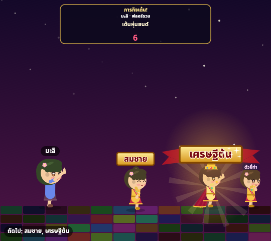

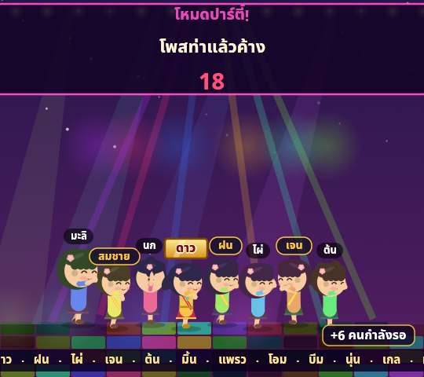

| ฉากเต็ม vs โปร่งใส — เต้น | ปาตกน้ำ |
|---|---|
| 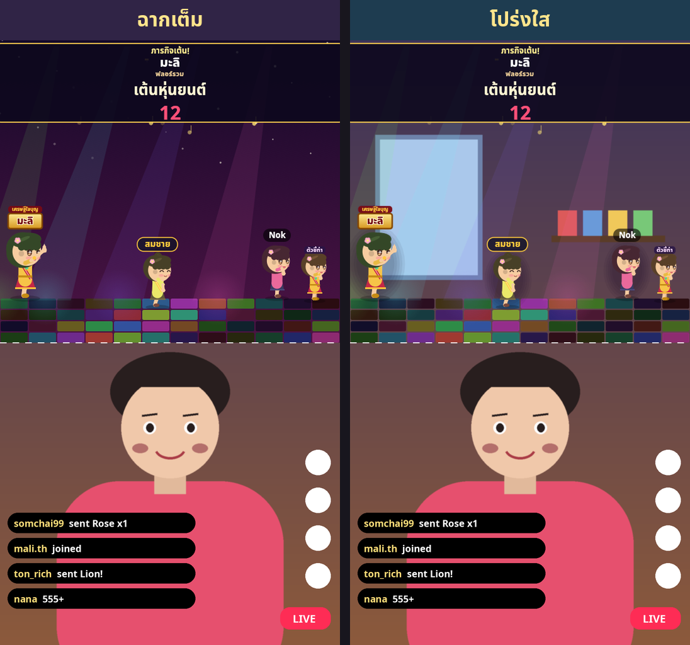 | 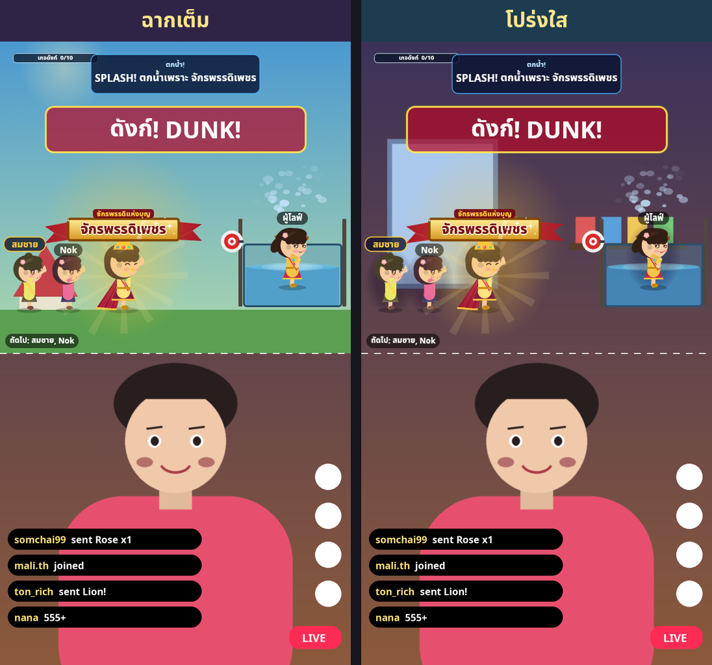 |

## มีอะไรใหม่ใน v0.2.2
- **ตัวเลือกของขวัญ / สติกเกอร์ทั้งชุด** ในแท็บของขวัญ: รูป ชื่อ **รหัส gift id** ราคาเพชร และ **ราคาโดยประมาณเป็นบาท** — ค้นหา / เรียงราคา แล้วคลิกเลือกว่าของขวัญนั้นทำอะไร (ไม่ต้องพิมพ์รหัสเอง) · ชุดข้อมูลจริง 761 รายการมากับโปรแกรม + กด **รีเฟรชรายการของขวัญ** ตอนเชื่อมไลฟ์เพื่อดึงชุดล่าสุด · ตารางครบชุด: [รายการของขวัญ](docs/รายการของขวัญ.md)
- ข้อความผิดพลาดตอนอัปเดตสั้นลงเหลือบรรทัดเดียว (รายละเอียดเต็มอยู่ใน log) · หน้าต่างตั้งค่าพอดีจอโน้ตบุ๊ก (800×760)


## มีอะไรใหม่ใน v0.2.1
- **โหมดให้อาหารแมว** 🐱 — แมวของผู้ส่งเดินมาที่ชาม กินตามยอดของขวัญ แล้วขึ้น **การ์ดขอบคุณ** มีชื่อคนส่ง (ไม่มีเลขมงคล) · หลายคนส่งพร้อมกันแมวนั่งต่อแถว · `F2` สลับ 3 โหมด
- **ไม่ต้องติดตั้ง Node.js อีกต่อไป**: ไฟล์ Windows zip / Mac .app / Linux tar.gz มี Node.js รุ่นพกพา (ทางการ, MIT) สำหรับตัวเชื่อม TikTok มาให้ — โปรแกรมใช้ตัวที่มากับโปรแกรมก่อน ถ้าไม่มีค่อยใช้ Node.js ในเครื่อง (ใส่ตำแหน่งเองได้ในแท็บ TikTok → ขั้นสูง)
- **อัปเดตปุ่มเดียว**: ตรวจ แอป + ตัวเชื่อม TikTok + ตัวรัน พร้อมกัน ถ้ามีอะไรใหม่ขึ้นปุ่ม **"มีอัปเดต — กดเพื่ออัปเดต"** ทำให้ครบตามลำดับ ตัวรัน → ตัวเชื่อม → แอป (เปิดใหม่เองท้ายสุด) ทุกขั้นทดสอบก่อนใช้ ถ้าไม่ผ่าน **ย้อนกลับเป็นของเดิมเองและทำงานต่อ**
- **คู่มือติดตั้งแยก Windows / Mac** ([Windows](docs/ติดตั้ง-Windows.md) · [Mac](docs/ติดตั้ง-Mac.md)) และคู่มือใช้มือถือคู่กับคอม ([Android](docs/ติดตั้ง-Android.md) · [iPhone](docs/ติดตั้ง-iPhone.md) — ติดตั้งบนมือถือไม่ได้)
- **ตั้งค่า "พื้นหลัง" ใช้ได้ทั้ง 3 โหมด** (แท็บหน้าจอ / `F9`): **ฉากเต็ม** (วัด / แม่น้ำยามค่ำ / มุมแมว) หรือ **โปร่งใส** — เห็นกล้องของสตรีมเมอร์ เหลือแค่ตัวละคร ป้ายชื่อ การ์ด พลุ + ของประกอบเล็ก ๆ (ศาล / เส้นน้ำ+ท่าน้ำ / ชามข้าวแมว ปิดได้) ตัวละครมีเงานุ่ม ๆ ด้านหลังให้อ่านออกบนกล้องทุกแบบ · ตอนว่างในโหมดโปร่งใส = ไม่มีอะไรทับกล้องเลย (เหลือแค่ข้อความแนะนำเล็ก ๆ)
- ป้ายชื่อไม่ถูกการ์ดผลบัง (ป้ายชื่ออยู่ชั้นบนสุด, การ์ดลอยกระทงชิดขวา) · ป้ายชื่อไม่ล้นขอบจอ · ป้ายที่ซ้อนกันจะขยับหลบให้เอง
- ไฟล์ Linux build บน Ubuntu 22.04 (ใช้ได้กับ Linux รุ่นเก่ากว่า) · เพิ่ม `--version`


| ฉากเต็ม vs โปร่งใส — ไหว้พระ | ลอยกระทง | แมว | ตอนว่าง |
|---|---|---|---|
|  |  |  |  |

## มีอะไรใหม่ใน v0.2
- **ตัวละครน่ารักแบบ chibi** หน้าตา/ทรงผม/สีเสื้อต่างกันตามชื่อผู้ชม · เดินแบบมีจังหวะ กระพริบตา หายใจ ผ้าคลุมพลิ้ว · ไหว้แบบ 3 จังหวะ (ยกมือ → ก้มกราบ → เงย)
- **ต่อแถวให้เห็น**: ส่งของขวัญพร้อมกันหลายคน → ตัวละครเดินออกมายืน **ต่อแถวทีละคน** (เห็นพร้อมกันสูงสุด `max_visible` = 5 คน ที่เหลือรอนอกจอ) **ทุกคนมีป้ายชื่อเหนือหัว** คนหน้าสุดทำพิธี → เดินออก → แถวขยับ
- **การ์ดผลบอกชัดว่าเป็นของใคร**: ป้ายชื่อสีเดียวกับเจ้าของ + เส้นประชี้ลงไปที่ตัวละคร · ชื่อที่มีอีโมจิถูกตัดอีโมจิออก (ไม่ขึ้นเป็นกล่องสี่เหลี่ยม)
- เลขมงคลหมุนแบบ **สล็อตแมชชีน** · เซียมซีเขย่า ไม้กระเด็นตกพื้นจริง กล้องซูม · คำทำนายเป็น **ม้วนกระดาษคลี่ออก** · พลุหลายรูปทรง (วงกลม หัวใจ ดาว วงแหวน) + จอสั่นระดับสูง
- **โหมดลอยกระทง** 🌕 (เลือกในหน้าตั้งค่า / กด `F2` สลับระหว่างไลฟ์) — ไหว้ขอเลขริมน้ำ หรือ อธิษฐานรับคำอวยพร กระทงลอยค้างในแม่น้ำพร้อมชื่อ
- **ตอนไม่มีของขวัญ**: `idle = "still"` ภาพนิ่งไม่มีตัวละคร (ค่าเริ่มต้น) · `"ambient"` ขยับเบาๆ · `"hidden"` โปร่งใสทั้งหมด
- **ปุ่มอัปเดตในโปรแกรม** (แท็บ "อัปเดต"): ตรวจ GitHub Releases ตอนเปิด/กดปุ่ม → แถบแจ้ง + ปุ่ม **อัปเดตเลย** (ดาวน์โหลด สลับไฟล์ แล้วเปิดใหม่เอง) และปุ่มแยก **อัปเดตตัวเชื่อม TikTok** (อัปเดตเฉพาะ `bridge.cjs`)
- License เปลี่ยนเป็น **AGPL-3.0** (ใช้ `tiktok-live-connector`)

| ก่อน (v0.1) / หลัง (v0.2) |
|---|
|  |
|  |

## ความสามารถ
- หน้าต่าง **โปร่งใสจริง (per-pixel alpha) ไม่มีขอบ ลอยบนสุด** ลากย้ายได้ เปิด **คลิกทะลุ** ได้ + โหมด **จอเขียว** สำหรับ Chroma Key + โหมด **ฉากเต็ม** (วัด / แม่น้ำ / มุมแมว)
- เลย์เอาต์ **ส่วนบนของจอ** (ปรับ % ความสูงได้) หรือ **เต็มจอ 9:16**
- **หน้าตั้งค่าภาษาไทย** เป็นหน้าต่างแยก (ไม่ติดเข้าไลฟ์) — ชื่อ TikTok + ปุ่มเชื่อมต่อ, ปุ่ม **เริ่ม/หยุด** ใหญ่, **ตัวเลือกของขวัญ/สติกเกอร์ทั้งชุด** (รูป ชื่อ รหัส gift id ราคาเพชร ค้นหา/เรียงราคา คลิกเพื่อกำหนดการกระทำ), เพชรขั้นต่ำแต่ละระดับ, รูปแบบเลข, คำทำนาย, ความเร็ว, ปุ่มทดสอบ → บันทึกลง `config.toml`
- **คิวที่มองเห็นได้**: ส่งพร้อมกันหลายคน ตัวละครยืนต่อแถว เล่นทีละคนตามลำดับ (ตั้งจำนวนบนจอได้ `window.max_visible`)
- ของขวัญแบบคอมโบ (streak) นับตอนจบคอมโบครั้งเดียว ไม่นับซ้ำ
- ฟอนต์ไทย **Noto Sans Thai** + ตัวเชื่อม TikTok **ฝังอยู่ในไฟล์โปรแกรม** — Windows ใช้แค่ไฟล์ .exe ไฟล์เดียว (config สร้างให้อัตโนมัติ)
- ภาพทั้งหมดวาดด้วยโค้ด ใส่ PNG ของตัวเองแทนได้ที่ `assets/sprites/` (`buddha.png`, `character.png`, `background.png`)
- รับเหตุการณ์ได้ 3 ทาง: **TikTok โดยตรง** (ตัวเชื่อม tiktok-live-connector รันด้วย Node.js ที่มากับโปรแกรม), **HTTP/Webhook** (TikFinity, Streamer.bot, curl), **คีย์บอร์ด** ทดสอบ

## ดาวน์โหลด / ติดตั้ง (สรุป)
| ระบบ | วิธี |
|---|---|
| **Windows** | แตก `TikTokShrineLive-Windows-x64.zip` → ดับเบิลคลิก `TikTokShrineLive.exe` (ถ้า SmartScreen เตือน: More info → Run anyway) |
| **macOS** | เปิด `.dmg` → ลากเข้า Applications → ครั้งแรก: macOS 15+ ลองเปิด → **System Settings → Privacy & Security → Open Anyway** (macOS 14 หรือเก่ากว่า: คลิกขวา → Open) |
| ทั้งสองระบบ | ไม่ต้องลงอะไรเพิ่ม (Node.js รุ่นพกพามากับโปรแกรมสำหรับตัวเชื่อม TikTok) |

ตั้งของขวัญด้วย **ชื่อภาษาอังกฤษ** หรือ **รหัส gift id** ก็ได้ — ในหน้าตั้งค่าแท็บของขวัญมีรายการสติกเกอร์พร้อมรูปและราคาเพชรให้คลิกเลือก (ไม่ต้องพิมพ์รหัสเอง) ดู [คู่มือ ข้อ 6](docs/คู่มือ.md#61-ของขวัญ--การกระทำ-แท็บ-ของขวัญ) และตารางครบชุดใน [รายการของขวัญ](docs/รายการของขวัญ.md)

ทีละขั้นพร้อม OBS / TikTok LIVE Studio / มือถือเป็นกล้อง / แก้ปัญหา → [Windows](docs/ติดตั้ง-Windows.md) · [Mac](docs/ติดตั้ง-Mac.md) · ใช้มือถือคู่กับคอม: [Android](docs/ติดตั้ง-Android.md) · [iPhone](docs/ติดตั้ง-iPhone.md)

## ปุ่มลัด (คลิกหน้าต่างเอฟเฟกต์ก่อน)
| ปุ่ม | ผล |
|---|---|
| `1` / `2` | ไหว้พระขอเลข / เซียมซี (ระดับที่เลือก) |
| `Shift+1..5` | เลือกระดับทดสอบ |
| `Q W E R T` / `A S D F G` | ไหว้พระ / เซียมซี ระดับ 1–5 |
| `F1`, คลิกขวา, ดับเบิลคลิก | เปิด/ปิดหน้าตั้งค่า |
| `F2` | สลับโหมด ไหว้พระ → ลอยกระทง → ให้อาหารแมว → โหมดเต้น → ปาตกน้ำ → เลี้ยงแมว |
| `F8` / `F9` | คลิกทะลุ / สลับพื้นหลัง |
| `Delete` | ล้างคิว |
| `Ctrl+Q` (Mac `Cmd+Q`) | ปิดโปรแกรม |
| ลากเมาส์ซ้าย | ย้ายหน้าต่าง |

## ระดับความหรูหรา (ตั้งเพชรขั้นต่ำได้)
ค่าเริ่มต้นเป็นบันไดของไม่แพงในแคตตาล็อก: Rose / TikTok 1 → ขั้น 1, Finger Heart 5 → ขั้น 2, Perfume 20 → ขั้น 3, Doughnut 30 → ขั้น 4 (ขึ้นเวที), Hand Heart 100 → ขั้น 5 (สตาร์)

| ระดับ | เพชร (ค่าเริ่มต้น) | ไหว้พระ+เลข | เซียมซี |
|---|---|---|---|
| 1 สายบุญ | 0+ |  |  |
| 2 ผู้มีบุญ | 5+ |  |  |
| 3 เศรษฐีใจบุญ | 20+ |  |  |
| 4 มหาเศรษฐี | 30+ |  |  |
| 5 จักรพรรดิแห่งบุญ | 100+ |  |  |

(ลายตารางหมากรุก = ส่วนที่โปร่งใส)

### ลำดับภาพ (ระดับ 5)
| เดินเข้า | ไหว้ | ขึ้นเลข | พลุ |
|---|---|---|---|
|  |  |  |  |

| เขย่าเซียมซี | ไม้ตก | คำทำนาย |
|---|---|---|
|  |  |  |

| หลายคนต่อแถว — คนหน้าสุดไหว้ | การ์ดเลขของคนหน้าสุด (ชี้ไปที่เจ้าของ) |
|---|---|
|  |  |

### โหมดลอยกระทง
| เดินถือกระทง | อธิษฐาน | ลอยกระทง | ขึ้นเลข | คำอวยพร |
|---|---|---|---|---|
|  |  |  |  |  |

### ตอนไม่มีของขวัญ (idle)
| ไหว้พระ (ภาพนิ่ง) | ลอยกระทง (ภาพนิ่ง) | บนไลฟ์ (พื้นหลังโปร่งใส = ไม่ทับกล้อง) |
|---|---|---|
|  |  |  |

ทุกระดับ ทุกเฟรม อยู่ในโฟลเดอร์ [`screenshots/`](screenshots/)

### โหมดให้อาหารแมว
เลือกได้ในแท็บเริ่ม/หยุด ของหน้าตั้งค่า คิวหลายคนเดินต่อกันเป็นแถว แต่ละตัวมีชื่อคนส่งบนหัว ยิ่งยอดสูงแมวและอาหารยิ่งน่ารัก (ลูกแมว+อาหารเม็ด ถึงแมวหลวงมีมงกุฎ+สำรับปลา)

| ภาพนิ่งตอนว่าง | คิว 3 คน | กินระดับ 5 | การ์ดขอบคุณของคนส่ง |
|---|---|---|---|
|  |  |  |  |

พรีวิวแอนิเมชัน: [`previews/cat_t1.gif`](previews/cat_t1.gif) · [`previews/cat_t5.gif`](previews/cat_t5.gif) · [`previews/cat_queue.gif`](previews/cat_queue.gif)


### โหมดเต้น
- `[dance]` ใน `config.toml`: `venue` ค่าเริ่มต้น `floor_stage` (ฟลอร์ + เวที เต็มจอ), หรือ `auto` / `random` / คีย์ฉากอื่น, `venues`, `[dance.moves]`, `menu_board` / `menu_position` / `menu_max_rows`, `stay_seconds`, `max_floor`, `max_stage`, `card_title`, `guide_label`, `max_visible`, `max_seconds`, `merge_window`, `party_threshold` · `countdown` ยังใช้เป็นระยะเวลาภายใน ไม่ขึ้นตัวเลขบนการ์ด
- ของขวัญซ้ำจากคนเดียวกันรวมเป็นการ์ดเดียว (ป้าย ×N ท่าเดิม) · คนที่ล้นขึ้นป้าย «+N คนกำลังรอ» · ของขวัญถาโถมเข้า **โหมดปาร์ตี้** (ดิสโก้ + แถบชื่อเลื่อน)
- ฉากที่มีในตัว: **ฟลอร์ + เวที** (ค่าเริ่มต้น), ฟลอร์รวม, ลานวัด/งานวัด, เต้นบนโต๊ะ, บนลำโพง, บนเวที, รถแห่เครื่องเสียง, บนดาดฟ้ายามค่ำ, เต้นใต้ฝนโฟม, บนเมฆ

### โหมดปาตกน้ำ
- `[dunk]`: `meter_target` (ค่าเริ่มต้น 10), `meter_add`, `balls`, `dunk_banner`, `splash_text` (ใช้ `{name}` แทนชื่อผู้ส่ง), `max_visible`, `max_seconds`, `merge_window`, `party_threshold` — รวมของขวัญซ้ำ (×N + ลูกเพิ่ม) และโหมดปาร์ตี้พร้อมแถบชื่อเลื่อนเมื่อของขวัญถาโถม · ดังก์ทันทีตามขั้น 5 / สตาร์ในแท็บเรทราคา (`instant_dunk_tier` ในไฟล์เก่ายังโหลดได้แต่ไม่ใช้แล้ว)

### โหมดเลี้ยงแมว
- แมวหนึ่งตัวอยู่กลางจอเสมอ (แม้ตอนว่าง) ผู้ชมส่งของขวัญเพื่อเล่นกับแมวและช่วยกันเลี้ยงให้โต · การ์ดบอกกิมมิก + ชื่อคนส่ง ไม่มีเลขมงคล
- **กิมมิก 10 อย่างไล่ตามราคาจริง:** ลูบหัว (Rose 1) · แปะอุ้งเท้า (Brown Paw 5) · ไล่ไม้ขนกล่อ (Magic Feather 10) · ให้โดนัทแมว (Doughnut 30) · นมชามใหญ่ (Sundae Bowl 99) · ปลาของเล่น (Puffer Fish 150) · เพื่อนแมวมาเล่น (Fan Cat 199) · แมวนวดทำบิสกิต (Kitten Kneading 399) · นมขวดจุกใหญ่ (Reindeer Milk 400) · ลูกแมวทองคำ (Leon the Kitten 4888) · ของนอกตารางเลือกกิมมิกแพงสุดที่ราคาไม่เกินเพชรที่ส่ง
- **3 แถบ:** ความเหงา / ความอิ่ม / ความผูกพัน · ความเหงาเพิ่มหลังไม่มีคนเล่นเกิน `lonely_after` (ค่าเริ่มต้น 20 วิ) · ความอิ่มลดเอง `hungry_rate` ต่อวิ ของกิน (โดนัท/นม/ปลา) เติมอิ่ม · ผูกพันครบ 100 เลื่อนเลเวล (สูงสุด `max_level` = 5): แมวโตขึ้น ได้ปลอกคอ (เลเวล 2) โบว์ (เลเวล 3) มงกุฎ + ขนทอง (เลเวล 5)
- `[pet]`: `cat_name`, `lonely_after`, `lonely_rate`, `hungry_rate`, `max_level`, `max_queue`, `merge_window`, `max_seconds` (แก้ในแท็บ **เลข/คำทำนาย** หัวข้อ «โหมดเลี้ยงแมว» ได้) · `[pet.tricks]` จับคู่ของขวัญ→กิมมิกเอง (ไม่ร่วมเกณฑ์สตาร์ของโหมดอื่น) · `[pet.gifts]` ว่าง = รับทุกของขวัญ

### โหมดพื้นหลัง / เลย์เอาต์
| โปร่งใส | จอเขียว | หลัง Chroma Key | ฉากวัด | เต็มจอ 9:16 |
|---|---|---|---|---|
|  |  |  |  |  |

### หน้าตั้งค่า
| เริ่ม/หยุด | หยุดอยู่ | TikTok | หน้าจอ |
|---|---|---|---|
|  |  |  |  |

| ของขวัญ | ระดับ | เลข/เซียมซี | ทดสอบ |
|---|---|---|---|
|  |  |  |  |

| อัปเดต | เริ่ม/หยุด (โหมดลอยกระทง) |
|---|---|
|  |  |

---

## การเชื่อมต่อ TikTok — เลือกวิธีไหน และทำไม
TikTok **ไม่มี API ทางการ** สำหรับอ่านของขวัญในไลฟ์ ทางเลือกที่มี:

| วิธี | สถานะ (พ.ย. 2026) | ใช้ในโปรเจกต์นี้ |
|---|---|---|
| Rust crate `tiktoklive` (TikTokLiveRust) | อัปเดตล่าสุด ส.ค. 2024 — ค้างนาน เสี่ยงพังกับ TikTok ปัจจุบัน | ❌ |
| Node `tiktok-live-connector` (zerodytrash) | ดูแลต่อเนื่อง v2.5.0 (ก.ย. 2026), ใช้ sign server ของ EulerStream | ✅ **หลัก** (bridge ฝังในโปรแกรม) |
| TikFinity / Streamer.bot → Webhook | แอปสำเร็จรูปของคนอื่น | ✅ **สำรอง** ผ่าน HTTP |

โปรแกรม Rust จะรัน `node bridge.cjs <username>` (สคริปต์ bundle รวม dependency แล้ว ฝังใน exe แตกไฟล์ออกมาเองข้าง config) อ่าน JSON ทีละบรรทัดจาก stdout และ **ต่อใหม่อัตโนมัติ** เมื่อหลุด ทุกแหล่งทำงานผ่าน trait `EventSource` เปลี่ยน/เพิ่มตัวเชื่อมได้โดยไม่แตะส่วนภาพ

⚠️ **ความเสี่ยง**: ตัวเชื่อมแบบไม่เป็นทางการอาจหยุดทำงานเมื่อ TikTok เปลี่ยนระบบ — ถ้าพัง ให้อัปเดต `tiktok-live-connector` แล้ว build bridge ใหม่ หรือใช้ TikFinity ชั่วคราว

### HTTP API (`127.0.0.1:8787`)
| Endpoint | ตัวอย่าง |
|---|---|
| `GET/POST /event` | `/event?action=pray&user=สมชาย&diamonds=100` · `action=siamsi` |
| `GET/POST /gift` | `/gift?gift_name=Rose&gift_id=5655&user=สมชาย&diamonds=1&repeat=5` (จับคู่ตามตารางของขวัญ) |
| `POST` JSON | `{"gift_name":"Rose","user":"สมชาย","diamonds":1,"repeat":5}` · รองรับชื่อฟิลด์แบบ `nickname`, `giftName`, `diamondCount`, `repeatCount` |
| `GET /control` | `?click_through=toggle\|1\|0` · `?background=green\|transparent\|scene` · `?clear=1` · `?mode=shrine\|krathong` · `?idle=still\|ambient\|hidden` · `?layout=top\|full` · `?running=0\|1` · `?save=1` · `?reload=1` · `?update=check\|apply\|bridge` |
| `GET /state` | สถานะ JSON (คิว, แถว, คนที่กำลังเล่น, โหมด) — ใช้ในชุดทดสอบ |
| `GET /health` | `ok` |

## สำหรับนักพัฒนา
```
src/main.rs     เปิดหน้าต่าง (eframe/egui + glow, transparent, always-on-top), ฟอนต์, หา config
src/app.rs      คิว, ไทม์ไลน์แอนิเมชัน, พลุ/particles, หน้าตั้งค่า (viewport แยก), ปุ่มลัด
src/scene.rs    ภาพวาดทั้งหมด (องค์พระ, ตัวละคร 5 ระดับ, เซียมซี, ป้ายชื่อ, การ์ด) + sprite override
src/events.rs   trait EventSource, HttpSource, TikTokBridgeSource (Node bridge), แปลง JSON
src/config.rs   config.toml (serde) + ค่าเริ่มต้นฝังในโปรแกรม
src/krathong.rs ฉากลอยกระทง (แม่น้ำ, ศาลา, กระทง)
src/updater.rs  อัปเดตตัวเอง (GitHub Releases) + อัปเดตตัวเชื่อม TikTok
scripts/e2e_test.py  ชุดทดสอบ end-to-end 110 ข้อ (คีย์, HTTP, ระดับ, คิว, แถวหลายคน, โหมด, เรทร่วม/เวที/สตาร์, เลี้ยงแมว, save/reload) → tests/e2e_results.md
                     21 ข้อคีย์บอร์ด: มี xdotool (Linux) ยิงคีย์จริง · ไม่มีก็รัน cargo test hotkey_tests (egui headless)
bridge/         bridge.js (tiktok-live-connector) → bundle เป็น dist/bridge.cjs ด้วย esbuild
```
**ทำไม eframe/egui** (แทน macroquad): ต้องการหน้าต่างโปร่งใส per-pixel + always-on-top + click-through + หลายหน้าต่าง (ตั้งค่าแยก) บน Windows/macOS ซึ่ง eframe รองรับครบผ่าน winit/glutin และ text shaping (harfrust) ทำให้สระ/วรรณยุกต์ไทยวางถูกตำแหน่ง

```bash
cargo build --release                       # Linux/Windows/macOS
# Windows .exe จาก Linux (ไม่มี icon ในไฟล์ exe แต่หน้าต่างมี icon):
pip install ziglang && cargo install cargo-zigbuild
rustup target add x86_64-pc-windows-gnu
cargo zigbuild --release --target x86_64-pc-windows-gnu
packaging/fetch_node.sh win dist/rt-win      # Node.js รุ่นพกพา (ตรวจ SHA-256) — เวอร์ชันอยู่ใน packaging/NODE_VERSION
RUNTIME_DIR=dist/rt-win packaging/make_windows_zip.sh
# macOS .app + .dmg (universal) — รันบน Mac:
packaging/macos/make_app.sh
# build bridge ใหม่ (หลังอัปเดต tiktok-live-connector):
cd bridge && npm install && npx esbuild bridge.js --bundle --platform=node --target=node18 --format=cjs --minify --outfile=dist/bridge.cjs
# ดูว่าโปรแกรมจะใช้ Node ตัวไหนรันตัวเชื่อม: bundled / system / custom
./tiktok-shrine-live --which-node
# ภาพตัวอย่างทั้งหมด (Linux + Xvfb):
scripts/make_screenshots.sh && python3 scripts/make_composites.py
# ถ่ายภาพเฟรมเดียว:
./target/release/tiktok-shrine-live --demo pray:5:ชื่อ --shot-at 8 --out shot.png --bg transparent --layout top
```
**CI**: `.github/workflows/release.yml` — build Windows (.exe มี icon, zip), macOS (universal .app + .dmg + .zip), Linux (tar.gz) และตัวเชื่อม (`bridge.cjs` + `bridge-version.json`) บน runner จริง; push tag `v*` แล้วจะแนบไฟล์ใน GitHub Release · `bridge.yml` สร้างตัวเชื่อมล่าสุดลง release `bridge-latest` ทุกสัปดาห์

## License
โค้ดทั้งหมด: **AGPL-3.0-only** (`LICENSE`) เพราะฝัง [`tiktok-live-connector`](https://github.com/zerodytrash/TikTok-Live-Connector) (AGPL-3.0) ไว้ในตัวโปรแกรม · ฟอนต์ Noto Sans / Noto Sans Thai: SIL OFL 1.1 (`assets/fonts/OFL.txt`) · รายละเอียดผู้มีส่วนร่วมดู `NOTICE.md`
