# คู่มือใช้งาน TikTok Shrine Live (ทีละขั้นตอน)

โปรแกรมเอฟเฟกต์สำหรับไลฟ์ TikTok: ผู้ชมส่งของขวัญ แล้วจะมีตัวละครชื่อผู้ชมเดินไป **ไหว้พระแล้วขึ้นเลขมงคล** หรือ **เขย่าเซียมซีแล้วขึ้นคำทำนาย** ยิ่งของขวัญแพง ตัวละครยิ่งหรู พลุยิ่งใหญ่ (มี 5 ระดับ)

> สารบัญ: [1. ดาวน์โหลด](#1-ดาวน์โหลด) · [2. ติดตั้ง Windows](#2-ติดตั้งบน-windows) · [3. ติดตั้ง Mac](#3-ติดตั้งบน-mac) · [4. เปิดครั้งแรก](#4-เปิดโปรแกรมครั้งแรก) · [5. ตั้งชื่อ TikTok](#5-ตั้งชื่อผู้ใช้-tiktok-และเชื่อมต่อ) · [6. ของขวัญ/ระดับ](#6-ตั้งค่าของขวัญ-และระดับความหรูหรา) · [7. ทดสอบ](#7-ทดสอบด้วยคีย์บอร์ด) · [8. TikTok LIVE Studio](#8-ใส่ในโปรแกรม-tiktok-live-studio) · [9. OBS](#9-ใส่ใน-obs-studio) · [10. เช็กลิสต์ก่อนไลฟ์](#10-เช็กลิสต์ก่อนเริ่มไลฟ์) · [11. แก้ปัญหา](#11-แก้ปัญหา) · [12. อัปเดตโปรแกรม](#12-อัปเดตโปรแกรม)

---

## 1. ดาวน์โหลด

| ระบบ | ไฟล์ |
|---|---|
| Windows 10/11 (64-bit) | `TikTokShrineLive-Windows-x64.zip` |
| macOS 11 ขึ้นไป (Apple Silicon และ Intel) | `TikTokShrineLive-macOS-universal.dmg` |

นอกจากนี้ต้องมี **Node.js** (ฟรี) สำหรับเชื่อมต่อ TikTok: ดาวน์โหลดรุ่น **LTS** ที่ https://nodejs.org แล้วกดติดตั้งตามปกติ (Next ไปเรื่อย ๆ)
ถ้าจะใช้ **TikFinity** หรือ **Streamer.bot** ส่งของขวัญเข้ามาแทน ไม่ต้องลง Node.js (ดูข้อ 5.3)

## 2. ติดตั้งบน Windows

1. คลิกขวาไฟล์ `TikTokShrineLive-Windows-x64.zip` → **Extract All… (แตกไฟล์ทั้งหมด)** ไปไว้ที่ไหนก็ได้ เช่น `เอกสาร\TikTokShrineLive`
   (อย่าเปิดจากใน zip ตรง ๆ เพราะจะบันทึกการตั้งค่าไม่ได้)
2. ในโฟลเดอร์จะมี
   - `TikTokShrineLive.exe` ← ตัวโปรแกรม (ฟอนต์ไทยและตัวเชื่อม TikTok ฝังอยู่ในไฟล์นี้แล้ว)
   - `config.toml` ← ไฟล์ตั้งค่า (แก้ผ่านหน้าตั้งค่าในโปรแกรมได้ ไม่ต้องเปิดไฟล์เอง)
   - `assets\sprites\` ← ใส่รูป PNG ของตัวเองแทนภาพวาดได้ (ไม่บังคับ)
3. ดับเบิลคลิก `TikTokShrineLive.exe`
   - ถ้าขึ้นหน้าจอสีน้ำเงิน **"Windows protected your PC"** ให้กด **More info (ข้อมูลเพิ่มเติม)** → **Run anyway (เรียกใช้ต่อไป)** (เกิดเพราะโปรแกรมยังไม่ได้ซื้อใบรับรองดิจิทัล)
   - ถ้า Windows Firewall ถาม ให้กด **Allow** (โปรแกรมเปิดพอร์ต 8787 เฉพาะในเครื่องสำหรับทดสอบ/Webhook)

## 3. ติดตั้งบน Mac

1. ดับเบิลคลิก `TikTokShrineLive-macOS-universal.dmg`
2. ลากไอคอน **TikTok Shrine Live** ไปใส่โฟลเดอร์ **Applications**
3. **การเปิดครั้งแรก (Gatekeeper บล็อกแอปที่ไม่ได้ลงทะเบียนกับ Apple):**
   - เปิด Finder → Applications → **คลิกขวา (หรือ Control+คลิก)** ที่ TikTok Shrine Live → เลือก **Open (เปิด)** → กด **Open** อีกครั้งในกล่องเตือน
   - ถ้า macOS 15 (Sequoia) ขึ้นไปไม่มีปุ่ม Open: ไปที่ **System Settings → Privacy & Security** เลื่อนลงล่างสุด จะเห็น "TikTok Shrine Live was blocked…" กด **Open Anyway** แล้วใส่รหัสผ่านเครื่อง
   - ถ้ายังเปิดไม่ได้ (ขึ้นว่าแอป "เสียหาย/damaged") เปิด Terminal แล้วพิมพ์:
     ```
     xattr -dr com.apple.quarantine "/Applications/TikTok Shrine Live.app"
     ```
   - ทำครั้งเดียว ครั้งต่อไปดับเบิลคลิกเปิดได้ตามปกติ
4. บน Mac ไฟล์ตั้งค่าอยู่ที่ `~/Library/Application Support/TikTokShrineLive/config.toml`
   (รูป sprites ใส่ที่ `~/Library/Application Support/TikTokShrineLive/assets/sprites/`)
5. ถ้าจะให้ OBS จับภาพหน้าต่างได้ ต้องอนุญาต **Screen Recording** ให้ OBS ใน System Settings → Privacy & Security

## 4. เปิดโปรแกรมครั้งแรก

เมื่อเปิดจะมี **2 หน้าต่าง**:

| หน้าต่าง | คืออะไร | ติดเข้าไลฟ์ไหม |
|---|---|---|
| **หน้าต่างเอฟเฟกต์** (ไม่มีขอบ พื้นใส มีองค์พระ) | ตัวที่ผู้ชมจะเห็น | ✅ ใช่ — จับภาพอันนี้ |
| **หน้าต่างตั้งค่า** (พื้นดำ มีแท็บ) | แผงควบคุมของเรา | ❌ ไม่ติด (เป็นหน้าต่างแยก) |

- **ย้ายตำแหน่ง**: คลิกซ้ายค้างที่หน้าต่างเอฟเฟกต์แล้วลาก
- **เปิด/ปิดหน้าตั้งค่า**: กด **F1**, หรือ **คลิกขวา / ดับเบิลคลิก** ที่หน้าต่างเอฟเฟกต์
- **ปิดโปรแกรม**: ปุ่ม "ปิดโปรแกรม" ในแท็บ เริ่ม/หยุด หรือกด **Ctrl+Q** (Mac: **Cmd+Q**)
- **เริ่ม/หยุดรับของขวัญ**: ปุ่มใหญ่สีแดง/เขียวในแท็บ **เริ่ม/หยุด** (หยุดแล้วยังกดทดสอบได้)
- ทุกครั้งที่แก้ค่า กด **บันทึกลง config.toml** ด้านล่าง เพื่อให้จำไว้ครั้งหน้า (ตำแหน่งหน้าต่างก็ถูกบันทึกด้วย)

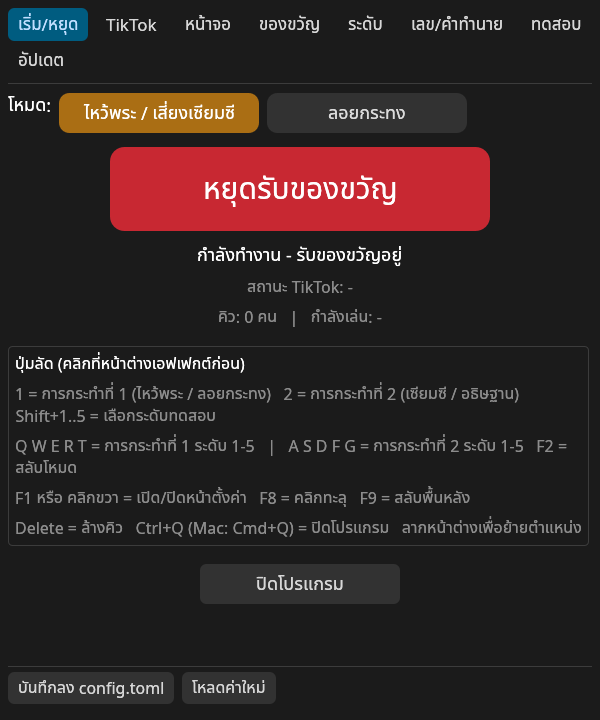

## 5. ตั้งชื่อผู้ใช้ TikTok และเชื่อมต่อ

### 5.1 วิธีหลัก (ในตัวโปรแกรม)
1. **เริ่มไลฟ์บน TikTok ก่อน** (ระบบจะเชื่อมต่อได้เฉพาะตอนที่บัญชีกำลังไลฟ์อยู่)
2. หน้าตั้งค่า → แท็บ **TikTok** → ช่อง **ชื่อผู้ใช้ TikTok** ใส่ชื่อบัญชี (ไม่ต้องมี @) เช่น `mychannel`
3. กด **เชื่อมต่อ / เชื่อมต่อใหม่** → สถานะจะขึ้น **"เชื่อมต่อแล้ว @mychannel"**
4. กด **บันทึกลง config.toml**

ถ้าเชื่อมไม่ติด โปรแกรมจะลองใหม่เองทุก 15 วินาที ไม่ต้องปิด-เปิด

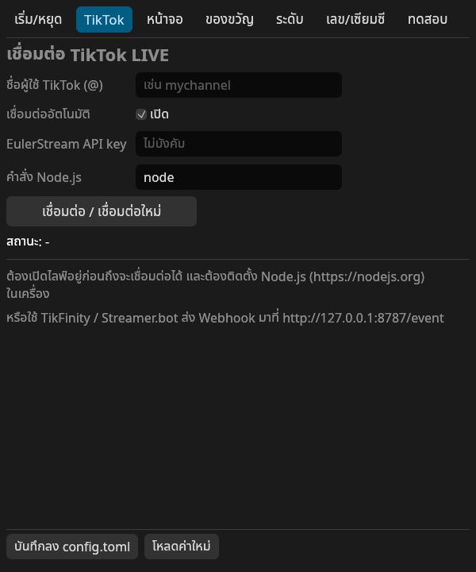

### 5.2 EulerStream API key (ไม่บังคับ)
ตัวเชื่อมใช้บริการ "sign server" ของ EulerStream ถ้าเชื่อมบ่อยแล้วโดนจำกัด ให้สมัคร key ฟรีที่ https://www.eulerstream.com แล้วใส่ในช่อง **EulerStream API key**

### 5.3 วิธีสำรอง: TikFinity / Streamer.bot (ไม่ต้องใช้ Node.js)
โปรแกรมรับ Webhook ที่ `http://127.0.0.1:8787` ได้ ตั้งใน TikFinity ให้ "เมื่อได้รับของขวัญ X → เรียก Webhook / URL":
```
http://127.0.0.1:8787/event?action=pray&user={nickname}&diamonds={coins}
http://127.0.0.1:8787/event?action=siamsi&user={nickname}&diamonds={coins}
```
(ชื่อตัวแปร `{nickname}`, `{coins}` ให้ใช้ตามที่ TikFinity/Streamer.bot ของคุณมีให้ — แต่ละโปรแกรมเรียกไม่เหมือนกัน)
หรือส่งแบบชื่อของขวัญ แล้วให้โปรแกรมจับคู่เองตามแท็บของขวัญ:
```
http://127.0.0.1:8787/gift?gift_name=Rose&user=สมชาย&diamonds=1&repeat=5
```
POST แบบ JSON ก็ได้: `{"gift_name":"Rose","user":"สมชาย","diamonds":1,"repeat":5}`
ถ้าใช้วิธีนี้ ให้ปิด "เชื่อมต่ออัตโนมัติ" ในแท็บ TikTok เพื่อไม่ให้ของขวัญเข้าซ้ำ 2 ทาง

## 6. ตั้งค่าของขวัญ และระดับความหรูหรา

### 6.0 เลือกโหมด (แท็บ "เริ่ม/หยุด")
ปุ่มโหมดด้านบนสุดสลับได้ 3 แบบ (หรือกด F2 ที่หน้าต่างเอฟเฟกต์):
- **ไหว้พระ / เสี่ยงเซียมซี** — เดินไปไหว้พระขึ้นเลข หรือเขย่าเซียมซี
- **ลอยกระทง** — ปล่อยกระทงแล้วขึ้นเลข หรืออธิษฐานรับคำอวยพร
- **ให้อาหารแมว** — แมวเดินเข้าคิวไปที่ชาม ชื่อคนส่งลอยบนหัว อาหารและแมวหรูขึ้นตามยอดของขวัญ (5 ระดับ: ลูกแมว+อาหารเม็ด ถึงแมวหลวงมีมงกุฎ+สำรับปลา) หลังกินเสร็จขึ้นการ์ดขอบคุณมีชื่อคนส่ง (เช่น «ขอบคุณ มะลิ ที่เลี้ยงข้าวน้องแมว») — โหมดนี้ไม่มีเลขมงคล

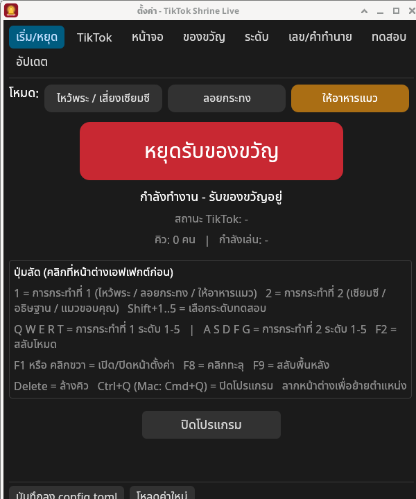 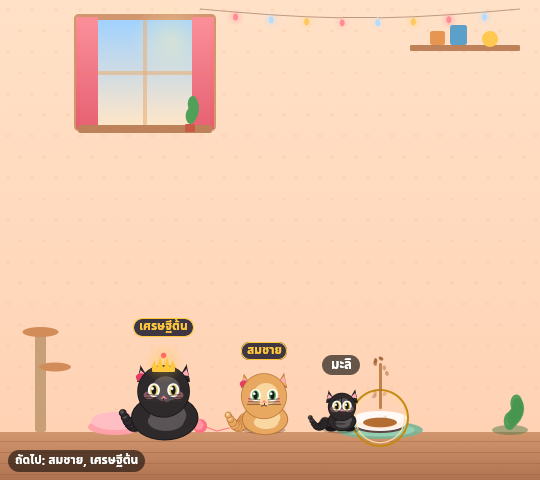

### 6.1 ของขวัญ → การกระทำ (แท็บ "ของขวัญ")
- ใส่ **ชื่อของขวัญภาษาอังกฤษ** ตามที่ TikTok ใช้ (เช่น `Rose`, `TikTok`, `Finger Heart`, `Doughnut`, `Galaxy`) หรือ **gift id** (ตัวเลข) ก็ได้
- เลือกการกระทำ: **ไหว้พระขอเลข** / **เสี่ยงเซียมซี** / **ไม่ทำอะไร**
- **ของขวัญอื่น ๆ ที่ไม่อยู่ในตาราง**: เลือกว่าจะให้ทำอะไร (ค่าเริ่มต้น = ไหว้พระขอเลข)
- **ส่งแบบคอมโบ เล่นซ้ำสูงสุด**: ถ้าผู้ชมส่งกุหลาบ x10 จะเล่นกี่รอบ (ค่าเริ่มต้น 1 รอบ แต่มูลค่ารวม 10 เพชรยังนับเป็นระดับความหรูหรา)
- ไม่รู้ชื่อของขวัญ? ดูในหน้าต่างดำ (console) ตอนรันจาก Terminal หรือดูรายชื่อในเว็บ/แอป TikTok — โปรแกรมพิมพ์ `[gift] ชื่อ ส่ง ... ` ทุกครั้งที่มีของขวัญ

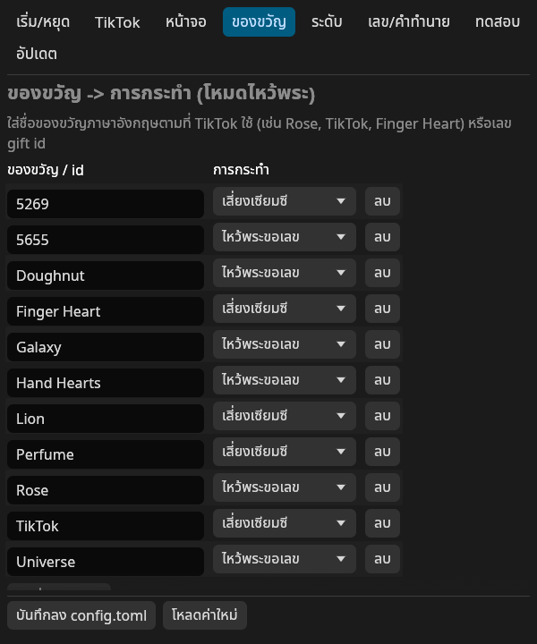

### 6.2 ระดับความหรูหรา (แท็บ "ระดับ")
มูลค่า = **จำนวนเพชรของของขวัญ × จำนวนที่ส่ง** แล้วเทียบกับ "เพชรขั้นต่ำ" ของแต่ละระดับ

| ระดับ | ค่าเริ่มต้น | หน้าตา |
|---|---|---|
| 1 สายบุญ | 0+ | ชุดธรรมดา ป้ายชื่อเล็ก ประกายเล็ก |
| 2 ผู้มีบุญ | 10+ | ผ้าคาดทอง ป้ายชื่อขอบทอง พลุ 2 ลูก |
| 3 เศรษฐีใจบุญ | 100+ | ชุดทอง พรมทอง ป้ายทองมีชื่อระดับ พลุ 4 ลูก |
| 4 มหาเศรษฐี | 1,000+ | มงกุฎ ออร่าเรืองแสง ป้ายริบบิ้น พลุ 8 ลูก + ฝนทอง |
| 5 จักรพรรดิแห่งบุญ | 10,000+ | ชุดจักรพรรดิ+ผ้าคลุม ผู้ติดตามกางฉัตร พรมแดง พลุเต็มฟ้า 18 ลูก แสงระยิบทั้งจอ |

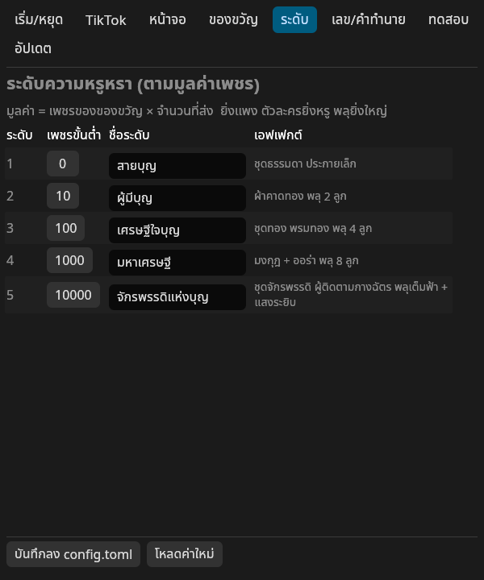

### 6.3 เลขมงคล / เซียมซี (แท็บ "เลข/เซียมซี")
- เลือกสุ่มเลข หนึ่งตัว / สองตัว / สามตัว / สี่ตัว (ติ๊กได้หลายแบบ)
- แก้หัวข้อ และแก้คำทำนายเซียมซีได้ (1 บรรทัด = 1 ใบ จะกี่ใบก็ได้ ค่าเริ่มต้น 28 ใบ)

### 6.4 หน้าจอ (แท็บ "หน้าจอ")
- **เลย์เอาต์**: "ส่วนบนของจอ" (ปรับความสูงเป็น % ของจอแนวตั้งได้ 50% = ครึ่งบน) หรือ "เต็มจอ 9:16"
- **ความกว้าง**: 540 = พอดีจอ HD ครึ่งหนึ่ง, 1080 = คมชัดสุด (ใช้ในโปรแกรมไลฟ์แล้วย่อได้)
- **พื้นหลัง**: โปร่งใส / สีเขียว (Chroma Key) / ฉากวัดเต็ม
- **ลอยอยู่บนสุดเสมอ**, **คลิกทะลุหน้าต่าง** (เปิดแล้วเมาส์จะคลิกทะลุไปโปรแกรมข้างหลัง — กด F8 หรือปิดในหน้าตั้งค่าเพื่อกลับมาลากได้)
- **ความเร็วแอนิเมชัน**, **เวลาแสดงผล**
- **ตอนไม่มีของขวัญ** (idle): **ภาพนิ่ง** (ค่าเริ่มต้น — เห็นองค์พระ/ริมน้ำ ไม่มีตัวละคร ไม่ขยับ) / **ขยับเบา ๆ** (กลีบดอกไม้ แสงระยิบ) / **ซ่อนทั้งหมด** (โปร่งใส มีของขวัญเมื่อไรค่อยค่อย ๆ ปรากฏ)
- **จำนวนตัวละครบนจอพร้อมกัน** (`max_visible`, ค่าเริ่มต้น 5): คนที่กำลังไหว้ + คนที่ยืนต่อแถว ที่เหลือรอนอกจอ

| ภาพนิ่ง ไหว้พระ | ภาพนิ่ง ลอยกระทง |
|---|---|
|  | 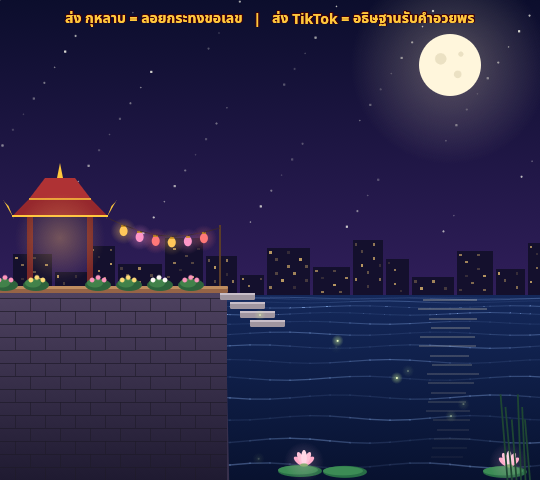 |

### 6.5 โหมด ไหว้พระ / ลอยกระทง
แท็บ **เริ่ม/หยุด** → **โหมด** เลือก **ไหว้พระ**, **ลอยกระทง** หรือ **ให้อาหารแมว** (หรือกด `F2` สลับได้ระหว่างไลฟ์ ไม่ต้องปิดโปรแกรม) แต่ละโหมดมีตารางของขวัญแยกกัน
- **ลอยกระทง + ขอเลข**: ตัวละครถือกระทงเดินลงท่าน้ำ อธิษฐาน แล้วปล่อยกระทงลอยไป ขึ้นเลขมงคล
- **ลอยกระทง + อธิษฐาน**: ปล่อยกระทงแล้วขึ้นการ์ด **คำอวยพร** (แก้รายการคำอวยพรได้ในแท็บ เลข/คำทำนาย)
- กระทงจะลอยค้างในแม่น้ำพร้อมชื่อผู้ส่ง (ตั้งจำนวนสูงสุด/เวลาได้ใน `config.toml` หัวข้อ `[krathong]`)

| ลอยกระทง | คำอวยพร | บนไลฟ์ |
|---|---|---|
| 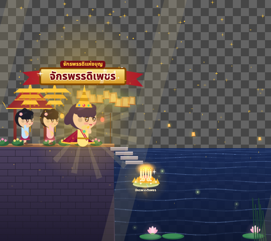 |  | 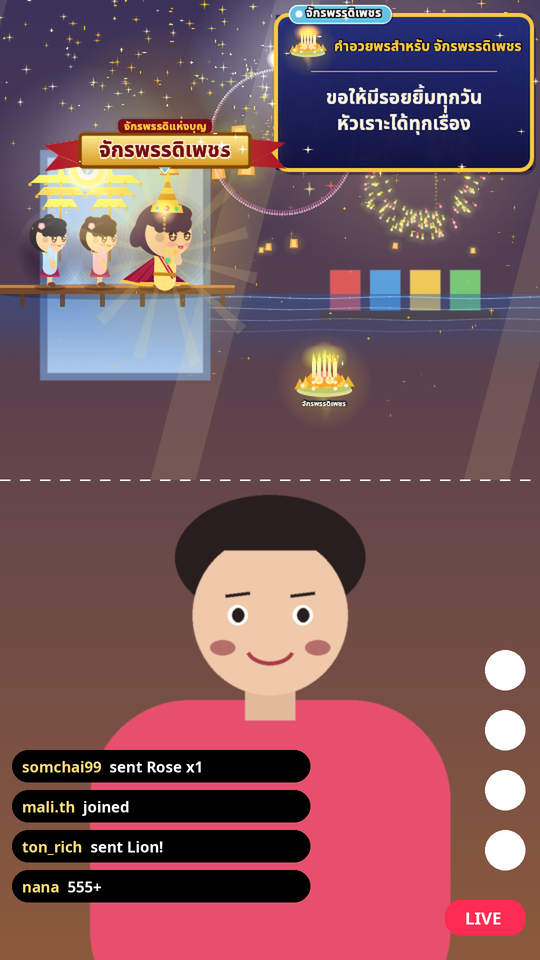 |

### 6.5.1 โหมดให้อาหารแมว 🐱
- ผู้ชมส่งของขวัญ → **แมวของคนนั้นเดินเข้ามาที่ชาม** (ชื่อคนส่งลอยบนหัว) เทอาหาร → แมวกิน → ขึ้น **การ์ดขอบคุณ** ที่มีชื่อคนส่ง (ป้ายชื่อ "ของ …" ที่มุมการ์ด)
- **โหมดนี้ไม่มีเลขมงคลและไม่มีเซียมซี** — ของขวัญทุกแบบ (ทั้ง "ให้อาหารแมว" และ "แมวขอบคุณ") จบด้วยการ์ดขอบคุณเท่านั้น
- ยิ่งยอดของขวัญสูง แมวและอาหารยิ่งหรู: ระดับ 1 ลูกแมว + อาหารเม็ด … ระดับ 5 แมวหลวงใส่มงกุฎ + สำรับปลา
- หลายคนส่งพร้อมกัน แมวจะ **นั่งต่อแถว** รอคิวเหมือนโหมดอื่น
- แก้ข้อความขอบคุณได้ใน `config.toml` หัวข้อ `[cat]` (`thanks`, `thanks_title`) และตั้งของขวัญแยกของโหมดนี้ได้ในแท็บของขวัญ

| เดินมาที่ชาม | กิน | การ์ดขอบคุณ (ระดับ 5) | บนไลฟ์ (3 คน) |
|---|---|---|---|
| 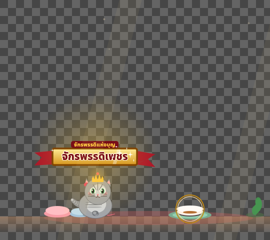 | 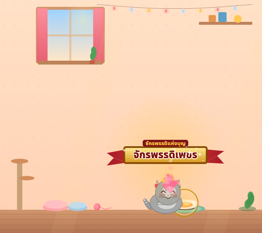 | 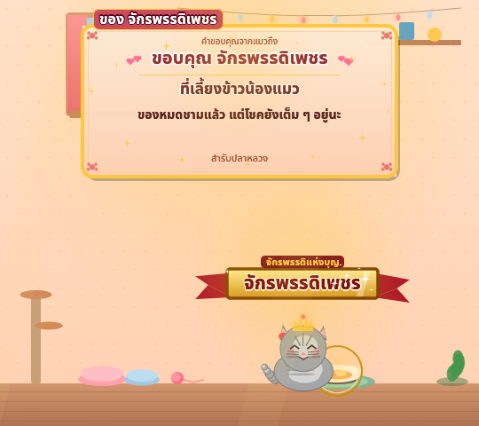 | 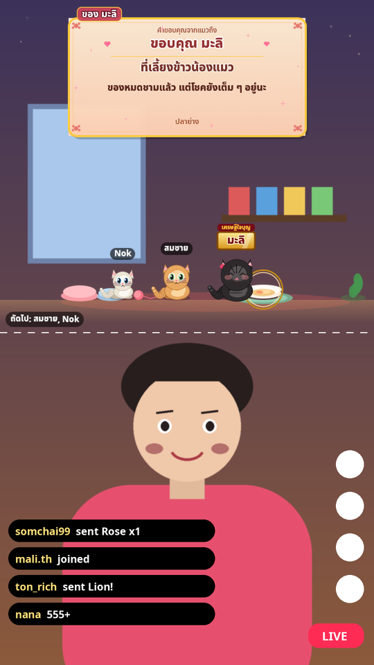 |

ตัวอย่างเคลื่อนไหว: [ระดับ 1](../previews/cat_t1.gif) · [ระดับ 5](../previews/cat_t5.gif) · [คิวแมว](../previews/cat_queue.gif)

### 6.6 หลายคนส่งพร้อมกัน — ต่อแถว
ถ้ามีหลายคนส่งของขวัญติด ๆ กัน ตัวละครของแต่ละคนจะ **เดินออกมายืนต่อแถว** ทีละคน (เห็นพร้อมกันได้สูงสุด 5 คน) **ทุกคนมีป้ายชื่อเหนือหัว**
คนหน้าสุดทำพิธี → การ์ดผล (เลข/คำทำนาย/คำอวยพร) จะมี **ป้ายชื่อสีเดียวกับเจ้าของ** ที่มุมบนซ้าย และ **เส้นประชี้ลงไปที่ตัวละครเจ้าของ** จึงไม่สับสนว่าเลขเป็นของใคร → เดินออก → แถวขยับขึ้น
ชื่อที่มีอีโมจิ โปรแกรมจะตัดอีโมจิออกให้ (ฟอนต์วาดอีโมจิไม่ได้) ชื่อยาวจะถูกตัดท้ายเป็น …

| คนหน้าสุดไหว้ แถวรอ | การ์ดชี้ไปที่เจ้าของ | ลอยกระทง |
|---|---|---|
|  |  |  |

## 7. ทดสอบด้วยคีย์บอร์ด

คลิกที่หน้าต่างเอฟเฟกต์ 1 ครั้งก่อน แล้วกด:

| ปุ่ม | ผล |
|---|---|
| `1` | ไหว้พระขอเลข (ระดับที่เลือกไว้) |
| `2` | เสี่ยงเซียมซี (ระดับที่เลือกไว้) |
| `Shift+1` … `Shift+5` | เลือกระดับสำหรับปุ่ม 1/2 |
| `Q W E R T` | ไหว้พระ ระดับ 1 – 5 |
| `A S D F G` | เซียมซี ระดับ 1 – 5 |
| `F1` / คลิกขวา | เปิด/ปิดหน้าตั้งค่า |
| `F2` | สลับโหมด ไหว้พระ → ลอยกระทง → ให้อาหารแมว |
| `F8` | เปิด/ปิด คลิกทะลุ |
| `F9` | สลับพื้นหลัง ใส → เขียว → ฉาก |
| `Delete` | ล้างคิว |
| `Ctrl+Q` / `Cmd+Q` | ปิดโปรแกรม |

หรือใช้ปุ่มในแท็บ **ทดสอบ** หรือเปิดเบราว์เซอร์ไปที่
`http://127.0.0.1:8787/event?action=pray&user=ทดสอบ&diamonds=10000`

ส่งหลายอันติดกันได้ — ตัวละครจะ **ยืนต่อแถว** เล่นทีละคน (มุมซ้ายล่างบอกชื่อคนถัดไป)

## 8. ใส่ในโปรแกรม TikTok LIVE Studio

> หมายเหตุ: ยังไม่ได้ทดสอบกับ LIVE Studio รุ่นจริง เมนูอาจต่างไปตามรุ่น

1. เปิด TikTok Shrine Live ก่อน แล้วเปิด TikTok LIVE Studio ตั้งเป็นจอ **แนวตั้ง (Portrait)**
2. ในฉาก (Scene) กด **+ Add Source** → **Window Capture (จับภาพหน้าต่าง)** หรือ **Game Capture**
3. เลือกหน้าต่าง **TikTok Shrine Live** (ไม่ใช่ "ตั้งค่า - TikTok Shrine Live")
4. ลากกรอบไปไว้ **ครึ่งบนของจอ** ปรับขนาดให้กว้างเต็มจอ
5. ถ้าพื้นหลังเป็นสีดำ (LIVE Studio ไม่รองรับความโปร่งใสของหน้าต่าง):
   - ตั้งพื้นหลังเป็น **สีเขียว** ในแท็บหน้าจอ แล้วใช้ **Chroma Key / Green screen** กับแหล่งภาพนี้ (ถ้า LIVE Studio รุ่นของคุณมี)
   - หรือใช้ **OBS** แทน (ข้อ 9) แล้วส่งภาพเข้า LIVE Studio ผ่าน **OBS Virtual Camera** หรือไลฟ์จาก OBS ด้วย Stream Key (ถ้าบัญชีได้สิทธิ์)

## 9. ใส่ใน OBS Studio

### Windows — โปร่งใสจริง (แนะนำ)
1. ตั้ง OBS เป็นจอแนวตั้ง: Settings → Video → Base/Output **1080x1920**
2. Sources → **+** → **Game Capture**
   - Mode: **Capture specific window**
   - Window: **[tiktok-shrine-live.exe / TikTokShrineLive.exe]: TikTok Shrine Live**
   - ✅ ติ๊ก **Allow Transparency**
3. ลากไปไว้ครึ่งบน กด Ctrl+F (Fit to screen) แล้วปรับความสูง หรือคลิกขวา → Transform → Edit Transform
4. ถ้า Game Capture จับไม่ได้: ใช้ **Window Capture** (Capture Method: Windows 10 (1903 and up)) + โหมดพื้นหลัง **สีเขียว** + ฟิลเตอร์ **Chroma Key** (ข้อด้านล่าง)

### Mac / ทุกระบบ — โหมดจอเขียว
1. แท็บหน้าจอ → พื้นหลัง **สีเขียว (Chroma Key)** (โหมดนี้ปิดแสงเรืองแบบโปร่งแสงอัตโนมัติ ขอบจะได้สะอาด)
2. OBS → Sources → **Window Capture** (Mac: **macOS Screen Capture** → Method: Window Capture) → เลือกหน้าต่าง TikTok Shrine Live
3. คลิกขวาที่ Source → **Filters** → **+** → **Chroma Key** → Key Color Type: **Green** → ปรับ Similarity ~400, Smoothness ~80, Key Color Spill Reduction ~100
4. วางไว้ครึ่งบนของจอ

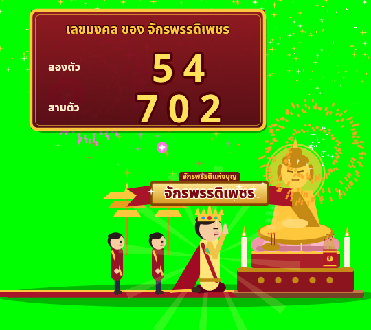 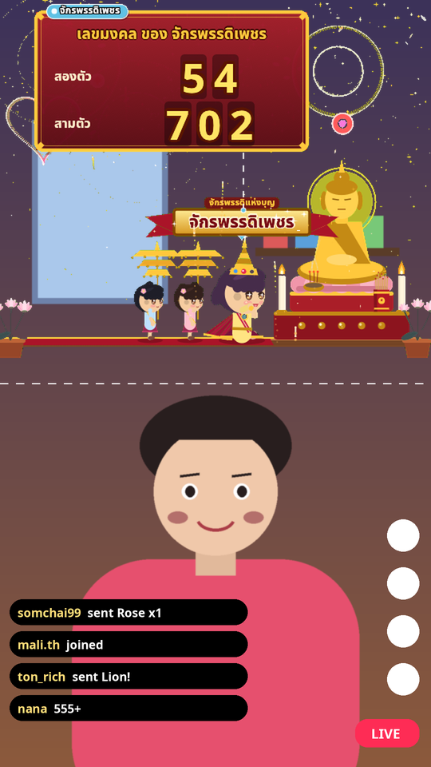

### 9.1 ไลฟ์จาก Mac โดยใช้มือถือเป็นกล้อง (ทีละขั้น)

> ⚠️ **ไลฟ์จากแอป TikTok บนมือถือโดยตรง จะใส่เอฟเฟกต์นี้ไม่ได้** — แอปมือถือส่งได้แค่ภาพจากกล้องมือถือ ดึงหน้าต่างโปรแกรมบนคอมไม่ได้
> วิธีที่ใช้ได้คือ: ให้มือถือเป็น **กล้อง** ของ Mac → รวมภาพกล้อง + หน้าต่างเอฟเฟกต์ใน **OBS** (หรือ **TikTok LIVE Studio**) → ส่งขึ้น TikTok จาก Mac

ข้อมูลอ้างอิงตรวจเมื่อ พ.ย. 2026 (เมนูอาจเปลี่ยนตามรุ่น): [Apple Continuity Camera](https://support.apple.com/en-us/102546) · [Camo](https://camo.com/support/how-to/use-android-as-webcam) · [DroidCam OBS](https://droidcam.app/obs/) · [TikTok LIVE Studio FAQ](https://www.tiktok.com/live/studio/help/article/FAQ/FAQ)

**ขั้นที่ 1 — ให้มือถือเป็นกล้องของ Mac**
- **iPhone → Continuity Camera** (มีในระบบ ไม่ต้องลงแอป): ต้องเป็น iPhone XR ขึ้นไป + iOS 16 ขึ้นไป และ Mac ที่ใช้ macOS Ventura 13 ขึ้นไป, ล็อกอิน **Apple Account เดียวกัน** (เปิดยืนยันตัวตน 2 ชั้น), เปิด **Wi-Fi + Bluetooth** ทั้งสองเครื่อง, วาง iPhone ให้นิ่ง (ขาตั้ง/ที่หนีบ) ใกล้ Mac **ล็อกจอไว้** และหัน **กล้องหลัง** มาทางเรา (Mac ต้องไม่ได้ใช้ AirPlay/Sidecar อยู่ ถ้าใช้สาย USB ให้กด "เชื่อถือ" Mac ก่อน) แล้วใน OBS จะเห็น iPhone เป็นกล้องตัวหนึ่ง
- **Android → Camo**: ลงแอป **Camo Camera** บนมือถือ (Google Play) + **Camo Studio** บน Mac (ตอนเปิดครั้งแรกให้ติดตั้ง camera extension และอนุญาตใน System Settings) เสียบสาย USB (แนะนำ, ภาพหน่วงน้อยสุด — ถ้าเคยเปิด USB debugging ให้ปิดก่อน) หรือจับคู่ Wi-Fi ด้วย QR → ใน OBS เลือกกล้องชื่อ **Camo Camera**
- **Android → DroidCam**: บน Mac ใช้ผ่าน **ปลั๊กอิน DroidCam สำหรับ OBS** (ดาวน์โหลดรุ่นให้ตรงกับเวอร์ชัน OBS ที่ใช้) แล้วเพิ่ม Source ชนิด **DroidCam** ใน OBS ใส่ Wi-Fi IP ที่แอปบนมือถือแสดง (อนุญาต OBS ใน System Settings → Privacy & Security → **Local Network**) — รุ่นฟรีได้ความละเอียดมาตรฐาน

**ขั้นที่ 2 — ตั้ง OBS บน Mac**
1. ดาวน์โหลด OBS Studio จาก https://obsproject.com (มีรุ่น Apple Silicon และ Intel) เปิดครั้งแรกให้อนุญาต **Camera**, **Microphone** และ **Screen & System Audio Recording** (macOS รุ่นเก่าเรียก Screen Recording — อยู่ใน System Settings → Privacy & Security) แล้วเปิด OBS ใหม่
2. Settings → Video → Base (Canvas) และ Output **1080x1920** (แนวตั้ง)
3. Sources → **+** → **Video Capture Device** → Device: เลือก iPhone (Continuity Camera) หรือ **Camo Camera** (ถ้าใช้ DroidCam ให้เลือก Source **DroidCam** แทน) → คลิกขวา → Transform → **Fit to screen** ให้เต็มจอ
4. เปิด TikTok Shrine Live → แท็บหน้าจอ → พื้นหลัง **สีเขียว (Chroma Key)**
5. Sources → **+** → **macOS Screen Capture** → Method: **Window Capture** → เลือกหน้าต่าง **TikTok Shrine Live** (ไม่ใช่หน้าต่าง "ตั้งค่า")
6. ลาก Source นี้ให้อยู่ **เหนือ** Video Capture Device ในรายการ Sources (อันบนสุดจะทับอันล่าง) แล้ววางไว้ **ครึ่งบนของจอ**
7. คลิกขวาที่ Source หน้าต่างเอฟเฟกต์ → **Filters** → **+** → **Chroma Key** (Key Color Type: Green) ตามค่าในข้อ 9 ด้านบน → จะเห็นหน้าเราจากกล้องมือถือด้านล่าง เอฟเฟกต์ลอยอยู่ครึ่งบน
8. Sources → **+** → **Audio Input Capture** → เลือกไมค์ (หรือไมค์ของ iPhone/Camo)

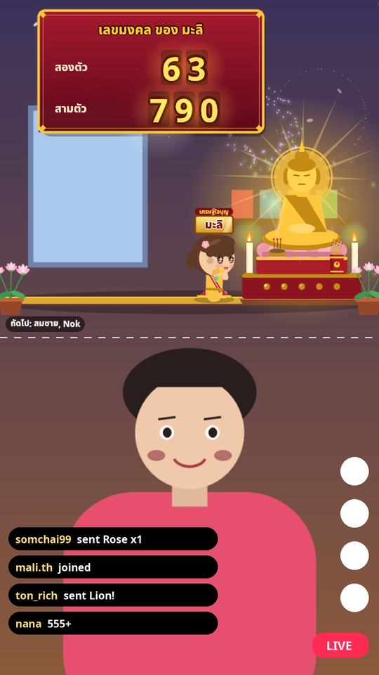

**ขั้นที่ 3 — ส่งภาพขึ้น TikTok**
- **ทาง A: OBS + Stream Key** — บนเบราว์เซอร์ล็อกอิน TikTok แล้วไปที่ **LIVE Center** (https://livecenter.tiktok.com) → ตั้งชื่อไลฟ์ → จะได้ **Server URL** และ **Stream Key** → ใน OBS: Settings → Stream → Service: **Custom…** → วาง Server URL และ Stream Key → **Start Streaming**
  - ⚠️ **ไม่ใช่ทุกบัญชีจะมี Stream Key** — TikTok เป็นคนให้สิทธิ์ (ต้องมีสิทธิ์ไลฟ์ก่อน: อายุ 18+, ผู้ติดตามตามเกณฑ์ของประเทศ, ไม่มีการละเมิด) ถ้าไม่เห็นช่อง Server URL/Stream Key แปลว่าบัญชียังไม่ได้สิทธิ์นี้
  - Stream Key มักใช้ได้ครั้งเดียว/เปลี่ยนทุกรอบ — คัดลอกใหม่ทุกครั้งก่อนไลฟ์ และ **ห้ามให้ใครเห็น Stream Key**
- **ทาง B: TikTok LIVE Studio** (ถ้าไม่มี Stream Key) — LIVE Studio มีรุ่น **macOS** แล้ว (Apple Silicon และ Intel, ดาวน์โหลดที่ https://www.tiktok.com/studio/download) ล็อกอินด้วยบัญชี TikTok แล้วไลฟ์ได้เลยโดยไม่ต้องใช้ Stream Key (บัญชีต้องมีสิทธิ์ไลฟ์) เพิ่มกล้องมือถือเป็นกล้อง และเพิ่ม **Add source → Window capture** เลือกหน้าต่าง TikTok Shrine Live วางไว้ครึ่งบน
  - ถ้าใน LIVE Studio ลบพื้นเขียวของหน้าต่างไม่ได้ (บางรุ่นมี Chroma Key เฉพาะกล้อง) ให้ทำภาพใน OBS ตามขั้นที่ 2 แล้วกด **Start Virtual Camera** ใน OBS จากนั้นใน LIVE Studio เลือก **OBS Virtual Camera** เป็นกล้อง

**ขั้นที่ 4 — เชื่อมของขวัญ**
1. เริ่มไลฟ์ให้ขึ้นก่อน (ทาง A หรือ B)
2. หน้าตั้งค่า TikTok Shrine Live → แท็บ **TikTok** → ใส่ **ชื่อผู้ใช้ TikTok** (ไม่ต้องมี @) → **เชื่อมต่อ** → รอสถานะ "เชื่อมต่อแล้ว" → **บันทึกลง config.toml** (ต้องติดตั้ง Node.js ไว้แล้ว ดูข้อ 1 และ 5)
3. ลองให้เพื่อนส่งกุหลาบ หรือกด `1` ที่หน้าต่างเอฟเฟกต์เพื่อทดสอบว่าภาพขึ้นในไลฟ์

## 10. เช็กลิสต์ก่อนเริ่มไลฟ์

- [ ] ติดตั้ง Node.js แล้ว (หรือใช้ TikFinity)
- [ ] เปิด TikTok Shrine Live → ใส่ชื่อผู้ใช้ → บันทึก
- [ ] จัดหน้าต่างเอฟเฟกต์ในโปรแกรมไลฟ์ไว้ครึ่งบน กดทดสอบ `1` `2` `T` `G` ดูว่าแสดงครบ ไม่โดนตัด
- [ ] ตั้งของขวัญที่ผู้ชมต้องส่ง และแก้ "ข้อความคำแนะนำ" ให้ตรง (เช่น ส่งกุหลาบ = ไหว้พระขอเลข)
- [ ] เริ่มไลฟ์บน TikTok → กลับมากด **เชื่อมต่อ / เชื่อมต่อใหม่** → สถานะ "เชื่อมต่อแล้ว"
- [ ] ให้เพื่อนส่งกุหลาบ 1 ดอกทดสอบ
- [ ] (ถ้าต้องการ) เปิด **คลิกทะลุ** เพื่อไม่ให้เผลอคลิกโดนหน้าต่าง
- [ ] ปุ่ม **หยุดรับของขวัญ** ใช้พักเอฟเฟกต์ชั่วคราวได้โดยไม่ต้องปิดโปรแกรม

## 11. แก้ปัญหา

| อาการ | วิธีแก้ |
|---|---|
| สถานะ "ไม่พบ Node.js" | ติดตั้ง Node.js LTS จาก nodejs.org แล้วปิด-เปิดโปรแกรม / หรือใส่ path เต็มในช่อง "คำสั่ง Node.js" เช่น `C:\Program Files\nodejs\node.exe` หรือ `/opt/homebrew/bin/node` |
| "เชื่อมต่อไม่ได้ (… ไม่ได้ไลฟ์อยู่?)" | ต้องเริ่มไลฟ์ก่อน / ตรวจชื่อผู้ใช้ / รอสักครู่โปรแกรมลองใหม่เอง / ใส่ EulerStream API key |
| เชื่อมได้ แต่ส่งของขวัญแล้วไม่มีอะไรเกิด | ดูว่าไม่ได้กด "หยุดรับของขวัญ" / ชื่อของขวัญในแท็บของขวัญตรงไหม / ของขวัญอื่นตั้งเป็น "ไม่ทำอะไร" หรือเปล่า |
| เคยใช้ได้ แล้ววันหนึ่งใช้ไม่ได้ | TikTok เปลี่ยนระบบ ตัวเชื่อมแบบไม่เป็นทางการพัง → อัปเดตโปรแกรมเวอร์ชันใหม่ หรือใช้ TikFinity ส่ง Webhook แทนชั่วคราว |
| พื้นหลังดำในโปรแกรมไลฟ์ | ใช้ OBS Game Capture + Allow Transparency หรือเปลี่ยนเป็นโหมดเขียว + Chroma Key |
| ลากหน้าต่างไม่ได้ / คลิกไม่โดน | ปิดคลิกทะลุ (F8 หรือหน้าตั้งค่า หรือเปิด `http://127.0.0.1:8787/control?click_through=0`) |
| หาหน้าตั้งค่าไม่เจอ | คลิกขวาที่หน้าต่างเอฟเฟกต์ หรือกด F1 |
| ตัวอักษรไทยเพี้ยน | ไม่ควรเกิด (ฟอนต์ Noto Sans Thai ฝังในโปรแกรม) ถ้าเกิดแจ้งผู้พัฒนาพร้อมภาพหน้าจอ |
| พอร์ต 8787 ถูกใช้ | แก้ `bind` ในส่วน `[http]` ของ config.toml เช่น `127.0.0.1:8899` |
| ต้องการรีเซ็ตการตั้งค่า | ลบ `config.toml` แล้วเปิดโปรแกรมใหม่ จะสร้างไฟล์ค่าเริ่มต้นให้ |

### ความเสี่ยงที่ควรรู้
TikTok **ไม่มี API ทางการ** สำหรับอ่านของขวัญในไลฟ์ โปรแกรมนี้ใช้ไลบรารีโอเพนซอร์ส `tiktok-live-connector` (แบบ reverse-engineering) ซึ่งอาจหยุดทำงานเมื่อ TikTok เปลี่ยนระบบ และการใช้เครื่องมือที่ไม่เป็นทางการเป็นความเสี่ยงของผู้ใช้เอง (โปรแกรมแค่ "อ่าน" ไลฟ์ ไม่ได้ล็อกอินหรือส่งอะไรแทนบัญชีคุณ)

## 12. อัปเดตโปรแกรม
แท็บ **อัปเดต** ในหน้าตั้งค่า (โปรแกรมตรวจให้เองทุกครั้งที่เปิด ปิดได้ด้วย `check_on_start = false` ใน `[update]`)

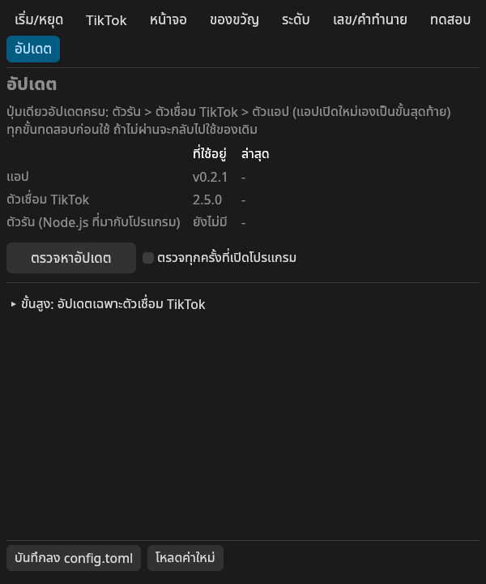

- **ตรวจหาอัปเดต**: ถามเวอร์ชันล่าสุดจาก GitHub Releases ถ้ามีใหม่จะขึ้นแถบแจ้งด้านบนหน้าตั้งค่า พร้อมรายการสิ่งที่เปลี่ยน
- **อัปเดตเลย**: ดาวน์โหลดไฟล์ของระบบที่ใช้อยู่ (Windows zip / macOS zip / Linux tar.gz) แสดงความคืบหน้า สลับไฟล์โปรแกรม แล้ว **เปิดใหม่เอง** (`config.toml` เดิมไม่ถูกแตะ)
- ก่อนเปิดใหม่ โปรแกรมจะ **ทดลองเปิดไฟล์ใหม่** ก่อน ถ้าไฟล์ใหม่เปิดไม่ได้บนเครื่องนี้ จะ **คืนไฟล์เดิมให้อัตโนมัติ** และทำงานต่อด้วยเวอร์ชันเดิม (ขึ้นข้อความ "ย้อนกลับเป็นเวอร์ชันเดิมแล้ว")
- **อัปเดตตัวเชื่อม TikTok**: อัปเดตเฉพาะตัวเชื่อม (`bridge.cjs`) เมื่อ TikTok เปลี่ยนระบบแล้วเชื่อมไม่ติด — ไม่ต้องลงโปรแกรมใหม่ทั้งหมด แสดงเวอร์ชันที่ใช้อยู่และเวอร์ชันล่าสุด
- Windows ต้องมี `curl.exe` (มีอยู่แล้วใน Windows 10 1803 ขึ้นไป / Windows 11)
