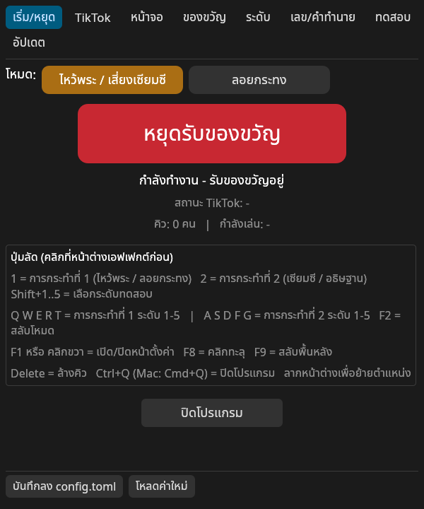
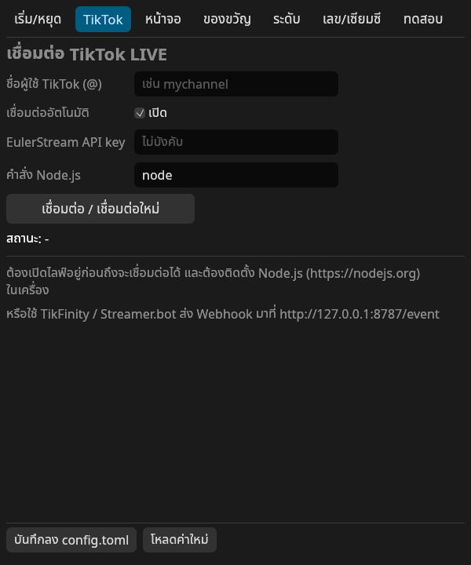
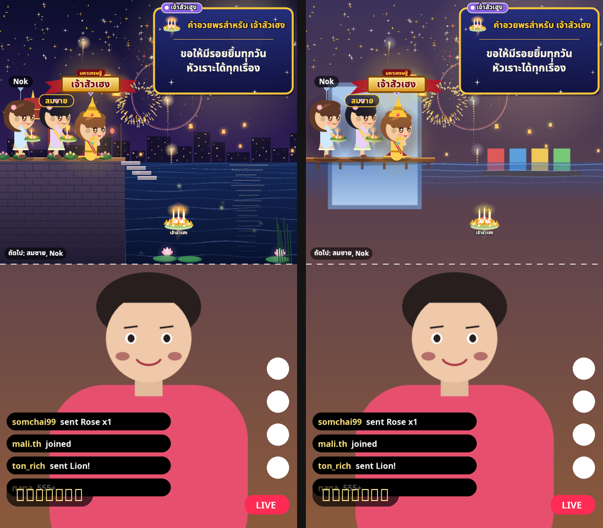
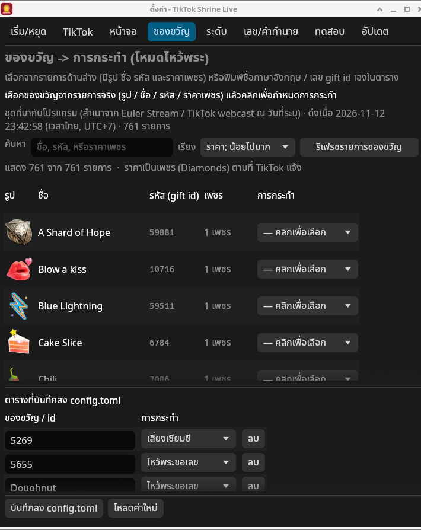
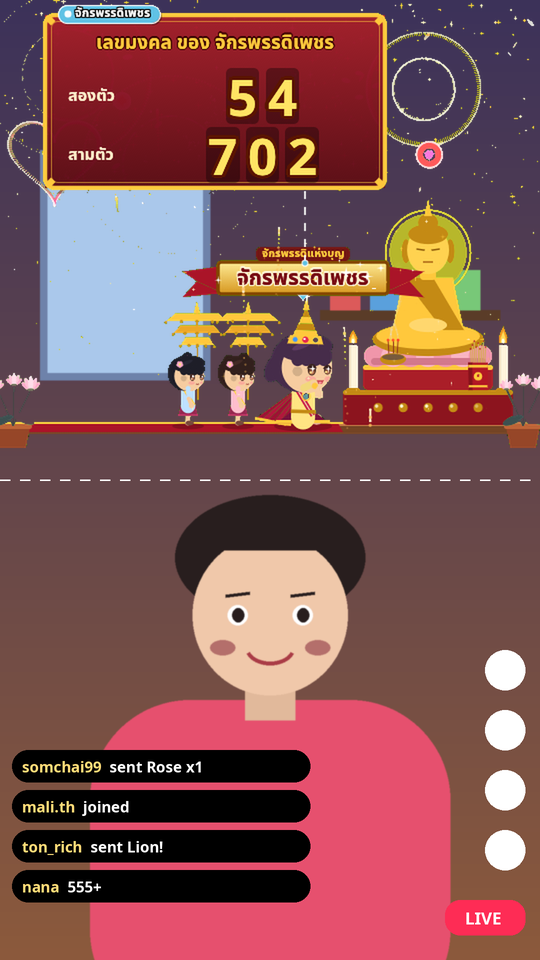
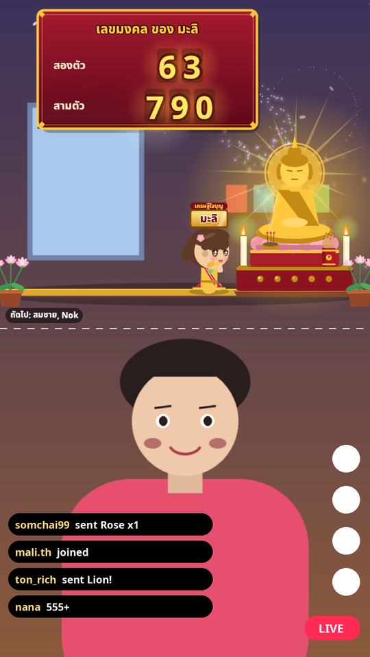
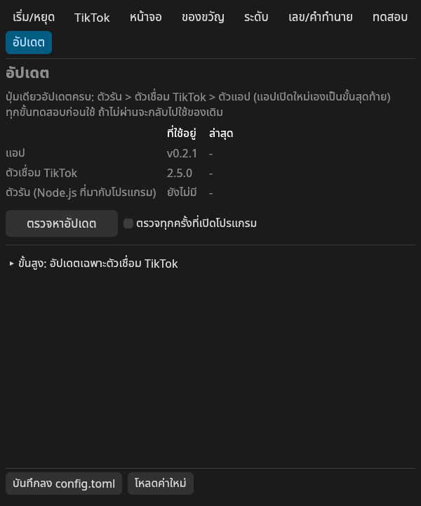

# ติดตั้งและไลฟ์บน Mac (ทีละขั้น)

คู่มือนี้สำหรับ **macOS 11 ขึ้นไป** (ทั้ง Apple Silicon M1/M2/M3/M4 และ Intel) เท่านั้น — ใช้ Windows ให้ดู [ติดตั้ง-Windows.md](ติดตั้ง-Windows.md)
**ไม่ต้องติดตั้ง Node.js หรือโปรแกรมอื่นเพิ่ม** ตัวเชื่อม TikTok อยู่ในแอปแล้ว

> สารบัญ: [1 ดาวน์โหลด](#1-ดาวน์โหลด) · [2 ติดตั้ง](#2-ติดตั้ง) · [3 เปิดครั้งแรก](#3-เปิดครั้งแรก-gatekeeper) · [4 ใส่ชื่อ TikTok](#4-ใส่ชื่อ-tiktok) · [5 เลือกโหมด/พื้นหลัง](#5-เลือกโหมด-พื้นหลัง-และขนาด) · [6 ใส่ในโปรแกรมไลฟ์](#6-ใส่เอฟเฟกต์ในโปรแกรมไลฟ์) · [7 มือถือเป็นกล้อง](#7-ใช้มือถือเป็นกล้อง) · [8 เริ่มไลฟ์](#8-เริ่มไลฟ์) · [9 อัปเดต](#9-อัปเดต) · [10 แก้ปัญหา](#10-แก้ปัญหา)

---

## 1. ดาวน์โหลด

1. เปิด https://github.com/samaboon/tiktok-shrine-live/releases/latest
2. ในหัวข้อ **Assets** กดไฟล์ **`TikTokShrineLive-macOS-universal.dmg`** (ใช้ได้ทั้ง Mac ชิป Apple และ Intel)

## 2. ติดตั้ง

1. ดับเบิลคลิก `TikTokShrineLive-macOS-universal.dmg` ในโฟลเดอร์ Downloads
2. ลากไอคอน **TikTok Shrine Live** ไปวางบนโฟลเดอร์ **Applications** ในหน้าต่างเดียวกัน
3. ปิดหน้าต่าง dmg แล้ว **Eject** (คลิกขวาที่ไอคอน dmg บนเดสก์ท็อป → Eject)
   ⚠️ เปิดแอปจากโฟลเดอร์ **Applications** เสมอ อย่าเปิดจากใน dmg (อัปเดตในแอปจะทำงานไม่ได้)
   💡 ในหน้าต่าง dmg มีไฟล์ **`เปิดครั้งแรก.command`** ช่วยปลดล็อกและเปิดแอปครั้งแรกให้ด้วย (ข้อ 3) — ใช้ก่อน Eject ได้เลย

## 3. เปิดครั้งแรก (Gatekeeper)

แอปนี้ยังไม่ได้ลงทะเบียนกับ Apple (notarize — ต้องมีบัญชีนักพัฒนา Apple แบบเสียเงิน ซึ่งโปรเจกต์นี้ไม่มี) Mac จึงบล็อกตอนเปิดครั้งแรก — ทำครั้งเดียว

**วิธีง่ายสุด — ไฟล์ช่วยเปิดครั้งแรก:**
1. ลากแอปไป **Applications** ตามข้อ 2 ก่อน
2. ในหน้าต่าง dmg ดับเบิลคลิก **`เปิดครั้งแรก.command`** → Terminal จะปลดล็อกการกักกัน (quarantine) แล้วเปิดแอปให้เอง
   - ถ้าตัวไฟล์ช่วยเองถูกบล็อก: **คลิกขวา (หรือ Control+คลิก) → Open** แล้วกด **Open**
   - ถ้าขึ้นว่า "ไม่พบแอป": ยังไม่ได้ลากไป Applications — ลากก่อนแล้วดับเบิลคลิกไฟล์ช่วยใหม่

**หรือทำเองทีละขั้น (ไม่ต้องใช้ไฟล์ช่วย):**

**macOS 15 Sequoia ขึ้นไป** (คลิกขวา → Open ใช้ไม่ได้แล้วในรุ่นนี้):
1. Finder → **Applications** → ดับเบิลคลิก **TikTok Shrine Live** → จะขึ้นคำเตือน ให้กด **Done** (เสร็จสิ้น) — อย่ากด Move to Trash
2. เมนู Apple  → **System Settings** → **Privacy & Security** → เลื่อนลงล่างสุด ส่วน **Security** จะเห็น "TikTok Shrine Live was blocked…" → กด **Open Anyway**
   (ปุ่มนี้ขึ้นอยู่ประมาณ 1 ชั่วโมงหลังลองเปิด ถ้าไม่เห็นให้ทำข้อ 1 ใหม่)
3. ใส่รหัสผ่านเครื่อง → กด **Open Anyway** / **Open** อีกครั้ง

**macOS 14 Sonoma หรือเก่ากว่า:**
1. Finder → **Applications** → **คลิกขวา (หรือ Control+คลิก)** ที่ TikTok Shrine Live → **Open**
2. กด **Open** ในกล่องเตือน

ถ้ายังเปิดไม่ได้ หรือขึ้นว่าแอป **"เสียหาย / damaged"**: เปิดแอป **Terminal** แล้ววางคำสั่งนี้ กด Enter แล้วเปิดแอปใหม่
```
xattr -dr com.apple.quarantine "/Applications/TikTok Shrine Live.app"
```

เปิดได้แล้วจะมี **2 หน้าต่าง**:
- **หน้าต่างเอฟเฟกต์** (ไม่มีขอบ) ← อันนี้ที่ผู้ชมเห็น ลากย้ายได้
- **หน้าต่างตั้งค่า** (พื้นดำ มีแท็บ) ← แผงควบคุม ไม่ติดในไลฟ์ · เปิด/ปิดด้วย **F1** (บางรุ่นต้องกด **fn+F1**) หรือ **คลิกขวา** ที่หน้าต่างเอฟเฟกต์ · ปิดโปรแกรม **Cmd+Q**

**ครั้งแรกสุด** จะมี **ตัวช่วยเริ่มต้น 3 ขั้น** โผล่มา: ใส่ชื่อ TikTok → เปิดการเชื่อมต่อ → เลือกโหมด (ติ๊ก **โหมดง่าย** เพื่อซ่อนตั้งค่าขั้นสูง) → กด **เริ่มใช้งาน** · กด **ข้าม** ได้ถ้าอยากตั้งค่าเองทีหลัง (เปิดซ้ำได้จากปุ่ม **เปิดตัวช่วยเริ่มต้น (3 ขั้น)** ในแท็บเริ่ม/หยุด)



## 4. ใส่ชื่อ TikTok

> ถ้าทำ **ตัวช่วยเริ่มต้น 3 ขั้น** (ข้อ 3) แล้ว ถือว่าทำข้อนี้แล้ว — ข้ามไปข้อ 5 ได้เลย

1. หน้าตั้งค่า → แท็บ **TikTok**
2. ช่อง **ชื่อผู้ใช้ TikTok** ใส่ชื่อบัญชี **ไม่ต้องมี @** เช่น `mychannel`
3. กด **บันทึกลง config.toml** (ปุ่มล่างสุด) — ไฟล์อยู่ที่ `~/Library/Application Support/TikTokShrineLive/`
4. ตอนเริ่มไลฟ์จริง (ข้อ 8) ค่อยกด **เชื่อมต่อ / เชื่อมต่อใหม่** — เชื่อมได้เฉพาะตอนที่บัญชี **กำลังไลฟ์อยู่**



## 5. เลือกโหมด พื้นหลัง และขนาด

- **โหมด** (แท็บ **เริ่ม/หยุด**): ไหว้พระ/เซียมซี · ลอยกระทง · ให้อาหารแมว · โหมดเต้น · ปาตกน้ำ · เลี้ยงแมว (กด **F2** สลับได้)
- **พื้นหลัง** (แท็บ **หน้าจอ**):
  - **สีเขียว (Chroma Key)** — **แนะนำบน Mac** เพราะ OBS บน Mac จับหน้าต่างแบบพื้นใสไม่ได้ แล้วค่อยลบสีเขียวใน OBS (ข้อ 6)
  - **โปร่งใส** — มีแค่ตัวละคร ป้ายชื่อ การ์ด พลุ ลอยทับกล้อง (ใช้ได้ถ้าโปรแกรมไลฟ์ของคุณรองรับพื้นใส)
  - **ฉากเต็ม** — ฉากวัด/แม่น้ำ/ห้องแมว เต็มกรอบ ไม่ต้องลบพื้นหลัง
- **เลย์เอาต์**: "ส่วนบนของจอ" (ครึ่งบน) หรือ "เต็มจอ 9:16"
- ทดสอบ: คลิกหน้าต่างเอฟเฟกต์ 1 ครั้ง แล้วกด `1` (ไหว้พระ) หรือ `2` (เซียมซี) · `T` = ระดับหรูสุด

| ฉากเต็ม vs โปร่งใส |
|---|
|  |

ตั้งค่าระดับความหรูและเลขมงคลเพิ่มเติมดู [คู่มือ.md](คู่มือ.md)

### ของขวัญ / สติกเกอร์ (รหัส gift id)

ในแท็บ **ของขวัญ** มีรายการสติกเกอร์ทั้งชุดพร้อม **รูป ชื่อ รหัส gift id และราคาเพชร** ค้นหาและเรียงตามราคาได้ คลิกเลือกได้ว่าของขวัญนั้นจะทำอะไรในโหมดปัจจุบัน (ไหว้พระ / เซียมซี / ลอยกระทง / ให้อาหารแมว / เต้น / ปาตกน้ำ / เลี้ยงแมว) — ไม่ต้องพิมพ์รหัสเอง

ใส่อะไรก็ได้: **ชื่อภาษาอังกฤษตามที่ TikTok ส่งมา** (เช่น `Rose`, `TikTok`) หรือ **รหัส gift id เป็นตัวเลข** (เช่น `5655` = กุหลาบ) ดูคำอธิบายตาราง `[gifts]` / `[krathong.gifts]` / `[cat.gifts]` ใน [คู่มือ ข้อ 6.1](คู่มือ.md#61-ของขวัญ--การกระทำ-แท็บ-ของขวัญ) และตารางครบชุดใน [รายการของขวัญ](รายการของขวัญ.md)

**ราคาเป็นบาท:** คอลัมน์ **ราคา (บาท)** เป็นราคา **โดยประมาณ** ที่ผู้ชมคนไทยจ่าย คิดจากแพ็กเกจเติมเหรียญทางเว็บของ TikTok (30 เหรียญ = 11 บาท → 1 เพชร ≈ 0.37 บาท เช่น กุหลาบ 1 เพชร ≈ 0.37 บาท) ถ้าผู้ชมเติมผ่านแอปบน iPhone / Android จะแพงกว่านี้ (เช่น iOS 21 เหรียญ = 15 บาท) ปรับอัตราเองได้ที่ช่อง **อัตราโดยประมาณ** ในแท็บของขวัญ (ใส่ `0` = ไม่แสดงราคาบาท) · ทุกครั้งที่เชื่อมไลฟ์ได้ กด **รีเฟรชรายการของขวัญ** เพื่อดึงชุดล่าสุดจาก TikTok




## 6. ใส่เอฟเฟกต์ในโปรแกรมไลฟ์

### 6.1 OBS Studio (แนะนำ)
1. ดาวน์โหลด OBS ที่ https://obsproject.com (มีรุ่น Apple Silicon และ Intel) → ลากไป Applications
2. เปิดครั้งแรกให้อนุญาต **Camera**, **Microphone** และ **Screen & System Audio Recording** (macOS รุ่นเก่าเรียก **Screen Recording**) ใน **System Settings → Privacy & Security** แล้วปิด-เปิด OBS ใหม่
3. OBS → **Settings → Video** → Base (Canvas) และ Output = **1080x1920** (แนวตั้ง)
4. TikTok Shrine Live → แท็บหน้าจอ → พื้นหลัง **สีเขียว (Chroma Key)**
5. OBS → Sources → **+** → **macOS Screen Capture** → Method: **Window Capture** → เลือกหน้าต่าง **TikTok Shrine Live** (ไม่ใช่หน้าต่าง "ตั้งค่า")
6. คลิกขวาที่ Source นี้ → **Filters** → **+** → **Chroma Key** → Key Color Type: **Green** (ถ้าขอบยังเขียว ปรับ Similarity ~400, Smoothness ~80)
7. วาง Source ไว้ **ครึ่งบน** ของจอ

 

### 6.2 TikTok LIVE Studio
1. LIVE Studio มีรุ่น macOS (Apple Silicon และ Intel) ดาวน์โหลดที่ https://www.tiktok.com/studio/download → ล็อกอินด้วยบัญชี TikTok (บัญชีต้องมีสิทธิ์ไลฟ์)
2. ตั้งจอ **แนวตั้ง** → **Add source** → **Window capture** → เลือก **TikTok Shrine Live** → วางครึ่งบน
3. ถ้าลบพื้นเขียวใน LIVE Studio ไม่ได้: ทำภาพใน OBS ตามข้อ 6.1 แล้วกด **Start Virtual Camera** ใน OBS → ใน LIVE Studio เลือกกล้อง **OBS Virtual Camera**

> เมนูของ LIVE Studio เปลี่ยนตามรุ่น — ยังไม่ได้ทดสอบกับ LIVE Studio รุ่นจริง

## 7. ใช้มือถือเป็นกล้อง

> ไลฟ์จาก **แอป TikTok บนมือถือโดยตรง จะใส่เอฟเฟกต์นี้ไม่ได้** — ให้มือถือเป็น "กล้อง" ของ Mac แล้วไลฟ์จาก Mac

เลือกวิธีเดียว:

- **iPhone → Continuity Camera** (มีในระบบ ไม่ต้องลงแอป): iPhone XR ขึ้นไป + iOS 16 ขึ้นไป, Mac ใช้ macOS Ventura 13 ขึ้นไป, ล็อกอิน **Apple Account เดียวกัน** ทั้งสองเครื่อง, เปิด **Wi-Fi + Bluetooth**, วาง iPhone นิ่ง ๆ ใกล้ Mac **ล็อกจอไว้** หันกล้องหลังมาทางเรา → ใน OBS: Sources → **+** → **Video Capture Device** → เลือก iPhone
- **Android → Camo**: ลง **Camo Camera** บนมือถือ (Google Play) + **Camo Studio** บน Mac (เปิดครั้งแรกให้ติดตั้ง camera extension และอนุญาตใน System Settings) → เสียบสาย USB หรือสแกน QR ผ่าน Wi-Fi → ใน OBS เลือกกล้อง **Camo Camera**
- **Android → DroidCam**: ลงแอป DroidCam บนมือถือ + **ปลั๊กอิน DroidCam สำหรับ OBS** (โหลดให้ตรงรุ่น OBS ที่ https://droidcam.app/obs/) → ใน OBS เพิ่ม Source **DroidCam** → **Use WiFi** ใส่ WiFi IP ที่แอปแสดง → **Activate** (อนุญาต OBS ใน **System Settings → Privacy & Security → Local Network**)

**จัดฉากใน OBS:** Source กล้องมือถือ **อยู่ล่าง** (คลิกขวา → Transform → Fit to screen) · Source หน้าต่างเอฟเฟกต์ **อยู่บน** ในรายการ Sources · เพิ่มไมค์: Sources → **+** → **Audio Input Capture**



## 8. เริ่มไลฟ์

1. **เริ่มไลฟ์ให้ขึ้นก่อน**
   - **OBS + Stream Key**: บนเบราว์เซอร์ล็อกอิน TikTok → **LIVE Center** (https://livecenter.tiktok.com) → ได้ **Server URL** + **Stream Key** → OBS: **Settings → Stream** → Service: **Custom…** → วางทั้งสองค่า → **Start Streaming** (ไม่ใช่ทุกบัญชีมี Stream Key — TikTok เป็นคนให้สิทธิ์ · ห้ามให้ใครเห็น Stream Key)
   - หรือ **TikTok LIVE Studio** → กด Go LIVE
2. หน้าตั้งค่า → แท็บ **TikTok** → **เชื่อมต่อ / เชื่อมต่อใหม่** → รอสถานะ **"เชื่อมต่อแล้ว @ชื่อคุณ"**
3. ให้เพื่อนส่งกุหลาบ 1 ดอกทดสอบ หรือกด `1` ที่หน้าต่างเอฟเฟกต์
4. (แนะนำ) เปิด **คลิกทะลุ** (F8) กันเผลอคลิกโดนหน้าต่างเอฟเฟกต์

## 9. อัปเดต

- แอปตรวจเองทุกครั้งที่เปิด ถ้ามีของใหม่จะมีแถบสีส้มบนหน้าตั้งค่า กดปุ่ม **"มีอัปเดต — กดเพื่ออัปเดต"** ปุ่มเดียว
- อัปเดตครบทั้ง **ตัวเชื่อม TikTok และตัวแอป** (ตัวรันอยู่ในแอป อัปเดตไปพร้อมกัน) แล้ว **เปิดใหม่เอง** การตั้งค่าเดิมอยู่ครบ
- ทุกขั้นทดสอบก่อนใช้ ถ้าของใหม่เปิดไม่ได้ จะกลับไปใช้ของเดิมเอง
- ปกติไม่ต้องทำขั้นตอน Gatekeeper ซ้ำหลังอัปเดต (ถ้าถูกถามอีก ทำตามข้อ 3)



## 10. แก้ปัญหา

| อาการ | วิธีแก้ |
|---|---|
| ไม่เห็นปุ่ม **Open Anyway** | ดับเบิลคลิกแอปอีกครั้ง กด Done แล้วกลับไปดู Privacy & Security ทันที (ปุ่มอยู่ประมาณ 1 ชั่วโมง) |
| ไฟล์ `เปิดครั้งแรก.command` ดับเบิลคลิกแล้วไม่ทำงาน | คลิกขวาที่ไฟล์ → **Open** · หรือทำเองตามข้อ 3 (คำสั่ง `xattr`) |
| ขึ้นว่าแอป "เสียหาย/damaged" | ใช้คำสั่ง `xattr` ในข้อ 3 |
| OBS ไม่เห็นหน้าต่างให้เลือก | อนุญาต **Screen & System Audio Recording** ให้ OBS ใน Privacy & Security แล้วปิด-เปิด OBS |
| ขอบเขียวเหลืออยู่ | ปรับ Similarity/Smoothness ใน Chroma Key · ตั้งพื้นหลังโปรแกรมเป็น "สีเขียว" (โหมดนี้ปิดแสงเรืองให้ขอบคม) |
| "เชื่อมต่อไม่ได้ (… ไม่ได้ไลฟ์อยู่?)" | ต้องเริ่มไลฟ์ก่อน · ตรวจชื่อผู้ใช้ (ไม่มี @) · รอ โปรแกรมลองใหม่เองทุก 15 วินาที |
| เคยใช้ได้ วันหนึ่งเชื่อมไม่ได้ | TikTok เปลี่ยนระบบ → กด **มีอัปเดต — กดเพื่ออัปเดต** (ถ้ามี) |
| Continuity Camera ไม่ขึ้น | Apple Account เดียวกัน, Wi-Fi+Bluetooth เปิด, iPhone ล็อกจอและวางนิ่ง, Mac ไม่ได้ใช้ AirPlay/Sidecar อยู่ |
| คลิก/ลากหน้าต่างไม่ได้ | ปิดคลิกทะลุ: กด **F8** หรือปิดในแท็บหน้าจอ |
| อยากรีเซ็ตการตั้งค่า | ปิดแอป ลบ `~/Library/Application Support/TikTokShrineLive/config.toml` แล้วเปิดใหม่ |

ข้อมูลอ้างอิง (ตรวจเมื่อ พ.ย. 2026 เมนูอาจเปลี่ยนตามรุ่น): [Apple: เปิดแอปจากผู้พัฒนาที่ไม่รู้จัก](https://support.apple.com/guide/mac-help/mh40616/mac) · [Apple Continuity Camera](https://support.apple.com/en-us/102546) · [Camo](https://camo.com/support/how-to/use-android-as-webcam) · [DroidCam OBS](https://droidcam.app/obs/) · [OBS Game Capture (Windows เท่านั้น)](https://obsproject.com/kb/game-capture-source)
