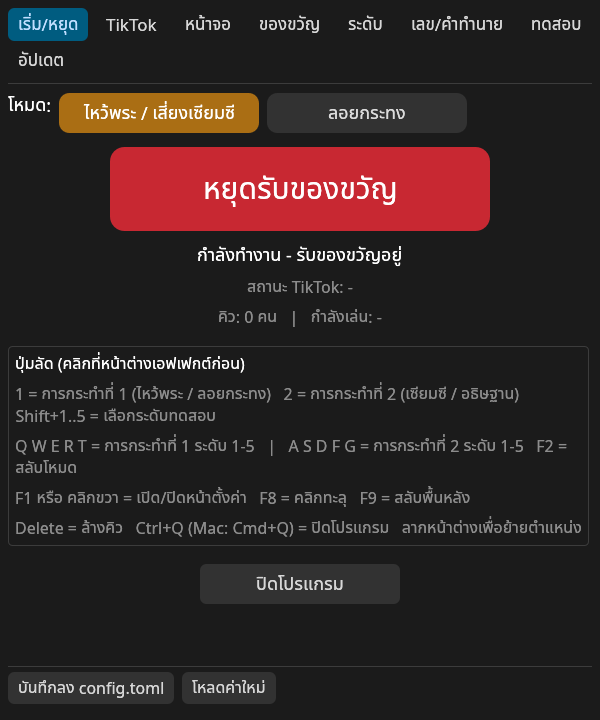
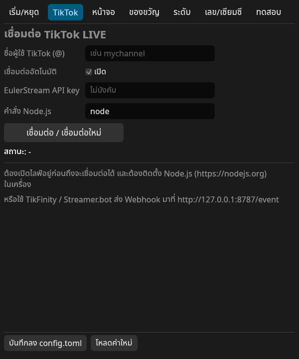
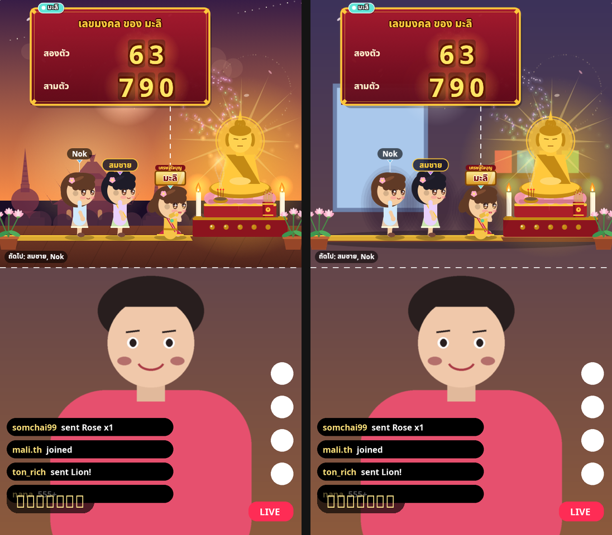
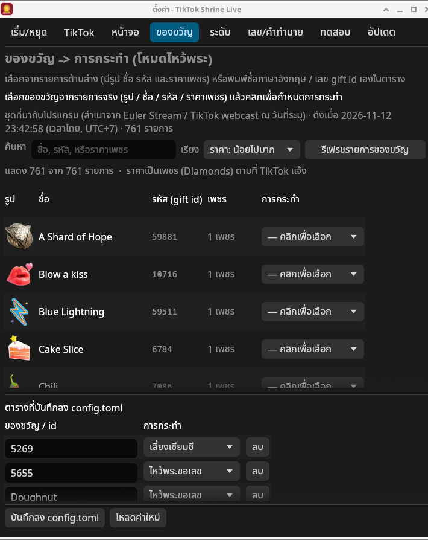
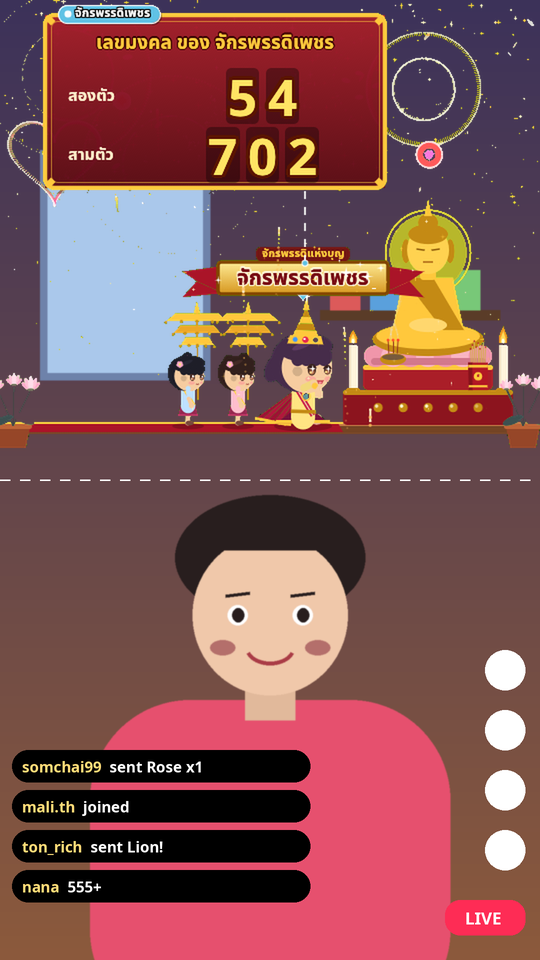
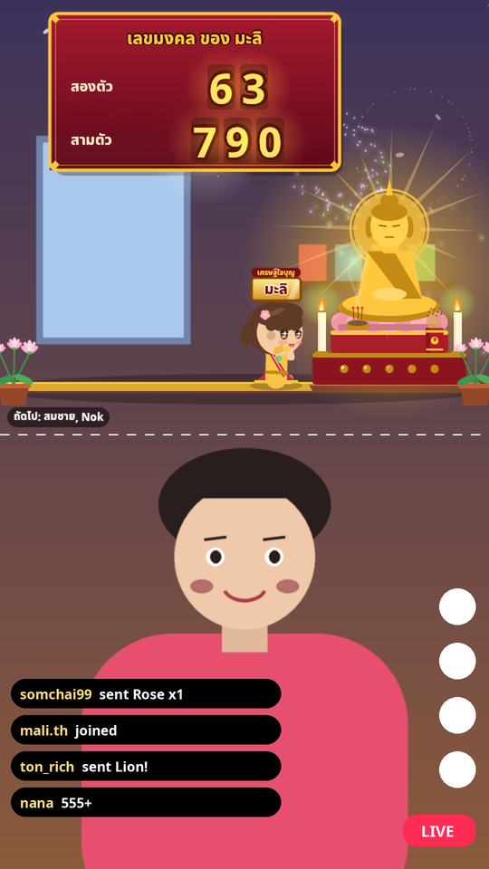
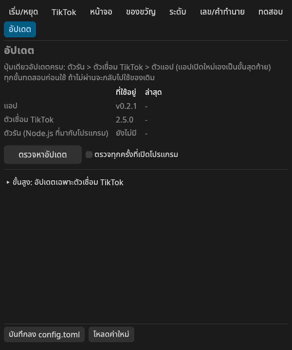

# ติดตั้งและไลฟ์บน Windows (ทีละขั้น)

คู่มือนี้สำหรับ **Windows 10 / 11 (64-bit)** เท่านั้น — ใช้ Mac ให้ดู [ติดตั้ง-Mac.md](ติดตั้ง-Mac.md)
**ไม่ต้องติดตั้ง Node.js หรือโปรแกรมอื่นเพิ่ม** ตัวเชื่อม TikTok มากับโปรแกรมแล้ว

> สารบัญ: [1 ดาวน์โหลด](#1-ดาวน์โหลด) · [2 แตกไฟล์](#2-แตกไฟล์) · [3 เปิดครั้งแรก](#3-เปิดครั้งแรก-หน้าจอสีน้ำเงิน-windows-protected-your-pc) · [4 ใส่ชื่อ TikTok](#4-ใส่ชื่อ-tiktok) · [5 เลือกโหมด/พื้นหลัง](#5-เลือกโหมด-พื้นหลัง-และขนาด) · [6 ใส่ในโปรแกรมไลฟ์](#6-ใส่เอฟเฟกต์ในโปรแกรมไลฟ์) · [7 มือถือเป็นกล้อง](#7-ใช้มือถือเป็นกล้อง) · [8 เริ่มไลฟ์](#8-เริ่มไลฟ์) · [9 อัปเดต](#9-อัปเดต) · [10 แก้ปัญหา](#10-แก้ปัญหา)

---

## 1. ดาวน์โหลด

1. เปิด https://github.com/samaboon/tiktok-shrine-live/releases/latest
2. ในหัวข้อ **Assets** กดไฟล์ **`TikTokShrineLive-Windows-x64.zip`** (ไฟล์อื่นไม่ต้องโหลด)

## 2. แตกไฟล์

1. เปิดโฟลเดอร์ **Downloads** → **คลิกขวา** ที่ `TikTokShrineLive-Windows-x64.zip` → **Extract All… (แตกไฟล์ทั้งหมด)**
2. เลือกที่เก็บ เช่น `เอกสาร\TikTokShrineLive` → กด **Extract**
   ⚠️ อย่าดับเบิลคลิกเปิดจากใน zip ตรง ๆ (จะบันทึกการตั้งค่าไม่ได้)
3. ในโฟลเดอร์จะมี
   - `TikTokShrineLive.exe` ← ตัวโปรแกรม
   - `runtime\` ← ตัวรันตัวเชื่อม TikTok (**อย่าลบ**)
   - `config.toml` ← การตั้งค่า (แก้ในโปรแกรมได้ ไม่ต้องเปิดไฟล์เอง)

## 3. เปิดครั้งแรก (หน้าจอสีน้ำเงิน "Windows protected your PC")

1. ดับเบิลคลิก `TikTokShrineLive.exe`
2. ถ้าขึ้นหน้าจอสีน้ำเงิน **"Windows protected your PC"** (Microsoft Defender SmartScreen) — เกิดเพราะโปรแกรมยังไม่ได้ซื้อใบรับรองดิจิทัล ไม่ได้แปลว่ามีไวรัส:
   - กดข้อความ **More info (ข้อมูลเพิ่มเติม)**
   - จะมีปุ่ม **Run anyway (เรียกใช้ต่อไป)** โผล่ขึ้นมา → กด
   - ทำครั้งเดียว ครั้งต่อไปเปิดได้เลย
   - ถ้า **ไม่มีปุ่ม Run anyway**: เครื่องบริษัท/โรงเรียนอาจถูกล็อกไว้ หรือเปิด **Smart App Control** (Windows 11) อยู่ — ต้องให้ผู้ดูแลเครื่องอนุญาต
3. ถ้า Windows Firewall ถาม ให้กด **Allow** (โปรแกรมเปิดพอร์ตเฉพาะในเครื่อง `127.0.0.1:8787` ไว้ทดสอบ)
4. จะมี **2 หน้าต่าง**:
   - **หน้าต่างเอฟเฟกต์** (ไม่มีขอบ) ← อันนี้ที่ผู้ชมเห็น ลากย้ายได้
   - **หน้าต่างตั้งค่า** (พื้นดำ มีแท็บ) ← แผงควบคุมของเรา ไม่ติดในไลฟ์ · เปิด/ปิดด้วย **F1** หรือ **คลิกขวา** ที่หน้าต่างเอฟเฟกต์

## 4. ใส่ชื่อ TikTok

1. หน้าตั้งค่า → แท็บ **TikTok**
2. ช่อง **ชื่อผู้ใช้ TikTok** ใส่ชื่อบัญชี **ไม่ต้องมี @** เช่น `mychannel`
3. กด **บันทึกลง config.toml** (ปุ่มล่างสุด)
4. ตอนเริ่มไลฟ์จริง (ข้อ 8) ค่อยกด **เชื่อมต่อ / เชื่อมต่อใหม่** — เชื่อมได้เฉพาะตอนที่บัญชี **กำลังไลฟ์อยู่**

## 5. เลือกโหมด พื้นหลัง และขนาด

- **โหมด** (แท็บ **เริ่ม/หยุด**): ไหว้พระ/เซียมซี · ลอยกระทง · ให้อาหารแมว (กด **F2** สลับได้ระหว่างไลฟ์)
- **พื้นหลัง** (แท็บ **หน้าจอ**):
  - **โปร่งใส** — เห็นกล้องของเรา มีแค่ตัวละคร ป้ายชื่อ การ์ด พลุ ลอยทับ (แนะนำบน Windows คู่กับ OBS ข้อ 6.1)
  - **ฉากเต็ม** — มีฉากวัด/แม่น้ำ/ห้องแมว เต็มกรอบ
  - **สีเขียว (Chroma Key)** — ใช้เมื่อโปรแกรมไลฟ์ทำพื้นใสไม่ได้
- **เลย์เอาต์**: "ส่วนบนของจอ" (ครึ่งบน หน้าเรายังเห็นด้านล่าง) หรือ "เต็มจอ 9:16"
- ทดสอบ: คลิกหน้าต่างเอฟเฟกต์ 1 ครั้ง แล้วกด `1` (ไหว้พระ) หรือ `2` (เซียมซี) · `T` = ระดับหรูสุด

| ฉากเต็ม vs โปร่งใส |
|---|
|  |

ตั้งค่าระดับความหรูและเลขมงคลเพิ่มเติมดู [คู่มือ.md](คู่มือ.md)

### ของขวัญ / สติกเกอร์ (รหัส gift id)

ในแท็บ **ของขวัญ** มีรายการสติกเกอร์ทั้งชุดพร้อม **รูป ชื่อ รหัส gift id และราคาเพชร** ค้นหาและเรียงตามราคาได้ คลิกเลือกได้ว่าของขวัญนั้นจะทำอะไรในโหมดปัจจุบัน (ไหว้พระ / เซียมซี / ลอยกระทง / ให้อาหารแมว) — ไม่ต้องพิมพ์รหัสเอง

ใส่อะไรก็ได้: **ชื่อภาษาอังกฤษตามที่ TikTok ส่งมา** (เช่น `Rose`, `TikTok`) หรือ **รหัส gift id เป็นตัวเลข** (เช่น `5655` = กุหลาบ) ดูคำอธิบายตาราง `[gifts]` / `[krathong.gifts]` / `[cat.gifts]` ใน [คู่มือ ข้อ 6.1](คู่มือ.md#61-ของขวัญ--การกระทำ-แท็บ-ของขวัญ) และตารางครบชุดใน [รายการของขวัญ](รายการของขวัญ.md)

## 6. ใส่เอฟเฟกต์ในโปรแกรมไลฟ์

### 6.1 OBS Studio — พื้นใสจริง (แนะนำ)
1. ดาวน์โหลด OBS ที่ https://obsproject.com แล้วติดตั้ง
2. OBS → **Settings → Video** → Base (Canvas) และ Output = **1080x1920** (จอแนวตั้ง)
3. ช่อง **Sources** → **+** → **Game Capture**
   - Mode: **Capture specific window**
   - Window: **[TikTokShrineLive.exe]: TikTok Shrine Live** (ไม่ใช่หน้าต่าง "ตั้งค่า")
   - ✅ ติ๊ก **Allow Transparency**
4. ลากกรอบไปไว้ **ครึ่งบน** ของจอ (คลิกขวา → Transform → Edit Transform เพื่อปรับละเอียด)
5. ถ้า Game Capture จับไม่ได้ (จอดำ): ใช้ **Window Capture** แทน + ตั้งพื้นหลังโปรแกรมเป็น **สีเขียว** + คลิกขวาที่ Source → **Filters** → **+** → **Chroma Key** (Key Color Type: **Green**)

### 6.2 TikTok LIVE Studio
1. ดาวน์โหลดที่ https://www.tiktok.com/studio/download แล้วล็อกอินด้วยบัญชี TikTok (บัญชีต้องมีสิทธิ์ไลฟ์)
2. ตั้งเป็นจอ **แนวตั้ง (Portrait)** → **Add source** → **Window capture** → เลือกหน้าต่าง **TikTok Shrine Live** → วางครึ่งบน
3. ถ้าพื้นหลังหน้าต่างเป็นสีดำ/ไม่ใส: ทำภาพใน OBS ตามข้อ 6.1 แล้วกด **Start Virtual Camera** ใน OBS → ใน LIVE Studio เพิ่มกล้อง **OBS Virtual Camera** แทน

> เมนูของ LIVE Studio เปลี่ยนตามรุ่น — ยังไม่ได้ทดสอบกับ LIVE Studio รุ่นจริง

## 7. ใช้มือถือเป็นกล้อง

> ไลฟ์จาก **แอป TikTok บนมือถือโดยตรง จะใส่เอฟเฟกต์นี้ไม่ได้** — ต้องให้มือถือเป็น "กล้อง" ของคอม แล้วไลฟ์จากคอม (OBS หรือ LIVE Studio)

เลือกวิธีเดียว:

- **Android + Windows 11 → Phone Link (มีในระบบ ไม่ต้องลงโปรแกรมบนคอม)**
  ต้องมี Windows 11, Android 10 ขึ้นไป, แอป **Link to Windows** บนมือถือ (รุ่น 1.24022.0 ขึ้นไป)
  1. คอม: **Settings → Bluetooth & devices → Mobile devices** → ถ้ายังไม่ได้เชื่อมมือถือ กด **Add device** แล้วสแกน QR ด้วยแอป Link to Windows บนมือถือ (บางรุ่นต้องเปิดสวิตช์อนุญาตและกด **Manage devices** ก่อน)
  2. เลือกมือถือของเรา แล้วเปิดสวิตช์ **Use as connected camera**
  3. ในมือถือกดอนุญาตกล้องให้ Link to Windows
  4. ใน OBS: Sources → **+** → **Video Capture Device** → เลือกกล้องมือถือ
- **Android หรือ iPhone → Camo**: ลงแอป **Camo** บนมือถือ + **Camo Studio** บน Windows (ตอนเปิดครั้งแรกให้ติดตั้ง camera extension ตามที่โปรแกรมบอก) → เชื่อมด้วยสาย USB หรือสแกน QR ผ่าน Wi-Fi → ใน OBS เลือกกล้อง **Camo Camera** (Android ต่อสาย USB ต้องเปิด USB debugging)
- **Android → DroidCam**: ลงแอป DroidCam บนมือถือ แล้วบนคอมใช้ **ปลั๊กอิน DroidCam สำหรับ OBS** (โหลดให้ตรงรุ่น OBS ที่ https://droidcam.app/obs/) → ใน OBS เพิ่ม Source **DroidCam** → **Use WiFi** ใส่ WiFi IP ที่แอปมือถือแสดง → **Activate** (หรือใช้ **DroidCam Windows Client** แล้วเลือกกล้อง **DroidCam Webcam**) · รุ่นฟรีได้ความละเอียดมาตรฐาน

**จัดฉากใน OBS:** ให้ Source กล้องมือถือ **อยู่ล่าง** (เต็มจอ: คลิกขวา → Transform → Fit to screen) และ Source หน้าต่างเอฟเฟกต์ **อยู่บน** ในรายการ Sources → เพิ่มไมค์: Sources → **+** → **Audio Input Capture**

## 8. เริ่มไลฟ์

1. **เริ่มไลฟ์ให้ขึ้นก่อน**
   - **OBS + Stream Key**: บนเบราว์เซอร์ล็อกอิน TikTok → **LIVE Center** (https://livecenter.tiktok.com) → ได้ **Server URL** + **Stream Key** → OBS: **Settings → Stream** → Service: **Custom…** → วางทั้งสองค่า → **Start Streaming** (ไม่ใช่ทุกบัญชีมี Stream Key — TikTok เป็นคนให้สิทธิ์ · ห้ามให้ใครเห็น Stream Key)
   - หรือ **TikTok LIVE Studio** → กด Go LIVE
2. กลับมาที่หน้าตั้งค่า → แท็บ **TikTok** → **เชื่อมต่อ / เชื่อมต่อใหม่** → รอสถานะ **"เชื่อมต่อแล้ว @ชื่อคุณ"**
3. ให้เพื่อนส่งกุหลาบ 1 ดอกทดสอบ หรือกด `1` ที่หน้าต่างเอฟเฟกต์
4. (แนะนำ) เปิด **คลิกทะลุ** (F8) กันเผลอคลิกโดนหน้าต่างเอฟเฟกต์

## 9. อัปเดต

- โปรแกรมตรวจเองทุกครั้งที่เปิด ถ้ามีของใหม่จะมีแถบสีส้มบนหน้าตั้งค่า กดปุ่ม **"มีอัปเดต — กดเพื่ออัปเดต"** ปุ่มเดียว
- โปรแกรมจะอัปเดตให้ครบ: **ตัวรัน → ตัวเชื่อม TikTok → ตัวโปรแกรม** แล้ว **เปิดใหม่เอง** (การตั้งค่าเดิมอยู่ครบ)
- ทุกขั้นทดสอบก่อนใช้ ถ้าของใหม่เปิดไม่ได้ จะกลับไปใช้ของเดิมเองและขึ้นข้อความบอก
- ดูเวอร์ชันหรือกดตรวจเองได้ที่แท็บ **อัปเดต**

## 10. แก้ปัญหา

| อาการ | วิธีแก้ |
|---|---|
| ไม่มีปุ่ม **Run anyway** | เครื่องถูกจำกัดโดยผู้ดูแล หรือเปิด Smart App Control อยู่ → ให้ผู้ดูแลเครื่องอนุญาต |
| เปิดแล้วถามซ้ำทุกครั้ง | คลิกขวา `TikTokShrineLive.exe` → **Properties** → แท็บ General ติ๊ก **Unblock** → OK |
| "เชื่อมต่อไม่ได้ (… ไม่ได้ไลฟ์อยู่?)" | ต้องเริ่มไลฟ์ก่อน · ตรวจชื่อผู้ใช้ (ไม่มี @) · รอ โปรแกรมลองใหม่เองทุก 15 วินาที |
| "ไม่พบตัวรันตัวเชื่อม" | โฟลเดอร์ `runtime` หาย → กดอัปเดต หรือดาวน์โหลด zip ใหม่แล้วแตกไฟล์ทับ |
| เคยใช้ได้ วันหนึ่งเชื่อมไม่ได้ | TikTok เปลี่ยนระบบ → กด **มีอัปเดต — กดเพื่ออัปเดต** (ถ้ามี) |
| พื้นหลังดำใน OBS | Game Capture ต้องติ๊ก **Allow Transparency** · หรือใช้พื้นหลังสีเขียว + Chroma Key |
| คลิก/ลากหน้าต่างไม่ได้ | ปิดคลิกทะลุ: กด **F8** หรือปิดในแท็บหน้าจอ |
| หาหน้าตั้งค่าไม่เจอ | คลิกขวาที่หน้าต่างเอฟเฟกต์ หรือกด **F1** |
| อยากรีเซ็ตการตั้งค่า | ปิดโปรแกรม ลบ `config.toml` ในโฟลเดอร์โปรแกรม แล้วเปิดใหม่ |

ข้อมูลอ้างอิง (ตรวจเมื่อ พ.ย. 2026 เมนูอาจเปลี่ยนตามรุ่น): [OBS Game Capture](https://obsproject.com/kb/game-capture-source) · [Microsoft: ใช้กล้องมือถือ](https://support.microsoft.com/en-us/windows/apps/phonelink/use-your-mobile-device-s-camera) · [DroidCam](https://droidcam.app/) · [Camo](https://camo.com/support/camo/camo-getting-started)
